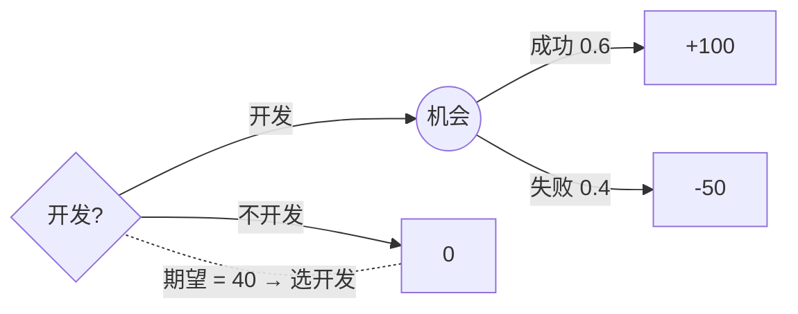

# 运筹学-决策分析

> 所属阶段：[[🧭 阶段3-随机与动态决策|🧭 第3阶段：随机与动态决策]]

## 这个知识点解决什么问题？

**我们遇到的麻烦**：面对不确定结果的选择（要不要上新产品、要不要买情报），单凭直觉决策会系统性偏差。**决策分析**把"决策—不确定事件—结果价值"画成**决策树**，用**期望值准则**与**期望效用理论**系统比较备选方案，并量化**信息价值**（情报值多少钱）。它是 MIT 15.053 课程的核心模块之一，也是 [[运筹学-Markov决策过程]]（序贯随机决策）与 [[运筹学-随机规划]]（不确定参数优化）的决策论基础。

## 核心概念

### 1. 决策树（Decision Tree）

- **方形节点** = 决策点（你选择）；**圆形节点** = 机会点（自然选择，带概率）；叶子 = 结果价值。
- 求解：**向后归纳**（rollback）——从叶子向根逐层：机会点取期望，决策点取最大/最小。
- 与 [[运筹学-动态规划]] 同一递推思想，只是"自然"也在做决策。

### 2. 期望值准则与期望效用

- **期望值准则**：选 $E[\text{价值}]$ 最大的方案。
- **风险偏好**：期望值最大化假设风险中性。风险厌恶者用**效用函数** $u(\cdot)$（凹函数）：选 $E[u(\text{价值})]$ 最大。**效用函数的凹性 = 确定性溢价**（愿意付钱消除波动）。
- **风险溢价** $=E[X]-u^{-1}(E[u(X)])$：风险厌恶者为消除风险愿意放弃的金额。

### 3. 信息价值

- **EVPI（完全信息期望价值）** = 知道真相后决策的期望收益 − 现在最优决策的期望收益。
- **EVSI（采样信息价值）**：不完全信息的价值 = 采样前后决策期望收益之差（≤ EVPI）。
- **意义**：EVPI 给出"情报采购"的价格上限——超过它买情报不划算。

## 一个最小例子（手算）

要不要开发新产品：成功概率 0.6（收益 +100 万）、失败 0.4（−50 万）。

- 期望值：$0.6\times100+0.4\times(-50)=40$ 万 → 开发。
- **EVPI**：若提前知道结果——成功就开发（100），失败就不开发（0），期望 $0.6\times100+0.4\times0=60$。EVPI $=60-40=20$ 万。**市场调研的价值上限 20 万**。
- 风险厌恶检验：$u(x)=\sqrt{x+50}$（凹），$E[u]=0.6\sqrt{150}+0.4\sqrt{0}=7.35$；确定性等价 $u^{-1}(7.35)=7.35^2-50=4$ 万 < 40 万 → 风险厌恶者只愿付约 4 万的确定性等价，更可能不开发。

**决策树示意**（方框=决策，圆=机会；rollback 从右向左：机会点取期望、决策点取最大）：



### 进阶例子：先调研再决策（两阶段决策树）

产品开发前可花 $c=5$ 万做市场调研，结果"好/差"与真实需求相关：需求高（H，概率 0.5）时调研"好"概率 0.9；需求低（L，概率 0.5）时调研"好"概率 0.2。开发成本 30，需求高收益 120、低收益 0（不开发收益 0）。

1. **后验概率**（贝叶斯更新）：$P(H\mid\text{好})=\frac{0.9\times0.5}{0.9\times0.5+0.2\times0.5}=0.82$；$P(H\mid\text{差})=\frac{0.1\times0.5}{0.1\times0.5+0.8\times0.5}=0.11$。调研结果本身的概率：$P(\text{好})=0.9\times0.5+0.2\times0.5=0.55$、$P(\text{差})=0.45$。
2. **调研"好"后**：开发期望 $0.82\times(120-30)+0.18\times(-30)=73.8-5.4=68.4>0$ → 开发。
3. **调研"差"后**：开发期望 $0.11\times90-0.89\times30=9.9-26.7=-16.8<0$ → 不开发。
4. **调研本身价值（EVSI）**：调研决策的期望收益（未扣费）$=0.55\times68.4+0.45\times0=37.62$；扣除调研费 5 万后 $37.62-5=32.62$ vs 不调研直接开发 $0.5\times90+0.5\times(-30)=30$ → **EVSI $=37.62-30=7.62$ 万 > 调研费 5 万，应该买这个调研**（净增益 2.62 万）。

> 关键教训：**信息有价格**——EVSI（7.62）必须与信息成本（5）比较：EVSI > 成本才买。若调研费涨到 10 万（> EVSI），则不该买。

## 常见误区

- **误区 1**：期望值最大化适用于所有决策者。风险中性才适用；大额/极端结果下必须用期望效用。
- **误区 2**：把概率当确定性。决策树里机会点必须用概率加权，事后"早知道"不能反推决策质量（结果≠决策质量）。
- **误区 3**：EVPI 无限买情报。EVPI 是理论上限，实际调研信息（EVSI）价值更低且要付调研成本。

## 最小自测

- [ ] 画出"开发/不开发"决策树并 rollback 求最优与期望收益。
- [ ] 计算上例 EVPI 并解释其管理含义。
- [ ] 解释为什么风险厌恶者会接受低于期望值的"确定性等价"。

## 学完后可以完成

```dataview
LIST
FROM "03-Projects"
WHERE contains(requires, this.file.link)
SORT assignment_level ASC, file.name ASC
```
