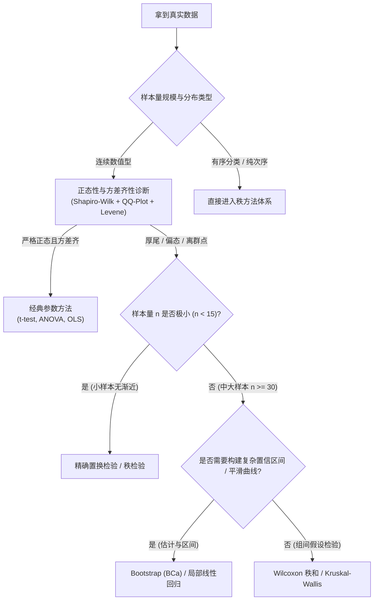

# 非参数统计-参数与非参数方法选型决策

---

## 0. 先判断它值不值得深挖

- **类别**：**A 类（端到端统计实务决策总揽）**
- **判断理由**：统计分析中最致命的错误往往不是公式算错，而是**选型错误**——在严重偏态数据上滥用 t 检验导致结论造假，或在理想正态小样本上滥用秩检验损失功效。本卡建立完整的诊断检验与选型决策树，是指引全部非参数工具落地的作战地图。
- **验收模式说明**：诊断流程梳理、全景方法对照矩阵、决策树推演、真实案例选型自测。

---

## 1. 统计方法选型诊断全景流程



---

## 2. 经典参数 vs 非参数方法终极对照表

| 实验设计与推断目标 | 经典参数方法 | 非参数秩方法 | 现代重抽样方法 | 非参数方法核心优势 |
| :--- | :--- | :--- | :--- | :--- |
| **单样本位置 / 配对差值** | 单样本 / 配对 t 检验 | **Wilcoxon 符号秩检验** | 单样本 Bootstrap 区间 | 抗重尾，正态 ARE 高达 $95.5\%$ |
| **两独立样本比较** | 独立两样本 t 检验 (Student / Welch) | **Mann-Whitney U 秩和检验** | 两样本置换检验 (Permutation) | 完全不受离群点与量纲单调变换影响 |
| **单因素多组独立比较** | 单因素方差分析 (One-way ANOVA) | **Kruskal-Wallis 检验** | 置换 ANOVA | 无需方差齐性假设，结合 Nemenyi 事后检验 |
| **双因素随机区组 / 重复测量** | 双因素配伍 ANOVA | **Friedman 检验** | 区组置换检验 (Block Permutation) | 消除受试者个体基线异质性 |
| **双变量关联分析** | Pearson 线性相关系数 $r$ | **Spearman $\rho$ / Kendall $\tau$** | 置换相关检验 | 捕捉任意单调非线性依赖关系 |
| **连续概率分布拟合** | 卡方拟合优度检验 (需分组) | **Kolmogorov-Smirnov / CvM 检验** | Bootstrap 修正 Lilliefors 检验 | 无需人为划分 bin 区间，全域一致检验 |
| **函数曲线与非线性回归** | 多项式回归 / 线性 OLS | **局部多项式 (LOESS) / 样条回归** | Bootstrap 曲线置信带 | 自适应恢复任意未知曲面，无模型失配风险 |

---

## 3. 实务选型三大铁律与陷阱防范

1. **大样本中心极限定理不能掩盖离群点的方差爆炸**：
   - *陷阱*：有人认为“只要 $n > 30$，根据 CLT 无论什么数据都能做 t 检验”。
   - *真理*：即使 CLT 保证了均值的渐近正态，离群点会使样本方差 $s^2$ 剧烈膨胀，导致检验分母巨大、$t$ 统计量趋于 0、功效降为 0（无法检测出真实差异）。此时必须使用 Wilcoxon 或置换检验。
2. **两组形状不同时谨慎解读中位数**：
   - *陷阱*：将 Mann-Whitney 检验显著直接等同于“两组中位数不相等”。
   - *真理*：Mann-Whitney 检验的本质是随机优势 $P(X > Y) = 0.5$。只有在满足“纯平移假设”时才代表中位数差。
3. **不要在已经使用非参数回归后再盲目套用全局正态统计量**。

---

## 4. 闭卷验收与决策推演

- [ ] **决策树复述**：针对“配对小样本且存在 2 个爆表离群点”，写出最佳检验选型路径及排除 t 检验的理由。
- [ ] **对照表默写**：默写单样本、两样本、多组、关联性 4 大场景下的参数与非参数对应工具。

---

## 5. 给 Obsidian 的归档建议
- **归档目录**：`02-Knowledge/🧠 学习系统/32-非参数统计/04-Bootstrap与现代应用/`
- **标签**：`#学习 #非参数统计 #方法选型 #决策树`


---

## 🎯 学完后可以完成

```dataview
LIST
FROM "03-Projects/32-非参数统计"
WHERE contains(requires, this.file.link)
SORT assignment_level ASC, file.name ASC
```
