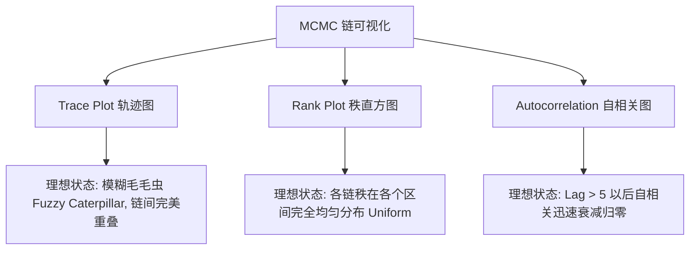

# 贝叶斯统计-MCMC收敛诊断与采样质量评估

> 所属阶段：[[🧭 阶段2-计算贝叶斯|阶段2：计算贝叶斯]]

---

## 1. 为什么不能直接信任 MCMC 采出的样本？

MCMC 生成的样本**不是相互独立的**，且如果采样链被困在局部多峰的某一个峡谷中，单条链的样本均值与方差会给出极其自信但完全错误的推断。

因此，现代贝叶斯推断必须依靠**多链并行运行（至少 4 条独立链）**与**严格的形式化收敛指标**来为采样质量背书。

---

## 2. Gelman-Rubin 潜在尺度缩减因子 ($\hat{R}$)

$\hat{R}$ 指标的核心逻辑是：**比较链间变异 (Between-chain Variance) 与链内变异 (Within-chain Variance)**。如果所有链都已经收敛到同一平稳分布，链间的平均差异应当与每条链内部的波动完全一致（$\hat{R} \to 1.0$）。

### (1) 经典代数定义
设运行 $m$ 条独立链，每条链在弃去预热期后保留 $n$ 个样本，$\theta_{mj}$ 表示第 $m$ 条链的第 $j$ 个样本：
- **各链均值与总均值**：$\bar{\theta}_m = \frac{1}{n} \sum_{j=1}^n \theta_{mj}, \quad \bar{\theta}_{\cdot\cdot} = \frac{1}{m} \sum_{m=1}^m \bar{\theta}_m$；
- **链间方差 (Between-chain Variance $B$)**：
  $$B = \frac{n}{m - 1} \sum_{m=1}^m (\bar{\theta}_m - \bar{\theta}_{\cdot\cdot})^2$$
- **链内方差 (Within-chain Variance $W$)**：
  $$s_m^2 = \frac{1}{n - 1} \sum_{j=1}^n (\theta_{mj} - \bar{\theta}_m)^2, \quad W = \frac{1}{m} \sum_{m=1}^m s_m^2$$
- **边际方差无偏估计量 $\widehat{\text{Var}}^+(\theta \mid y)$**：
  $$\widehat{\text{Var}}^+(\theta \mid y) = \frac{n - 1}{n} W + \frac{1}{n} B$$

由此定义 $\hat{R}$：
$$\hat{R} \triangleq \sqrt{\frac{\widehat{\text{Var}}^+(\theta \mid y)}{W}} = \sqrt{\frac{n - 1}{n} + \frac{1}{n} \frac{B}{W}}$$

### (2) 现代 Rank-Normalized Folded $\hat{R}$ (Vehtari et al., 2021)
经典 $\hat{R}$ 在面对重尾分布或方差无限时会彻底失效。现代 ArviZ / PyMC 5.x 采用**秩归一化与折叠变换**：
1. 将所有链的样本混合并转化为均匀分布的秩 (Ranks)，再通过标准正态逆累积函数映射为正态变量；
2. 对绝对离差折叠 $|\theta - \text{median}|$ 再次计算 $\hat{R}$，以诊断尺度的不收敛；
3. **现代工业判决门槛**：所有参数的 $\hat{R} < \mathbf{1.01}$（传统 1.10 的老旧标准已被淘汰）。

---

## 3. 有效样本量 (Effective Sample Size, ESS)

由于相邻样本具有正自相关性 $\rho_k = \text{Corr}(\theta_t, \theta_{t+k}) > 0$，实际 $N$ 个相关样本提供的信息量等价于更少数量的独立样本。

### (1) 积分自相关时间 $\tau_{\text{int}}$
$$\tau_{\text{int}} \triangleq 1 + 2 \sum_{k=1}^\infty \rho_k$$
总有效样本量为：
$$\text{ESS} \triangleq \frac{m \cdot n}{\tau_{\text{int}}}$$

### (2) 分段 ESS 诊断
1. **Bulk-ESS**：基于秩转换评估分布中心区域（均值、中位数）的抽样效率，建议 $\text{Bulk-ESS} > 400$；
2. **Tail-ESS**：基于外侧分位数（如 5% 与 95% 极端分位）评估尾部不确定性的精度，建议 $\text{Tail-ESS} > 400$。

---

## 4. 蒙特卡洛标准误差 (MCSE)

MCSE 衡量由于**有限采样步数**带来的数值计算误差：
$$\text{MCSE}(\hat{\mu}) = \frac{\hat{\sigma}}{\sqrt{\text{Bulk-ESS}}}$$
- **判定标准**：$\text{MCSE}$ 必须小于后验标准差 $\hat{\sigma}$ 的 $5\%$（$\text{MCSE} < 0.05 \hat{\sigma}$），确保汇报的置信区间数字在有效数字位数上绝对稳定。

---

## 5. 可视化诊断：毛毛虫图 (Trace Plots) 与秩图 (Rank Plots)



---

## 6. 主动回忆与闭卷自测

- [ ] 默写链内方差 $W$ 与链间方差 $B$ 的计算公式，并推导 $\hat{R}$；
- [ ] 解释为什么自相关系数 $\rho_k$ 会导致 $\text{ESS} < N$；
- [ ] 为什么现代贝叶斯推断中 $\hat{R} < 1.01$ 是比 $\hat{R} < 1.10$ 更严苛的防线？

> [!tip]- 闭卷自测参考答案与思维误区
> 1. **$\hat{R}$ 闭卷推导**：
>    $W = \frac{1}{m} \sum_{m=1}^m s_m^2$（各链样本方差均值）；$B = \frac{n}{m-1} \sum_{m=1}^m (\bar{\theta}_m - \bar{\theta}_{\cdot\cdot})^2$（各链均值的离差平方和 $\times n$）；
>    无偏方差估计 $\widehat{\text{Var}}^+ = \frac{n-1}{n} W + \frac{1}{n} B$，由此 $\hat{R} = \sqrt{\frac{\widehat{\text{Var}}^+}{W}}$。若链未混合，$\bar{\theta}_m$ 彼此远离导致 $B \gg W$，$\hat{R} \gg 1.0$。
> 2. **自相关与有效样本量**：
>    样本均值的方差为 $\text{Var}(\bar{\theta}) = \frac{\sigma^2}{N} \left( 1 + 2 \sum_{k=1}^\infty \rho_k \right) = \frac{\sigma^2}{\text{ESS}}$。正自相关使得每个新样本包含大量与上一时刻重复的冗余信息，相当于真实独立信息量被压缩为 $N / \tau_{\text{int}}$。
> 3. **$\hat{R} < 1.01$ 严苛防线**：
>    Vehtari (2021) 证明在长尾或多峰分布下，即便单参数的均值看起来混合（$\hat{R} \approx 1.08$），其方差或分位数仍可能存在高达 20% 的系统性估计偏差。因此现代工业标准必须结合秩归一化与折叠变换，将门槛收紧至 $\hat{R} < 1.01$。

---

## 7. 学完后可以完成

> 📌 **实战与作业通道**：本收敛诊断体系直接对接以下实践任务与自动化测试：
> - 课后实战：[[贝叶斯统计-课后作业-02-Metropolis-Hastings采样器手写实现与诊断|课后作业 02：Metropolis-Hastings 采样器手写实现与诊断]]

```dataview
LIST
FROM "03-Projects"
WHERE contains(requires, this.file.link)
SORT file.name ASC
```

- [x] 完成作业：[[03-Projects/33-贝叶斯统计/课后作业/贝叶斯统计-课后作业-02-Metropolis-Hastings采样器手写实现与诊断|课后作业 02]]；
- [x] 下一步：进入现代多层建模 [[03-层次模型与回归/🧭 阶段3-层次模型与回归|阶段 03：层次模型与回归]]。

