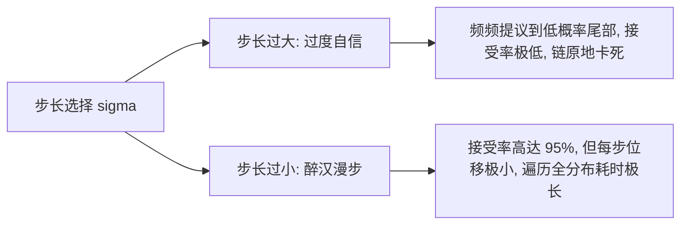

# 贝叶斯统计-马尔可夫链蒙特卡洛与Metropolis-Hastings算法

> 所属阶段：[[🧭 阶段2-计算贝叶斯|阶段2：计算贝叶斯]]

---

## 1. 核心推导任务与突破

当直接抽样不可行时，**马尔可夫链蒙特卡洛 (MCMC)** 的核心思想是：构造一个以目标后验分布 $P(\theta \mid y)$ 为**唯一平稳分布 (Stationary Distribution)** 的各态历经马尔可夫链。

MCMC 最伟大的代数优势在于：在计算接受率时，**难以计算的边际似然归一化常数 $P(y)$ 在分子分母中被精确抵消**！

---

## 2. 细致平衡条件与接受率的严密代数推导

### (1) 细致平衡条件 (Detailed Balance)
设马尔可夫链的状态转移概率密度为 $T(\theta \to \theta')$。若对任意 $\theta, \theta'$ 均满足：
$$P(\theta \mid y) T(\theta \to \theta') = P(\theta' \mid y) T(\theta' \to \theta)$$
则两端对 $\theta$ 积分：
$$\int P(\theta \mid y) T(\theta \to \theta') d\theta = \int P(\theta' \mid y) T(\theta' \to \theta) d\theta = P(\theta' \mid y) \int T(\theta' \to \theta) d\theta = P(\theta' \mid y)$$
**结论**：细致平衡条件是保证 $P(\theta \mid y)$ 为该马尔可夫链平稳分布的充分条件。

### (2) 提议-接受机制与 $\alpha(\theta, \theta')$ 推导
将状态转移过程拆解为两步：
1. **提议 (Proposal)**：从建议分布 $q(\theta' \mid \theta)$ 中生成候选状态 $\theta'$；
2. **接受 (Acceptance)**：以概率 $\alpha(\theta, \theta') \in [0, 1]$ 接受提议，否则保持原状态 $\theta$。

因此实际转移核为 $T(\theta \to \theta') = q(\theta' \mid \theta) \alpha(\theta, \theta')$（当 $\theta \neq \theta'$ 时）。代入细致平衡方程：
$$P(\theta \mid y) q(\theta' \mid \theta) \alpha(\theta, \theta') = P(\theta' \mid y) q(\theta \mid \theta') \alpha(\theta', \theta)$$
移项得到接受率之比：
$$\frac{\alpha(\theta, \theta')}{\alpha(\theta', \theta)} = \frac{P(\theta' \mid y) q(\theta \mid \theta')}{P(\theta \mid y) q(\theta' \mid \theta)}$$

为使采样链尽可能快地探索空间（使 $\alpha$ 最大化且不超过 1），Metropolis-Hastings 选取：
$$\alpha(\theta, \theta') = \min\left( 1, \frac{P(\theta' \mid y) q(\theta \mid \theta')}{P(\theta \mid y) q(\theta' \mid \theta)} \right)$$

### (3) 归一化常数完全消去证明
将未归一化后验 $P^*(\theta \mid y) = P(y \mid \theta) P(\theta)$（其中 $P(\theta \mid y) = \frac{P^*(\theta \mid y)}{P(y)}$）代入接受率公式：
$$\frac{P(\theta' \mid y)}{P(\theta \mid y)} = \frac{\frac{P^*(\theta' \mid y)}{P(y)}}{\frac{P^*(\theta \mid y)}{P(y)}} = \frac{P^*(\theta' \mid y)}{P^*(\theta \mid y)} = \frac{P(y \mid \theta') P(\theta')}{P(y \mid \theta) P(\theta)}$$
**分母积分 $P(y)$ 被精确抹平**，彻底解决了高维积分不可解的问题！

---

## 3. 随机游走 M-H (Random-Walk MH) 与步长调优

当建议分布为对称分布（如高斯分布 $q(\theta' \mid \theta) = \mathcal{N}(\theta' \mid \theta, \sigma^2 I)$）时，$q(\theta \mid \theta') = q(\theta' \mid \theta)$，接受率简化为标准的 **Metropolis 准则**：
$$\alpha(\theta, \theta') = \min\left( 1, \frac{P^*(\theta' \mid y)}{P^*(\theta \mid y)} \right)$$

### 提议步长 (Proposal Scale $\sigma$) 的权衡困境

- **理论黄金接受率 (Roberts & Rosenthal 极限准则)**：
  - 1 维参数空间：最优接受率约为 **0.44**；
  - 随着维度 $D \to \infty$：高斯后验的最优接受率渐近收敛于 **0.234**。

---

## 4. 主动回忆与闭卷自测

- [ ] 在草稿纸上完整写出细致平衡条件到 M-H 接受概率 $\alpha(\theta, \theta')$ 的推导；
- [ ] 说明为什么非对称提议分布（如 $\theta' \sim \text{Log-Normal}$）必须在接受率中乘上修正因子 $\frac{q(\theta \mid \theta')}{q(\theta' \mid \theta)}$；
- [ ] 解释预热期 (Burn-in / Warmup) 的统计意义与剔除原因。

> [!tip]- 闭卷自测参考答案与思维误区
> 1. **细致平衡推导核心**：由 $P(\theta)q(\theta'\mid\theta)\alpha(\theta, \theta') = P(\theta')q(\theta\mid\theta')\alpha(\theta', \theta)$。若 $\frac{P(\theta')q(\theta\mid\theta')}{P(\theta)q(\theta'\mid\theta)} \ge 1$，令 $\alpha(\theta, \theta') = 1$，则 $\alpha(\theta', \theta) = \frac{P(\theta)q(\theta'\mid\theta)}{P(\theta')q(\theta\mid\theta')} \le 1$。综合两式即得 Hastings 最小化修正解 $\alpha = \min(1, \text{Ratio})$。
> 2. **非对称修正因子**：若从 $\theta$ 跳到 $\theta'$ 极易发生（$q(\theta'\mid\theta)$ 很大），而反向跳回 $\theta$ 极难发生（$q(\theta\mid\theta')$ 很小），该几何偏倚会破坏马氏链的时间反演对称性。乘上 Hastings 修正项 $\frac{q(\theta\mid\theta')}{q(\theta'\mid\theta)}$ 恰好抵消了提议分布本身的不对称流动，维持平稳测度。
> 3. **预热期（Burn-in）意义**：马氏链从任意初始位置 $\theta^{(0)}$ 开始时，前几百步尚未达到平稳分布，受到初始点的强烈偏倚。必须剔除前 1000 步的瞬态轨迹，只保留平稳遍历状态下的后验样本。

---

## 5. 学完后可以完成

> 📌 **实战与作业通道**：本推导直接对接以下核心采样器构建任务：
> - 课后实战：[[贝叶斯统计-课后作业-02-Metropolis-Hastings采样器手写实现与诊断|课后作业 02：Metropolis-Hastings 采样器手写实现与诊断]]

```dataview
LIST
FROM "03-Projects"
WHERE contains(requires, this.file.link)
SORT file.name ASC
```

- [x] 完成实战：[[03-Projects/33-贝叶斯统计/课后作业/贝叶斯统计-课后作业-02-Metropolis-Hastings采样器手写实现与诊断|课后作业 02]]；
- [x] 下一步：学习现代物理采样器 [[02-计算贝叶斯/贝叶斯统计-哈密顿蒙特卡洛与无掉头采样NUTS|哈密顿蒙特卡洛与无掉头采样 NUTS]]。

