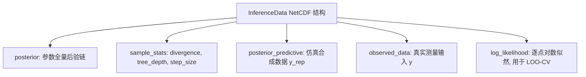

# 贝叶斯统计-PyMC概率编程工作流与参数推断

> 所属阶段：[[🧭 阶段3-层次模型与回归|阶段3：层次模型与回归]]

---

## 1. 现代概率编程 (PPL) 的设计哲学

概率编程语言 (Probabilistic Programming Language, PPL) 允许数据科学家将**生成式概率图模型直接声明为可执行代码**，并由背后的自动微分引擎（如 PyTensor）计算后验联合梯度的符号图，自动调度 NUTS 采样器。

PyMC 5.x 的核心组件架构：
1. **模型上下文 (`pm.Model`)**：管理随机变量计算图；
2. **坐标系体系 (`coords` & `dims`)**：结构化管理高维张量维度，彻底消除魔术索引 (Magic Indexing)；
3. **推断引擎 (`pm.sample`)**：高度优化的 C/JAX 编译后端；
4. **统一数据结构 (`arviz.InferenceData`)**：基于 xarray/NetCDF 标准化存储先验、后验、诊断与后验预测张量。

---

## 2. PyMC 5.x 现代代码范式：Eight-Schools 非中心化完整实现

```python
import pymc as pm
import arviz as az
import numpy as np

# 1. 准备数据与坐标系
schools = ["A", "B", "C", "D", "E", "F", "G", "H"]
y_obs = np.array([28.0, 8.0, -3.0, 7.0, -1.0, 1.0, 18.0, 12.0])
sigma_obs = np.array([15.0, 10.0, 16.0, 11.0, 9.0, 11.0, 10.0, 18.0])

coords = {"school": schools}

# 2. 构建计算图上下文
with pm.Model(coords=coords) as non_centered_eight_schools:
    # (1) 超先验 (Hyperpriors)
    mu = pm.Normal("mu", mu=0.0, sigma=10.0)
    tau = pm.HalfNormal("tau", sigma=10.0)
    
    # (2) 非中心化辅助参数 (Standard Normal Priors)
    theta_offset = pm.Normal("theta_offset", mu=0.0, sigma=1.0, dims="school")
    
    # (3) 确定性变换组参数 (Deterministic Transformation)
    theta = pm.Deterministic("theta", mu + tau * theta_offset, dims="school")
    
    # (4) 观测似然 (Likelihood)
    y = pm.Normal("y", mu=theta, sigma=sigma_obs, observed=y_obs, dims="school")
    
    # 3. 采样与推断 (4条独立链, 2000步预热 + 2000步采样)
    idata = pm.sample(
        draws=2000,
        tune=2000,
        chains=4,
        target_accept=0.95,
        random_seed=42,
        return_inferencedata=True
    )
    
    # 4. 后验预测采样 (Posterior Predictive Sampling)
    idata.extend(pm.sample_posterior_predictive(idata, random_seed=42))

# 5. 打印 ArviZ 严苛诊断摘要
summary_df = az.summary(idata, var_names=["mu", "tau", "theta"])
print(summary_df[["mean", "sd", "hdi_3%", "hdi_97%", "mcse_mean", "ess_bulk", "ess_tail", "r_hat"]])
```

---

## 3. ArviZ `InferenceData` 的五大核心数据组



- **提取 Divergence**：`diverging_count = idata.sample_stats.diverging.sum().item()`；
- **森林收缩图**：`az.plot_forest(idata, var_names=["theta"], combined=True)`，直观展现组均值向总体 $\mu$ 的收缩拉动。

---

## 4. 主动回忆与闭卷自测

- [ ] 说明 `pm.Deterministic` 与 `pm.Normal` 在计算图中的本质差异；
- [ ] 解释为什么 PyMC 5.x 推荐使用 `coords` 和 `dims` 替代一维整数索引；
- [ ] 为什么 `sample_posterior_predictive` 必须基于后验样本 `idata` 进行条件二次生成？

> [!tip]- 闭卷自测参考答案与思维误区
> 1. **`pm.Deterministic` 与 `pm.Normal` 差异**：
>    - `pm.Normal` 声明了一个具有概率测度和对数先验密度的**自由随机变量**，会被 NUTS 采样器分配动量并进行微积分梯度追踪；
>    - `pm.Deterministic` 只是由其他变量计算而来的**确定性派生节点**，无须额外的先验密度项，但在采样后会自动将其追踪记录在 `InferenceData` 的后验张量中供下游分析。
> 2. **`coords` 与 `dims` 的工程优势**：
>    消除了代码中 `shape=(8,)`、`shape=(J,)` 这种魔术硬编码数字，使得张量能够与数据集的类别标签（如学校名称、产品 SKU、省份）自动对齐，并与 ArviZ/xarray 无缝融合，大幅减少维度广播错误。
> 3. **PPC 条件二次生成**：
>    预测分布是对后验参数求全期望 $P(y^{\text{rep}} \mid y) = \int P(y^{\text{rep}}\mid\theta)P(\theta\mid y)d\theta$。因此必须以 MCMC 采出的每组参数样本 $\theta^{(s)}$ 作为生成参数代入似然分布中生成 $y^{\text{rep},(s)}$，才能忠实保留后验参数的不确定性。

---

## 5. 学完后可以完成

> 📌 **实战与作业通道**：PyMC 概率编程工作流直接支撑以下实验与作业：
> - 课后实战：[[贝叶斯统计-课后作业-03-Neal漏斗分歧诊断与非中心化参数化实验|课后作业 03：Neal 漏斗分歧诊断与非中心化参数化实验]]
> - 阶段项目：[[贝叶斯统计-阶段作业-01-PyMC层次模型与Eight-Schools收缩效应分析|阶段作业 01：PyMC 层次模型与 Eight-Schools 收缩效应分析]]

```dataview
LIST
FROM "03-Projects"
WHERE contains(requires, this.file.link)
SORT file.name ASC
```

- [x] 完成实验：[[03-Projects/33-贝叶斯统计/课后作业/贝叶斯统计-课后作业-03-Neal漏斗分歧诊断与非中心化参数化实验|课后作业 03]]；
- [x] 完成作业：[[03-Projects/33-贝叶斯统计/阶段作业/贝叶斯统计-阶段作业-01-PyMC层次模型与Eight-Schools收缩效应分析|阶段作业 01]]；
- [x] 下一步：学习广义线性模型与先验正则化 [[03-层次模型与回归/贝叶斯统计-广义线性回归与先验正则化|广义线性回归与先验正则化]]。

