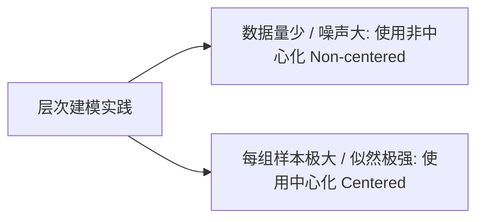

# 贝叶斯统计-层次模型与部分汇聚收缩机制

> 所属阶段：[[🧭 阶段3-层次模型与回归|阶段3：层次模型与回归]]

---

## 1. 经典困境：处理群组数据的三类策略

在现实数据中，观测数据通常按类别分组（如 $J$ 所不同学校的辅导效果、各医院的手术死亡率、各城市用户的转化率）：

1. **完全汇聚 (Complete Pooling)**：
   - 假设所有组的参数完全恒等：$\theta_1 = \theta_2 = \dots = \theta_J = \theta$；
   - **缺点**：抹杀了组间固有的异质性，导致严重的欠拟合。
2. **完全不汇聚 (No Pooling)**：
   - 各组独立拟合自己的参数 $\theta_j$，各组之间毫无通信；
   - **缺点**：对于样本量极少或噪声极大的组，估计方差极大，极易被极端离群样本误导，导致过拟合。
3. **部分汇聚 (Partial Pooling / 层次贝叶斯模型)**：
   - 假设各组的真实参数来自一个共同的**超总体分布 (Super-population)**：
     $$\theta_j \sim \mathcal{N}(\mu, \tau^2)$$
   - 各组在保留自身特异性的同时，**相互借用统计强度 (Borrowing Strength)**，自动实现自适应收缩。

---

## 2. 部分汇聚收缩因子 (Shrinkage Factor) 的数学推导

设已知各组的观测样本均值为 $\bar{y}_j$，各组观测方差为 $\sigma_j^2$：
$$y_{ij} \sim \mathcal{N}(\theta_j, \sigma_j^2), \quad i=1, \dots, n_j$$
$$\theta_j \sim \mathcal{N}(\mu, \tau^2) \quad (\text{群组层级先验})$$
$$\mu \sim \mathcal{N}(\mu_0, \sigma_0^2), \quad \tau \sim \text{Half-Normal}(\sigma_\tau) \quad (\text{超参数先验})$$

在给定总体均值 $\mu$ 与组间方差 $\tau^2$ 的条件下，组参数 $\theta_j$ 的条件后验分布为高斯分布，其后验均值为：
$$\mathbb{E}[\theta_j \mid y, \mu, \tau] = (1 - B_j) \bar{y}_j + B_j \mu$$
其中**收缩因子 (Shrinkage Factor)** $B_j \in [0, 1]$ 严格由方差之比决定：
$$B_j \triangleq \frac{\sigma_j^2}{\sigma_j^2 + \tau^2}$$

### 收缩因子的物理行为
- **若某组数据极少或噪声极大 ($\sigma_j^2 \gg \tau^2$)**：$B_j \to 1$，该组估计值被强力**收缩拉向总体均值 $\mu$**，有效防止假阳性发现；
- **若某组样本量极其丰富 ($\sigma_j^2 \ll \tau^2$)**：$B_j \to 0$，保持该组特有均值 $\bar{y}_j$；
- **若组间差异极小 ($\tau \to 0$)**：模型自适应退化为完全汇聚；若组间差异极大 ($\tau \to \infty$)，模型自适应退化为不汇聚。

---

## 3. 经典案例：八所学校实验 (Eight Schools, BDA3 Ch 5)

美国 ETS 对 8 所学校开展 SAT 辅导项目效果评估：

| 学校 (School) | 辅导提升估计值 $y_j$ | 测量标准误差 $\sigma_j$ | 经典不汇聚估计 | 层次模型收缩后估计 |
| :---: | :---: | :---: | :---: | :---: |
| **A** | 28 | 15 | 28 (过度自信) | **11.2** (强力收缩) |
| **B** | 8 | 10 | 8 | **7.9** |
| **C** | -3 | 16 | -3 (严重受噪) | **6.0** (被总体均值挽救) |
| **D** | 7 | 11 | 7 | **7.6** |
| **E** | -1 | 9 | -1 | **5.3** |
| **F** | 1 | 11 | 1 | **6.1** |
| **G** | 18 | 10 | 18 | **10.5** |
| **H** | 12 | 18 | 12 | **8.5** |

不汇聚模型声称学校 A 提升了 28 分且极其显著；而层次贝叶斯推断发现各校提升的后验均值高度集中在 6~11 分之间，成功消除了小样本高方差带来的虚假繁荣。

---

## 4. 几何奇异点：Neal's Funnel 与非中心化参数化

### (1) Neal 漏斗 (Neal's Funnel) 的致命陷阱
在层次模型中，当组间方差 $\tau \to 0$ 时，所有 $\theta_j$ 必须紧紧挤在 $\mu$ 附近。在 $(\log \tau, \theta)$ 相空间中，后验几何呈现出极其尖锐的“漏斗状（Funnel）”：
- **中心化表示 (Centered Parameterization)**：
  $$\theta_j \sim \mathcal{N}(\mu, \tau^2)$$
  在漏斗颈部，曲率梯度急剧变化，HMC Leapfrog 步长无法自适应，导致大量采样飞逸，产生严重 **Divergence (分歧警告)**。

### (2) 非中心化参数化 (Non-Centered Parameterization)
引入独立标准正态变量 $\tilde{\theta}_j \sim \mathcal{N}(0, 1)$，将组参数写为确定性仿射变换：
$$\theta_j = \mu + \tau \cdot \tilde{\theta}_j$$
- **几何解耦**：采样器只需在无相关、平滑各向同性的标准正态球面上采样 $\tilde{\theta}_j$，彻底消除了漏斗颈部的几何奇异点，Divergence 降为 0！



---

## 5. 主动回忆与闭卷自测

- [ ] 在草稿纸上推导收缩因子 $B_j$ 并在坐标轴上画出 $B_j$ 随样本量 $n_j$ 的衰减曲线；
- [ ] 解释为什么非中心化参数化能够消除 Neal's Funnel 的采样 Divergence；
- [ ] 阐述 Eight Schools 实验中“借用统计强度”的直观统计学意义。

> [!tip]- 闭卷自测参考答案与思维误区
> 1. **收缩因子 $B_j$**：
>    $B_j = \frac{\sigma_j^2}{\sigma_j^2 + \tau^2}$。当某组样本量 $n_j \to \infty$ 时，其测量标准误 $\sigma_j^2 \propto 1/n_j \to 0$，导致 $B_j \to 0$。因此后验均值 $(1-B_j)\bar{y}_j + B_j \mu \to \bar{y}_j$，数据量充足时完全依赖组内观测，数据量匮乏时自动借用超总体均值 $\mu$。
> 2. **非中心化消除散度机理**：
>    中心化下参数 $\theta_j$ 的尺度直接依赖于 $\tau$（$\theta_j \sim \mathcal{N}(\mu, \tau^2)$），当 $\tau \to 0$ 时后验几何形成无限狭窄的漏斗尖角，曲率变化极剧烈。非中心化将随机变量转换为 $\tilde{\theta}_j \sim \mathcal{N}(0, 1)$，先验完全解耦为标准正态球形流形，各方向曲率处处均匀，使得 Leapfrog 辛积分器可以大步长稳定积分而不发生飞逸。
> 3. **借用统计强度（Borrowing Strength）**：
>    在 Eight Schools 中，学校 C 样本估计为 -3 分（方差为 16^2），若单看该校数据可能会得出“辅导起反作用”的荒谬结论。但层次模型通过总体超分布意识到其他 7 所学校提升均为正值，在概率上判定该校的负值主要是测量噪声所致，自动将其向群体中心拉回至 +6.0 分，展现了层次收缩的强大纠错能力。

---

## 6. 学完后可以完成

> 📌 **实战与作业通道**：层次收缩机制与非中心化变换直接对接以下任务：
> - 课后实战：[[贝叶斯统计-课后作业-03-Neal漏斗分歧诊断与非中心化参数化实验|课后作业 03：Neal 漏斗分歧诊断与非中心化参数化实验]]
> - 阶段项目：[[贝叶斯统计-阶段作业-01-PyMC层次模型与Eight-Schools收缩效应分析|阶段作业 01：PyMC 层次模型与 Eight-Schools 收缩效应分析]]

```dataview
LIST
FROM "03-Projects"
WHERE contains(requires, this.file.link)
SORT file.name ASC
```

- [x] 完成实验：[[03-Projects/33-贝叶斯统计/课后作业/贝叶斯统计-课后作业-03-Neal漏斗分歧诊断与非中心化参数化实验|课后作业 03]]；
- [x] 完成作业：[[03-Projects/33-贝叶斯统计/阶段作业/贝叶斯统计-阶段作业-01-PyMC层次模型与Eight-Schools收缩效应分析|阶段作业 01]]；
- [x] 下一步：学习概率编程实现 [[03-层次模型与回归/贝叶斯统计-PyMC概率编程工作流与参数推断|PyMC 概率编程工作流与参数推断]]。

