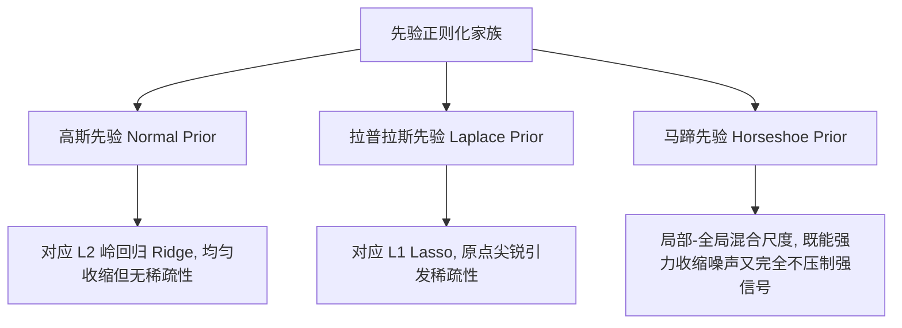

# 贝叶斯统计-广义线性回归与先验正则化

> 所属阶段：[[🧭 阶段3-层次模型与回归|阶段3：层次模型与回归]]

---

## 1. 广义线性模型 (GLM) 的统一三要素

经典线性回归要求连续正态残差，但在实际应用中，因变量常为二分类（违约/不违约）、计数（故障次数）或正偏态数据（响应时间）。

贝叶斯 GLM 将回归建立在三个核心支柱上：
1. **系统成分 (Systematic Component)**：线性预测器 $\eta_i = \alpha + x_i^T \boldsymbol{\beta}$；
2. **随机成分 (Random Component)**：观测似然 $y_i \sim \mathcal{D}(\mu_i, \phi)$（服从指数族分布）；
3. **连接函数 (Link Function)**：严格单调可导变换 $\eta_i = g(\mu_i) \iff \mu_i = g^{-1}(\eta_i)$。

---

## 2. 核心似然与过度离散 (Overdispersion) 处理

### (1) 二分类 Logit 回归
$$y_i \sim \text{Bernoulli}(p_i), \quad p_i = \text{logit}^{-1}(\eta_i) = \frac{1}{1 + \exp(-(\alpha + x_i^T \boldsymbol{\beta}))}$$

### (2) 计数数据：Poisson 回归与负二项回归 (Negative-Binomial)
- **标准泊松回归**：$\log(\lambda_i) = \alpha + x_i^T \boldsymbol{\beta}, \quad y_i \sim \text{Poisson}(\lambda_i)$；
  - **严重局限**：泊松分布强制等离散假设（$\mathbb{E}[y_i] = \text{Var}(y_i) = \lambda_i$）。在真实业务中，方差往往远大于均值（过度离散）。
- **负二项回归 (Gamma-Poisson 复合)**：引入离散度参数 $\alpha_{\text{disp}} > 0$：
  $$\text{Var}(y_i) = \mu_i + \frac{\mu_i^2}{\alpha_{\text{disp}}}$$
  当 $\alpha_{\text{disp}} \to \infty$ 时平滑退化为泊松回归，完美吸收过度方差。

---

## 3. 先验正则化与稀疏几何

高维回归（特征数 $P$ 接近甚至大于样本数 $N$）中，最大似然估计发生严重过拟合。先验分布在贝叶斯回归中充当了**数学惩罚项**的作用：

$$\log P(\boldsymbol{\beta} \mid y, X) = \log P(y \mid X, \boldsymbol{\beta}) + \log P(\boldsymbol{\beta}) + \text{Const}$$



### (1) 高斯先验 (Ridge 惩罚)
$$\beta_j \sim \mathcal{N}(0, \sigma_\beta^2) \iff \text{Penalty} = -\frac{1}{2\sigma_\beta^2} \sum \beta_j^2$$

### (2) 拉普拉斯先验 (Lasso 稀疏惩罚)
$$\beta_j \sim \text{Laplace}(0, b) \iff \text{Penalty} = -\frac{1}{b} \sum \lvert \beta_j \rvert$$

### (3) 马蹄先验 (Horseshoe Prior, Carvalho et al.)
拉普拉斯先验的缺陷是：在压缩噪声的同时，也会对真实大信号产生过度的衰减偏差（Shrinkage Bias）。
马蹄先验构造了局部-全局两层半柯西混合尺度：
$$\beta_j \sim \mathcal{N}\left(0, \tau^2 \lambda_j^2\right)$$
$$\lambda_j \sim \text{Half-Cauchy}(0, 1) \quad (\text{局部尺度: 允许个别真实特征逃脱收缩})$$
$$\tau \sim \text{Half-Cauchy}(0, \tau_0) \quad (\text{全局尺度: 强力将全局大部分噪声压制为 0})$$
马蹄先验是现代高维基因表达数据与海量稀疏特征建模的黄金标准。

---

## 4. 主动回忆与闭卷自测

- [ ] 说明为什么泊松回归在面对真实客户购买次数时常发生过度离散，负二项回归如何通过二次方差项解决该问题；
- [ ] 解释马蹄先验中“局部尺度”与“全局尺度”的分工与优势；
- [ ] 证明高斯先验的 MAP 估计等价于岭回归 (Ridge Regression)。

> [!tip]- 闭卷自测参考答案与思维误区
> 1. **过度离散机理与负二项解决**：
>    真实用户群体存在未观测到的异质性（如部分高净值忠诚客户购买率极高），导致样本方差远大于均值。负二项分布可视为参数服从 Gamma 分布的连续混合泊松分布（$\lambda_i \sim \text{Gamma}$），其方差公式 $\text{Var}(y_i) = \mu_i + \frac{\mu_i^2}{\alpha_{\text{disp}}}$ 引入了二次方差项，精准捕获长尾变异。
> 2. **马蹄先验（Horseshoe Prior）分工**：
>    - 全局尺度 $\tau$：拉向零点，强力收缩整个高维特征空间中的巨量无用噪声；
>    - 局部尺度 $\lambda_j$：具有重尾（Half-Cauchy），允许极少数真实强特征（大信号）拥有极大的方差，完全不受全局收缩的影响，从而彻底解决 Lasso 的衰减偏差（Shrinkage Bias）。
> 3. **高斯先验等价岭回归**：
>    目标为最大化对数后验 $\log P(\beta \mid y) = -\frac{1}{2\sigma^2} \|y - X\beta\|^2 - \frac{1}{2\sigma_\beta^2} \|\beta\|^2 + C$。乘以 $-2\sigma^2$ 并最小化，即为 $\min_\beta \|y - X\beta\|^2 + \frac{\sigma^2}{\sigma_\beta^2} \|\beta\|_2^2$，与 L2 岭回归目标函数完全等价。

---

## 5. 学完后可以完成

> 📌 **实战与作业通道**：广义线性模型直接对接以下阶段实验：
> - 阶段项目：[[贝叶斯统计-阶段作业-02-贝叶斯广义线性回归与PSIS-LOO模型比较|阶段作业 02：贝叶斯广义线性回归与 PSIS-LOO 模型比较]]

```dataview
LIST
FROM "03-Projects"
WHERE contains(requires, this.file.link)
SORT file.name ASC
```

- [x] 完成作业：[[03-Projects/33-贝叶斯统计/阶段作业/贝叶斯统计-阶段作业-02-贝叶斯广义线性回归与PSIS-LOO模型比较|阶段作业 02]]；
- [x] 下一步：进入最终阶段 [[04-决策与实践/🧭 阶段4-决策与实践|阶段 04：决策与实践]]。

