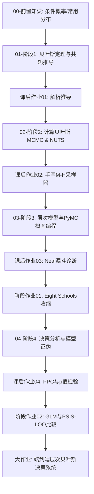

# 🗺️ 贝叶斯统计学习路径

> "贝叶斯统计把参数看作不确定性变量，将推断写成条件概率更新，并把不确定性完整保留到决策终局。"

---

## 🎯 课程总览与核心目标

本课程旨在建立从**经典贝叶斯推断**到**现代计算贝叶斯（MCMC/HMC/NUTS）**、**层次收缩建模**与**决策分析**的完整闭环。

- **核心主线**：$P(\theta \mid y) = \frac{P(y \mid \theta) P(\theta)}{P(y)}$（先验 $\times$ 似然 $\to$ 后验）。
- **现代支柱**：用概率编程语言（PyMC 5.x + ArviZ）求解高维复杂后验，利用分层结构实现参数收缩（Partial Pooling），基于 PSIS-LOO 与后验预测检查（PPC）进行模型严苛证伪。
- **终局交付**：不仅给出点估计，更给出完整的后验分布与决策期望损失最小化方案。

---

## 📚 权威参考主线 (Spine)

- **主教材 (Primary Spine)**: *Bayes Rules! An Introduction to Applied Bayesian Modeling* (Alicia A. Johnson et al.)
- **进阶与理论 (Co-Spine)**: *Bayesian Data Analysis, 3rd ed. (BDA3)* (Andrew Gelman et al.)
- **计算与实战生态**: PyMC 5.x / ArviZ / NumPy / SciPy
- **来源注册表**: [[📚 教材挂载索引|进入教材挂载索引]]

---

## 🧭 四阶段推进路线

| 阶段 | 核心任务 | 核心抓手与概念 | 阶段入口 | 对应作业 |
| :--- | :--- | :--- | :--- | :--- |
| **00 前置知识** | 概率论与分布底座 | 条件概率、全概率公式、共轭分布族 | [[00-前置知识/🧭 贝叶斯统计-前置知识\|前置诊断]] | 前置概念自测 |
| **01 贝叶斯基础** | 解析推断与共轭更新 | Bayes定理、共轭先验、后验预测分布、损失函数 | [[01-贝叶斯基础/🧭 阶段1-贝叶斯基础\|阶段1 MOC]] | [[贝叶斯统计-课后作业-01-共轭更新解析推导与Beta-Binomial实验\|课后作业 01]] |
| **02 计算贝叶斯** | 采样算法与收敛诊断 | Monte Carlo、M-H采样器、HMC/NUTS、$\hat{R}$/ESS/Divergences | [[02-计算贝叶斯/🧭 阶段2-计算贝叶斯\|阶段2 MOC]] | [[贝叶斯统计-课后作业-02-Metropolis-Hastings采样器手写实现与诊断\|课后作业 02]] |
| **03 层次模型与回归** | 多层结构与概率编程 | 层次收缩(Partial Pooling)、Neal漏斗非中心化、PyMC工作流 | [[03-层次模型与回归/🧭 阶段3-层次模型与回归\|阶段3 MOC]] | [[贝叶斯统计-课后作业-03-Neal漏斗分歧诊断与非中心化参数化实验\|课后作业 03]] + [[贝叶斯统计-阶段作业-01-PyMC层次模型与Eight-Schools收缩效应分析\|阶段作业 01]] |
| **04 决策与实践** | 证伪、比较与最终决策 | PPC后验预测检查、WAIC/PSIS-LOO-CV、Stacking、期望损失决策 | [[04-决策与实践/🧭 阶段4-决策与实践\|阶段4 MOC]] | [[贝叶斯统计-课后作业-04-后验预测检查PPC与贝叶斯p值双侧检验\|课后作业 04]] + [[贝叶斯统计-阶段作业-02-贝叶斯广义线性回归与PSIS-LOO模型比较\|阶段作业 02]] + [[贝叶斯统计-大作业-端到端层次贝叶斯建模与不确定性决策系统\|大作业]] |

---

## 🚦 阶段学习与验收流

---

## 🧰 作业与验收中心

- 课程作业统一事实源位于：`03-Projects/33-贝叶斯统计/`
- 作业入口总表：[[🧭 课程作业总索引|进入课程作业总索引]]
- 质量审计中心：[[课程严苛审计|课程严苛审计报告]]
