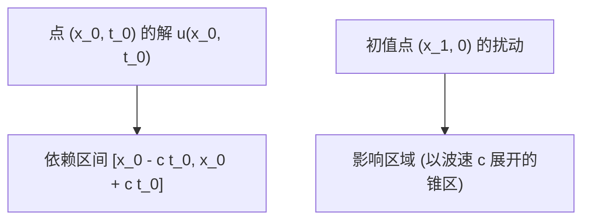

# 一维波动方程与达朗贝尔公式

> 所属阶段 MOC：[[01-经典方程与特征线法/🧭 阶段1-经典方程与特征线法|🧭 阶段 1：经典方程与特征线法]]  
> 学习定位：推导一维波动方程的因式分解与达朗贝尔解析解，深入剖析双曲型方程的特征传播线、有限因果锥（依赖区间与影响区域）及半无界弦的奇延拓反射机制。

---

## 1. 核心问题与物理直觉

一维弦振动方程 $u_{tt} = c^2 u_{xx}$ 是最具代表性的双曲型偏微分方程。
从物理上看，微小扰动沿张紧的弦以波速 $c = \sqrt{T/\rho}$ 向左右两侧传播。
数学上，二阶波动微分算子 $\partial_t^2 - c^2 \partial_x^2$ 可以完美因式分解为两个一阶平移对流算子的乘积 $(\partial_t - c\partial_x)(\partial_t + c\partial_x)$。这直接揭示了一切振动都是“右行波 $F(x-ct)$ 与左行波 $G(x+ct)$ 的线性叠加”。

---

## 2. 正式数学表述与达朗贝尔公式推导

### 2.1 一维全空间齐次波动方程 Cauchy 问题
考虑定解问题：
$$\begin{cases} u_{tt} - c^2 u_{xx} = 0, & x \in \mathbb{R}, t > 0 \\ u(x, 0) = \phi(x), & x \in \mathbb{R} \\ u_t(x, 0) = \psi(x), & x \in \mathbb{R} \end{cases}$$

### 2.2 严格推导步骤（坐标因式分解法）
1. **引入特征坐标**：令 $\xi = x - ct, \, \eta = x + ct$。
2. **算子变换**：
   $$\frac{\partial}{\partial x} = \frac{\partial}{\partial \xi} + \frac{\partial}{\partial \eta}, \quad \frac{\partial}{\partial t} = -c\frac{\partial}{\partial \xi} + c\frac{\partial}{\partial \eta}$$
   原方程化为标准形式：
   $$\frac{\partial^2 u}{\partial \xi \partial \eta} = 0$$
3. **积分得到通解形式**：
   $$u(x, t) = F(x - ct) + G(x + ct)$$
4. **代入初值条件确定函数 $F$ 与 $G$**：
   - $u(x, 0) = F(x) + G(x) = \phi(x)$
   - $u_t(x, 0) = -c F'(x) + c G'(x) = \psi(x) \implies -F'(x) + G'(x) = \frac{1}{c}\psi(x)$
5. **积分求 $F$ 与 $G$**：
   对导数式在 $[0, x]$ 积分：
   $$-F(x) + G(x) = \frac{1}{c}\int_0^x \psi(s) \, ds + K$$
   联立 $F(x) + G(x) = \phi(x)$，解得：
   $$F(x) = \frac{1}{2}\phi(x) - \frac{1}{2c}\int_0^x \psi(s) \, ds - \frac{K}{2}$$
   $$G(x) = \frac{1}{2}\phi(x) + \frac{1}{2c}\int_0^x \psi(s) \, ds + \frac{K}{2}$$
6. **写出达朗贝尔公式 (D'Alembert's Formula)**：
   代回 $u(x, t) = F(x-ct) + G(x+ct)$，常数 $K$ 自动抵消：
   $$u(x, t) = \frac{\phi(x - ct) + \phi(x + ct)}{2} + \frac{1}{2c}\int_{x - ct}^{x + ct} \psi(s) \, ds$$

---

## 3. 因果结构与时空几何



1. **依赖区间 (Domain of Dependence)**：点 $(x_0, t_0)$ 的解完全且仅由初始轴上线段 $[x_0 - ct_0, x_0 + ct_0]$ 上的初值 $\phi, \psi$ 决定。该区间外的扰动在 $t_0$ 时刻之前绝不可能到达 $x_0$。
2. **决定区域 (Domain of Determinacy)**：初值区间 $[a, b]$ 上的数据能够完全唯一决定的时空区域是三角锥 $\{(x, t) : a + ct \le x \le b - ct, t \ge 0\}$。
3. **影响区域 (Range of Influence)**：点 $(x_1, 0)$ 处施加的脉冲扰动，在未来 $t > 0$ 时刻只能局限在特征扇区 $x_1 - ct \le x \le x_1 + ct$ 内部。这表明**信息传播速度严格为有限常数 $c$**。

---

## 4. 半无界弦的反射与奇延拓 (Semi-Infinite String)

对于半无界问题：$u_{tt} - c^2 u_{xx} = 0 \, (x > 0, t > 0)$，带有固定端齐次 Dirichlet 边界 $u(0, t) = 0$。
- **反射原理（奇延拓）**：
  定义初值的奇延拓函数：
  $$\phi_{odd}(x) = \begin{cases} \phi(x), & x > 0 \\ 0, & x = 0 \\ -\phi(-x), & x < 0 \end{cases}, \quad \psi_{odd}(x) = \begin{cases} \psi(x), & x > 0 \\ 0, & x = 0 \\ -\psi(-x), & x < 0 \end{cases}$$
- 当 $x > ct$ 时（波未触碰边界），解与全空间完全相同：
  $$u(x, t) = \frac{\phi(x-ct) + \phi(x+ct)}{2} + \frac{1}{2c}\int_{x-ct}^{x+ct}\psi(s)ds$$
- 当 $x < ct$ 时（右行波从 $x=0$ 边界反射）：
  $$u(x, t) = \frac{\phi(x+ct) - \phi(ct-x)}{2} + \frac{1}{2c}\int_{ct-x}^{x+ct}\psi(s)ds$$
  *物理本质*：固定端边界产生了一个**倒置（反相）的反射波**。

---

## 5. 常见误区与反例

- **误区 1：误以为达朗贝尔公式要求初始位移 $\phi$ 必须二次可微**。如果 $\phi$ 仅为连续甚至逐段连续函数（例如三角波包），达朗贝尔公式给出的是满足弱方程的**广义弱解**，波包形态在传播中保持不变，只有尖点沿特征线 $x \pm ct = \text{常数}$ 传播。
- **误区 2：在非齐次波动方程 $u_{tt} - c^2 u_{xx} = f(x,t)$ 中遗漏 Duhamel 面积分**。非齐次源项会持续在时空锥内注入能量，其精确解为达朗贝尔项加上时空三角形区域内的卷积积分 $\frac{1}{2c}\int_0^t \int_{x-c(t-\tau)}^{x+c(t-\tau)} f(s, \tau) \, ds d\tau$。

---

## 6. 主动自测与闭卷检查

- [ ] 我能利用算子因式分解独立完整推导出达朗贝尔公式。
- [ ] 我能精确画出点 $(x_0, t_0)$ 的依赖区间并解释其物理因果性。
- [ ] 我能写出固定边界 $u(0,t)=0$ 时半无界弦在 $x < ct$ 区域的反射波公式。

---

## 7. 学完后可以完成（派生视图）

```dataview
LIST
FROM "02-Knowledge/🧠 学习系统"
WHERE contains(upstream, this.file.link)
SORT file.name ASC
```

```dataview
LIST
FROM "03-Projects"
WHERE contains(requires, this.file.link)
SORT assignment_level ASC, file.name ASC
```
