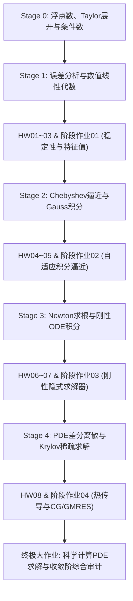

# 🗺️ 数值分析 · 课程全景学习路径

> “数值分析的核心使命：在有限精度的离散物理计算机上，构造数学严密、算法稳定、误差可控且计算高效的连续数学近似求解方法。”

---

## 📊 路线进度追踪

```dataviewjs
const stages = [
    "02-Knowledge/🧠 学习系统/35-数值分析/00-前置知识",
    "02-Knowledge/🧠 学习系统/35-数值分析/01-误差与数值线代",
    "02-Knowledge/🧠 学习系统/35-数值分析/02-插值积分与逼近",
    "02-Knowledge/🧠 学习系统/35-数值分析/03-非线性与ODE数值解",
    "02-Knowledge/🧠 学习系统/35-数值分析/04-PDE数值与科学计算"
];

let totalCards = 0;
let completedCards = 0;

for (let stage of stages) {
    const pages = dv.pages(`"${stage}"`).where(p => p.type === "study" && !p.file.name.includes("🧭"));
    totalCards += pages.length;
    completedCards += pages.where(p => p.status === "completed" || p.status === "active").length;
}

const progress = totalCards > 0 ? Math.round((completedCards / totalCards) * 100) : 0;
dv.paragraph(`**课程知识卡进度: ${progress}%** | 覆盖: ${completedCards} / ${totalCards} 张核心主题卡`);
```

---

## 🎯 课程主线与培养目标

1. **核心问题**：真实世界连续数学模型（微分方程、积分方程、连续优化）在 IEEE 754 浮点硬件上的离散化、扰动传播分析、条件数估计、收敛阶证明与大规模稀疏求解。
2. **最低前置**：微积分/数学分析（多元 Taylor 展开、中值定理）、高等代数/线性代数（矩阵相似、正交变换、特征值谱理论）、Python 基础科学计算编程（NumPy / SciPy）。
3. **主 Spine 教材**：*Fundamentals of Numerical Computation* (FNC) + *Numerical Linear Algebra* (Trefethen & Bau) + MIT 18.335J / 18.330 官方计算实验。
4. **学完后可进阶**：偏微分方程数值解（FEM / FVM）、大规模并行科学计算、优化算法工程与不确定性量化。

---

## 🧭 五阶段递进学习地图

| 阶段 | 核心任务与解决问题 | 核心知识抓手 | 阶段入口 |
| :---: | :--- | :--- | :---: |
| **00** | **前置数学与浮点物理底座** | 建立浮点规格化数、机器精度、多元 Taylor 展开与矩阵诱导范数视角。 | [[00-前置知识/🧭 阶段0-前置知识\|🧭 阶段0-前置知识]] |
| **01** | **误差分析与数值线性代数** | 掌握 Wilkinson 后向误差分析框架、选主元 LU 分解、Householder QR 与位移对称 QR 谱算法。 | [[01-误差与数值线代/🧭 阶段1-误差与数值线代\|🧭 阶段1-误差与数值线代]] |
| **02** | **函数逼近、插值与数值求积** | 攻克 Runge 震荡现象、Chebyshev 极小极大逼近、重心 Lagrange 公式与 Gauss-Legendre 高精度求积。 | [[02-插值积分与逼近/🧭 阶段2-插值积分与逼近\|🧭 阶段2-插值积分与逼近]] |
| **03** | **非线性方程与 ODE 数值解** | 掌握多维 Newton-Raphson 阻尼迭代、显式/隐式 Runge-Kutta 积分器、刚性微分系统与 A-稳定性分析。 | [[03-非线性与ODE数值解/🧭 阶段3-非线性与ODE数值解\|🧭 阶段3-非线性与ODE数值解]] |
| **04** | **PDE 有限差分与大规模计算** | 掌握多维 Poisson/热传导差分离散、Krylov 预条件迭代求解（CG / GMRES）与 MMS 制造解收敛阶验证。 | [[04-PDE数值与科学计算/🧭 阶段4-PDE数值与科学计算\|🧭 阶段4-PDE数值与科学计算]] |

---

## 🚀 阶段产出与能力构建闭环

| 阶段 | 学习者学完后必须能够独立交付的成果 |
| :---: | :--- |
| **00 前置底座** | 能手动推导常用函数截断误差界，编写脚本测量 CPU 真实机器精度 $\epsilon_{\text{mach}}$，计算并解释矩阵条件数 $\kappa(A)$。 |
| **01 数值线代** | 能独立实现带列主元的 LU 分解并监测增长因子 $\rho$，用 Householder 变换求解病态最小二乘，实现位移 QR 计算完整矩阵谱。 |
| **02 逼近求积** | 能用重心 Lagrange 第二型算法在 Chebyshev 节点上消除 Runge 现象，实现自适应 Gauss-Legendre 复合求积器。 |
| **03 非线性与ODE** | 能推导并实现多维 Newton 雅可比阻尼法，构建具有 A-稳定性的隐式 Crank-Nicolson / 梯形求解器跨越多尺度刚性动力系统。 |
| **04 PDE与计算** | 能利用 CSR 稀疏矩阵组装 2D Laplace 算子，配置 ILU 预条件 GMRES 求解器，用 MMS 算法实测时空收敛阶 $O(h^2 + \Delta t^2)$。 |

---

## 🚦 建议学习与验收流水线



---

## 🔗 跨学科交叉与知识连接

| 关联课程 | 连接方式与知识接口 |
| :--- | :--- |
| [[02-Knowledge/🧠 学习系统/28-数学分析/🗺️ 数学分析学习路径\|数学分析]] | 提供极限、微分中值定理、积分余项估计与收敛性判据。 |
| [[02-Knowledge/🧠 学习系统/09-高等代数/🗺️ 高等代数学习路径\|高等代数]] | 提供线性空间、矩阵分解、正交基与谱分解的精确代数结构。 |
| [[02-Knowledge/🧠 学习系统/06-常微分方程/🗺️ 常微分方程学习路径\|常微分方程]] | 为多时间尺度、刚性阻尼和动力系统数值求解提供物理模型与定性理论。 |
| [[02-Knowledge/🧠 学习系统/34-偏微分方程/🗺️ 偏微分方程学习路径\|偏微分方程]] | 为椭圆、抛物、双曲型 PDE 离散提供连续问题背景与最大值原理。 |
| [[02-Knowledge/🧠 学习系统/07-最优化方法/🗺️ 最优化方法学习路径\|最优化方法]] | 矩阵迭代求解（CG / GMRES）与非线性 Newton 迭代法深度相通。 |

---

## 🔎 核心导航总入口

- [[02-Knowledge/🧠 学习系统/35-数值分析/📚 教材挂载索引|📚 教材挂载索引 (Spine & Benchmark)]]
- [[02-Knowledge/🧠 学习系统/35-数值分析/00-前置知识/🧭 阶段0-前置知识|🧭 阶段0：前置数学与浮点底座]]
- [[02-Knowledge/🧠 学习系统/35-数值分析/01-误差与数值线代/🧭 阶段1-误差与数值线代|🧭 阶段1：误差分析与数值线性代数]]
- [[02-Knowledge/🧠 学习系统/35-数值分析/02-插值积分与逼近/🧭 阶段2-插值积分与逼近|🧭 阶段2：函数逼近、插值与数值求积]]
- [[02-Knowledge/🧠 学习系统/35-数值分析/03-非线性与ODE数值解/🧭 阶段3-非线性与ODE数值解|🧭 阶段3：非线性方程与ODE数值解]]
- [[02-Knowledge/🧠 学习系统/35-数值分析/04-PDE数值与科学计算/🧭 阶段4-PDE数值与科学计算|🧭 阶段4：PDE有限差分与科学计算]]
- [[03-Projects/35-数值分析/🧭 课程作业总索引|🧭 课程作业与实践中心 (HW01-08, Stage01-04, Capstone)]]
