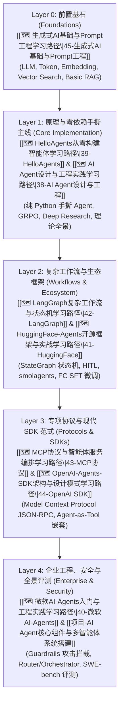

# 🛠️ 主线：AI Agent 工程 (AI Agent Engineering Track)

> 🧭 **主线宗旨**：收拢 Datawhale Hello-Agents、微软 18 课、Hugging Face Agents、LangGraph、MCP 协议、OpenAI SDK、GenAI 基础等 8 大 AI Agent 开源课程。严格遵循 `AGENTS.md` **全库唯一主卡** 规则，消除概念重复，构建从 Prompt/RAG 到手撕 Agent、状态机工作流、MCP 服务编排与企业级 Guardrails 的高能工程主线。
>
> 🗺️ **融合主视图**：详见全库 8 大开源课程无冗余融合主路线图 —— [[🗺️ AI Agent终极融合修炼路线]]。

---

## 🗺️ 8 门 AI Agent 子线路径 5 层递进图



---

## 🔑 全库唯一 Master 概念卡 (Single Source of Truth)

所有 8 门 Agent 课程的核心理论统一收拢至以下 6 张 Master 概念卡：

1. **ReAct 与 Agent 核心**：[[ReAct范式与Agent核心公式]] ($\text{Agent} = \text{LLM} + \text{Context} + \text{Tools}$)
2. **上下文与记忆系统**：[[Agent记忆系统与向量检索]] (Working vs Episodic Memory, Cosine + Decay)
3. **工具调用与安全沙箱**：[[ToolUse与FunctionCalling]] (JSON Schema, Code-as-Action, AST Sandbox)
4. **高级规划与 Coding Agent**：[[CodingAgent原理与实践]] (Tree of Thoughts, Reflexion, SWE-bench)
5. **多模态与多智能体**：[[MultiAgent多智能体协作机制]] (SOP Protocol, MetaGPT/AutoGen Topologies, GUI ReAct)
6. **评测对齐与自进化**：[[Agent评测对齐与自进化]] (Agent SFT/DPO Loss, Dynamic Tool Evolution)

---

## 📊 包含子路径看板 (Dataview)

```dataview
TABLE course AS "课程名称", status AS "状态", importance AS "优先级", updated AS "最近更新"
FROM "02-Knowledge/🧠 学习系统"
WHERE type = "index" AND track = "AI Agent工程"
SORT file.name ASC
```

---

*主线更新时间：2026-07-30 | 状态：active*
