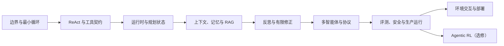

# AI Agent 工程：双教材章节覆盖矩阵

> [!abstract] 这张表如何使用
> 本页负责“教材章节不遗漏”，主题卡负责“稳定知识可复用”，项目映射负责“真正会做”。状态含义：**主卡**＝已有独立主题卡；**并入**＝内容进入一张更粗粒度主题卡；**选修**＝不阻塞工程主线；**外链**＝只保留来源导航，不复制正文。

## 1. 融合原则

1. 以问题和能力组织，不按两本教材各抄一遍。
2. 同一概念只保留一张主卡，教材章节作为 `source` 和定位回链。
3. 框架 API、协议字段和云服务会漂移；主题卡写稳定机制，版本卡写具体接线。
4. 新手主线先建立可运行、可测试的最小 runtime，再进入多 Agent、协议、生产和训练。
5. 训练、低代码平台和特定云部署均为选修，不用昂贵依赖阻塞核心能力。

## 2. Microsoft AI Agents for Beginners

核验版本：commit `15ad10ca60577b75199c1ba828887ab7e66bac87`，2026-07-29。

| Lesson | 原教材能力 | 本库落点 | 状态 | 学后证据 |
| :---: | :--- | :--- | :---: | :--- |
| 01 Intro | Agent 定义、类型、使用边界 | [[AI-Agent-边界与感知行动循环]] | 主卡 | 能给非 Agent 反例并实现有限循环 |
| 02 Frameworks | 框架与托管服务职责 | [[AI-Agent-框架选型与最小运行时]] | 主卡 | 能画 runtime、给出选型否决理由 |
| 03 Design Principles | 以用户旅程、工具和边界设计 | [[AI-Agent-边界与感知行动循环]]、[[AI-Agent-规划状态与工作流编排]] | 并入 | 先写状态/失败/停止再写代码 |
| 04 Tool Use | 工具定义、调用与可信边界 | [[AI-Agent-工具调用与结构化契约]] | 主卡 | 非法工具/参数失败关闭 |
| 05 Agentic RAG | 迭代检索、失败修正、治理 | [[AI-Agent-记忆与检索增强生成]]、[[AI-Agent-上下文工程-选择压缩隔离]] | 并入 | 答案可定位到 source ID |
| 06 Trustworthy Agents | 威胁、HITL、安全 | [[AI-Agent-安全威胁建模与系统评测]] | 主卡 | 正常/异常/对抗测试分层 |
| 07 Planning | 目标分解与计划执行 | [[AI-Agent-规划状态与工作流编排]] | 主卡 | 计划有依赖、状态和重规划条件 |
| 08 Multi-Agent | 多 Agent 模式与可见性 | [[AI-Agent-多智能体协作与消息协议]] | 主卡 | 能证明拆分收益大于协调成本 |
| 09 Metacognition | 自检、Corrective RAG、代码验证 | [[AI-Agent-反思与元认知-校验修正停止]] | 主卡 | 反馈能改变策略且有限停止 |
| 10 Production | trace、指标、成本与评测 | [[AI-Agent-可观测性与生产运行-轨迹审批恢复]]、[[AI-Agent-评测与基准-任务轨迹成本]] | 主卡 | 逐样本轨迹与 P95/成本可查 |
| 11 Protocols | MCP、A2A、NLWeb | [[AI-Agent-协议-MCP与A2A互操作]] | 主卡 | 能区分工具调用与 Agent 委托 |
| 12 Context Engineering | 选择、压缩、隔离与失败 | [[AI-Agent-上下文工程-选择压缩隔离]] | 主卡 | 给一次调用做预算与信任分区 |
| 13 Memory | 短期/长期记忆与自改进 | [[AI-Agent-记忆与检索增强生成]]、[[AI-Agent-Agentic-RL与自改进边界]] | 并入 | 明确写入、删除、污染和隐私策略 |
| 14 Microsoft Agent Framework | 框架构件与托管 | [[AI-Agent-框架选型与最小运行时]] | 并入 | 用 adapter 隔离框架类型 |
| 15 Computer Use | 浏览器/UI Agent 与审批 | [[AI-Agent-环境交互-代码网页与沙箱执行]] | 主卡 | 提交/购买等动作必须审批 |
| 16 Scalable Deployment | 部署、伸缩、路由、烟测 | [[AI-Agent-部署与本地运行-伸缩路由烟测]]、[[AI-Agent-可观测性与生产运行-轨迹审批恢复]] | 主卡 | 写部署前 smoke/eval gate |
| 17 Local Agents | 本地模型、RAG、MCP、混合 | [[AI-Agent-部署与本地运行-伸缩路由烟测]]、[[AI-Agent-环境交互-代码网页与沙箱执行]] | 主卡 | 按数据分类选择本地/云路径 |
| 18 Cryptographic Receipts | 防篡改审计与人类批准 | [[AI-Agent-安全审计-加密收据与审批绑定]] | 主卡 | 验签、哈希链、审批 digest 与重放防护 |

## 3. Datawhale Hello-Agents

核验版本：commit `d4953e839714cf0baaa624c0d9b4731c48a2a131`，2026-08-04。

| Chapter | 原教材能力 | 本库落点 | 状态 | 学后证据 |
| :---: | :--- | :--- | :---: | :--- |
| 1 初识智能体 | 定义、构成、5 分钟 Agent、协作模式 | [[AI-Agent-边界与感知行动循环]] | 主卡 | 不借框架实现最小循环 |
| 2 发展史 | 符号、学习、LLM Agent 演进 | [[AI-Agent-边界与感知行动循环]] | 并入 | 用“状态/策略/环境”解释连续性 |
| 3 LLM 基础 | Transformer、Prompt、模型局限 | [[45-生成式AI基础与Prompt工程/🗺️ 生成式AI基础与Prompt工程学习路径|生成式 AI 与 Prompt 工程]] | 外链 | 通过先修诊断，不重复造卡 |
| 4 经典范式 | ReAct、Plan-and-Solve、Reflection | [[AI-Agent-ReAct推理行动范式]]、[[AI-Agent-规划状态与工作流编排]]、[[AI-Agent-反思与元认知-校验修正停止]] | 主卡 | 三种控制流可比较与实现 |
| 5 低代码平台 | Coze、Dify、n8n | [[AI-Agent-框架选型与最小运行时]] | 选修 | 能指出平台边界与导出/测试风险 |
| 6 框架实践 | AutoGen、AgentScope、LangGraph | [[AI-Agent-框架选型与最小运行时]]、[[AI-Agent-框架-AutoGen官方Lab版本补丁]] | 并入 | 先按需求选，再做版本隔离 |
| 7 构建 Agent 框架 | 从零实现 HelloAgents | [[AI-Agent-框架选型与最小运行时]] | 主卡 | 识别 runtime 七部件 |
| 8 记忆与检索 | Memory、RAG、存储 | [[AI-Agent-记忆与检索增强生成]] | 主卡 | 写入/读取/删除/引用均可测 |
| 9 上下文工程 | ContextBuilder、结构化笔记、长程任务 | [[AI-Agent-上下文工程-选择压缩隔离]] | 主卡 | GSSC 装配与腐化测试 |
| 10 通信协议 | MCP、A2A、ANP、自建 server | [[AI-Agent-协议-MCP与A2A互操作]] | 主卡 | 以当前官方规范校正协议字段 |
| 11 Agentic RL | SFT、GRPO、奖励与评估 | [[AI-Agent-Agentic-RL与自改进边界]] | 选修 | 先过训练前置门和 reward audit |
| 12 性能评估 | BFCL、GAIA、judge、win rate | [[AI-Agent-评测与基准-任务轨迹成本]] | 主卡 | 公共基准与领域 eval 分离 |
| 13 旅行助手 | 多 Agent、MCP、前后端 | [[AI-Agent工程-双教材渐进实践-知识点映射#P7A 旅行助手迁移]] | 项目 | 完成受限行程规划迁移任务 |
| 14 Deep Research | TODO 驱动研究、搜索、报告 | [[AI-Agent工程-双教材渐进实践-知识点映射]] | 项目 | 事实与来源逐条对应 |
| 15 赛博小镇 | NPC、记忆、状态与通信 | [[AI-Agent工程-双教材渐进实践-知识点映射#P7B 赛博小镇离线模拟]] | 选修项目 | 用离线状态机模拟，不阻塞主线 |
| 16 毕业设计 | 完整多 Agent 应用 | [[AI-Agent工程-结课项目]] | 项目 | 通过本库安全与恢复 Rubric |

## 4. 去重后的稳定知识骨架

## 5. 缺口与“不纳入主线”说明

- **已补齐的独立缺口**：上下文工程、反思/元认知、MCP/A2A、框架选型与最小运行时、任务/轨迹/成本评测、Agentic RL 边界。
- **不单独成卡**：发展史、低代码平台、特定云产品、本地模型产品教程；它们要么是背景，要么变化快，不应挤占稳定概念索引。
- **暂不复制**：两教材的练习答案、长代码和图片。使用原创微型实现、故障注入与项目迁移达到同一能力目标。
- **动态内容**：协议、框架和云部署每次实践前核验官方文档，不能把本页的核验日期当永久保证。

## 6. 覆盖完成定义

- [x] 两教材所有正式 Lesson/Chapter 有明确落点；逐课官方 URL 与访问信息见 [[AI Agent 工程双教材课后习题册-Microsoft]]、[[AI Agent 工程双教材课后习题册-Hello-Agents]]。
- [x] 稳定概念有主题卡，不以框架 API 代替原理。
- [x] 每张新增主卡含直觉、定义、手算、可运行代码、误区、自测、主动回忆和 Anki。
- [x] 原创实践采用渐隐支架，见 [[AI-Agent工程-双教材渐进实践-知识点映射]] 与 `03-Projects/46-AI Agent工程/guided-labs/`。
- [ ] 学习者亲自完成各 Gate；“笔记覆盖完成”不等于“个人掌握完成”。
