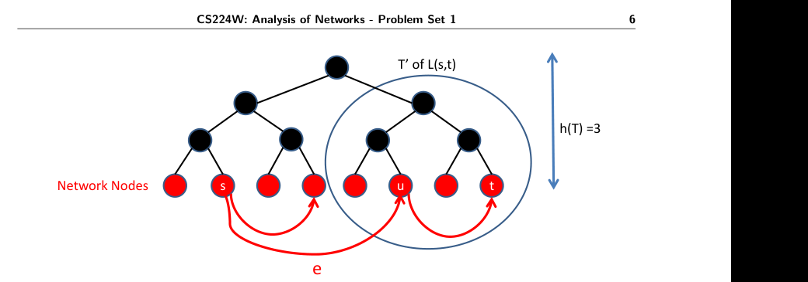

# CS224W：网络分析（2017 秋季）作业 1

> [!info] 授权中文译本
> 本页是 [Stanford CS224W 2017 Problem Set 1](https://snap.stanford.edu/class/cs224w-2017/homeworks/hw1/hw1.pdf) 的完整中文翻译，保留原章节、题号、分值、公式、图意和提交要求。翻译依据用户声明的 Stanford/作者授权制作，并非 Stanford 官方中文版。若公式或图示排版有差异，以原 PDF 为准。本页不含答案。知识准备与失败回流见[[../作业映射/CS224W-2017-HW1-知识点映射]]。

## 基本信息

- **课程**：CS224W：网络分析
- **学期**：2017 年秋季
- **作业**：Problem Set 1
- **截止时间**：2017 年 10 月 12 日，太平洋夏令时 23:59
- **迟交额度**：本作业最多使用 1 个迟交时段，定义见文末信息表。

## 通用说明

这些问题需要认真思考，但不要求很长的答案。请尽可能简洁。

### 提交方式

1. 通过 GradeScope 提交答案，通过 SNAP 提交网站提交代码。
2. 使用 Stanford 邮箱（SCPD 学生除外）在 [GradeScope](http://gradescope.com) 注册，并填写学号。
3. 使用课程加入代码 `MRW7PY` 加入 CS224W。
4. 将全部书面答案整理为一个 PDF。每个子问题单独占一页，页首注明题号，并使用课程提供的 TeX/PDF 提交模板。
5. 填写并签署文末或模板末尾的信息表，以确认遵守 Honor Code；排版提交时可键入姓名。信息表必须是最后一页，缺失将扣 2 分。
6. 在 [SNAP 提交网站](http://snap.stanford.edu/submit) 上传代码，每道大题的全部代码放在一个文件中。

## 1. 网络特征（35 分，Praty）

网络分析的目标之一，是寻找能够刻画真实网络的数学模型，再用这些模型生成具有相似性质的新网络。本题研究两个著名模型：Erdos-Renyi 模型和小世界模型，并将它们与真实学术合作网络比较。本题所有网络均为无向网络。

可以使用本题的[起始代码](http://snap.stanford.edu/cs224w-17-data/hw1/q1-starter.py)。

请准备以下三张网络：

### Erdos-Renyi 随机图

生成一个 $G(n,m)$ 随机网络实例，取

$$
n=5242,\qquad m=14484.
$$

从所有可能边中随机选择 $m$ 条边。必须自行编写构造代码，不得调用 SNAP 的随机图生成函数。

### 小世界随机网络

按以下步骤生成：

1. 将 $n=5242$ 个节点排列成环，每个节点连接其两个直接邻居。例如节点 399 连接节点 398 和 400。此时共有 5242 条边。
2. 再令每个节点连接其邻居的邻居。例如节点 399 还连接节点 397 和 401。再增加 5242 条边。
3. 从尚未连接的节点对中随机选择 4000 对并添加边。

最终边数为

$$
m=5242\times 2+4000=14484.
$$

同样必须自行实现，不得调用 SNAP 的生成函数。

### 真实合作网络

下载无向网络 [ca-GrQc.txt.gz](http://snap.stanford.edu/data/ca-GrQc.txt.gz)。节点代表 arXiv “General Relativity and Quantum Cosmology” 分类中的论文作者；两位作者至少共同发表过一篇论文时，二者之间存在边。

数据中有些边可能出现两次，分别对应两个方向。忽略重复边和自环后，网络共有 5242 个节点和 14484 条边。使用 SNAP 的 `LoadEdgeList` 加载有向图或无向图时，重复边会被自动忽略。

### 1.1 度分布（10 分）

分别生成一张 Erdos-Renyi 随机图和一张小世界网络，并读入真实合作网络。删除合作网络中的所有自环；删除后应剩余 14484 条边。

在同一幅双对数图中绘制三张网络的度分布：横轴是节点度数，纵轴是具有该度数的节点比例。“双对数”表示横轴和纵轴都使用对数刻度。

用 1-2 句话说明合作网络的度分布与两个随机图模型的度分布之间的一项关键差异。

### 1.2 余度分布（15 分）

网络分析中的一个重要概念是余度分布（excess degree distribution），记作 $q_k$，其中 $k\ge0$。直观地，$q_k$ 表示随机选择一条边后，该边到达一个度数为 $k+1$ 的节点的概率。

余度可按下式计算：

$$
q_k=\frac{q'_k}{\sum_i q'_i},
\qquad
q'_k=\sum_{i\in V}\sum_{(i,j)\in E}\mathbb I[k_j=k+1],
$$

其中，当条件成立时 $\mathbb I_{\text{condition}}=1$，否则为 0；$V$ 是节点集合，$E$ 是边集合，$k_j$ 是节点 $j$ 的邻居数量，也就是节点 $j$ 的度数。

期望余度为

$$
\sum_{k\ge0}kq_k,
$$

期望度为

$$
\sum_{k\ge0}kp_k,
$$

其中 $p_k$ 是度数恰好为 $k$ 的节点比例。

#### 1.2(a)（5 分）

证明如何仅根据度分布 $\{p_k\}$ 计算余度分布 $\{q_k\}$。

#### 1.2(b)（10 分）

在同一幅双对数图中绘制三张网络的余度分布。用 1-2 句话说明合作网络的度分布与余度分布之间的一项关键差异。随后计算并报告每张网络的期望度和期望余度。

### 1.3 聚类系数（10 分）

回顾课堂定义。节点 $v_i$ 的局部聚类系数为

$$
C_i=
\begin{cases}
\dfrac{2|e_i|}{k_i(k_i-1)}, & k_i\ge2,\\[6pt]
0, & \text{其他情况},
\end{cases}
$$

其中 $k_i$ 是节点 $v_i$ 的度，$e_i$ 是 $v_i$ 的邻居之间存在的边数。平均聚类系数定义为

$$
C=\frac{1}{|V|}\sum_{i\in V}C_i.
$$

计算并报告三张网络的平均聚类系数。本题必须自行实现聚类系数计算，不得使用 SNAP 内置函数。

哪张网络的聚类系数最大？用 1-2 句话解释原因，并考虑生成该网络的底层过程。

### 第 1 题提交内容

**第 1 页**：

- 三张网络的双对数度分布图，绘制在同一幅图中。
- 用 1-2 句话说明合作网络与随机图模型度分布的差异。

**第 2 页**：

- 三张网络的双对数余度分布图，绘制在同一幅图中。
- 用 1-2 句话说明合作网络的度分布与余度分布之间的差异。
- 每张网络的期望度与期望余度。
- 根据 $\{p_k\}$ 计算 $\{q_k\}$ 的简短证明。

> [!note] 译者校注
> 原 PDF 的“提交内容”把余度分布图标为 part (a)、证明标为 part (b)，与题目正文的 1.2(a)/(b) 标号相反。此处保留实际提交内容，但应以正文题号为准。

**第 3 页**：

- 每张网络的平均聚类系数。
- 聚类系数最大的网络。
- 用 1-2 句话解释该网络聚类系数最大的原因。

**对应知识卡**：[[../../../02-Knowledge/🧠 学习系统/01-社交网络挖掘/02-网络结构与生成模型/HW1-结构生成与去中心化搜索实验]]

## 2. 非 Web 网络的 Bow-tie 结构（30 分，Silviana、Ziyi）

本题研究两个有向网络：

- [Epinions 社交网络](http://snap.stanford.edu/data/soc-Epinions1.html)；
- [EU Email 通信网络](http://snap.stanford.edu/data/email-EuAll.html)。

我们将使用类似 Broder 等人的方法；他们曾据此发现 Web 图呈 Bow-tie 结构。

### 2.1 节点位置（4 分）

考虑 Epinions 网络中 ID 为 `9809` 和 `1952` 的节点，以及 Email 网络中 ID 为 `189587` 和 `675` 的节点。

从这些节点分别执行前向 BFS（沿出边方向）和后向 BFS（沿入边方向），判断它们属于 SCC、IN 还是 OUT 区域。

提示：可以使用 SNAP 的 `GetBfsTree` 函数。

### 2.2 随机起点 BFS（8 分）

对两张网络分别均匀随机选择 100 个节点。以每个节点为起点，各执行一次前向 BFS 和一次后向 BFS。

对两种遍历分别回答：每次可以到达多少节点？这些遍历表现出什么行为？可以由此对图结构作出什么推断？

仿照 Broder 等人的论文绘制这些 BFS 覆盖节点数的累计分布。前向 BFS 绘制一幅图，后向 BFS 绘制一幅图。

**图 1（原 PDF）**：从随机节点开始执行后向 BFS 时，可达节点数量的累计分布示例。

### 2.3 Bow-tie 各区域规模（8 分）

使用上一问的 BFS 实验数据确定两张网络各区域的规模。分别报告 SCC、IN、OUT、TENDRILS 和 DISCONNECTED 中的节点数。

### 2.4 随机节点对之间存在路径的概率（10 分）

Broder 等人发现，从随机选择的起始网页到随机选择的终止网页，仅沿链接前进时，大约 25% 的节点对之间存在路径。

对 Epinions 和 Email 网络分别回答：

1. 从整张图中均匀选择两个节点时，两者之间存在有向路径的概率是多少？
2. 如果只从两张图各自的弱连通分量中抽取节点对，该概率是多少？

报告四种情形下可达节点对的百分比，比较两张网络并简要解释结果。

提示：可以抽样大量节点对，再报告其中可达节点对的比例。

### 第 2 题提交内容

**第 4 页**：

- 四个指定节点分别属于哪个区域。
- 如何得到这些结论。

**第 5 页**：

- 四张图：两张网络各自的前向 BFS CDF 与后向 BFS CDF。
- 用 1-2 句话从图结构角度解释观察到的 BFS 行为。

**第 6 页**：

- 两张图各自的 SCC、IN、OUT、TENDRILS、DISCONNECTED 规模。
- 如何计算每个区域的规模。

**第 7 页**：

- 四个实验的结果。每个实验至少使用 100 个节点：对两张网络，分别估计从整图抽取节点对和仅从弱连通分量抽取节点对时存在路径的概率。
- 用 1-2 句话解释结果。

**对应知识卡**：[[../../../02-Knowledge/🧠 学习系统/01-社交网络挖掘/01-图与网络基础/路径连通与Bow-tie结构#原笔记：Bow-tie抽样估计与可达率实验]]

## 3. 去中心化搜索（35 分，Anthony、Anunay）

课堂上介绍过一种基于地理位置的去中心化搜索算法：在网格上的两个节点之间寻找路径时，每一步都沿着通向“距离目标最近节点”的边前进。

本题研究层次树结构上的去中心化搜索。网络节点是树的叶节点；任意两个节点之间的连边概率取决于它们在底层树中的接近程度。可以把这棵树解释为一所大学的层次组织：学生更可能在同一系内认识朋友，在同一学院内认识朋友的概率稍低，跨学院认识朋友的概率最低。

例如，把 Stanford 学生组织成一棵树：根节点是 Stanford University；第二层是不同学院，如工程学院、人文学院等；第三层是各个系；最后一层叶节点是学生。计算机系学生 Tom 想与社会学系学生 Mary 见面。如果 Tom 不认识 Mary，他可以请一位社会学系朋友介绍；如果不认识社会学系任何人，他可以找一位人文学院的朋友。一般地，他会尝试寻找在树上与 Mary “接近”的朋友。

本题分两部分。第一部分在一个特定设置下分析有效的去中心化搜索算法；第二部分在更一般的设置下做仿真实验。

> [!important] 两张网络
> 本题所说的网络节点只包括树的叶节点。树中的其他节点是虚拟节点，只用于决定叶节点之间的连边概率，并不属于观测网络。因此这里有两个结构：一个是可观测的学生关系网络；另一个是用于生成这些边的底层层次树。

### 图 2：层次结构与去中心化搜索

黑色层次节点和树边只表示层次结构，不属于观测网络；叶节点及它们之间的关系边才属于观测网络。$s$ 与 $t$ 的最低公共祖先是树根。去中心化搜索从起点 $s$ 出发，每一步查看当前节点的邻居，并移动到在层次树上与 $t$ 最近的邻居，也就是与 $t$ 的最低公共祖先最低的邻居。在图示例中，从 $s$ 移动到 $u$。

### 3.1 网络路径性质（25 分）

考虑一棵完整且完全平衡的 $b$ 叉树 $T$，其中每个非叶节点有 $b$ 个子节点且 $b\ge2$。网络节点是 $T$ 的所有叶节点。令 $N$ 表示网络节点数，即树的叶节点数；令 $h(T)$ 表示树高。只有一个节点的树高度为 0，并且

$$
h(T)=\log_b N.
$$

对任意两个网络节点（叶节点）$v,w$，定义相对于 $T$ 的距离 $h(v,w)$：它等于以 $v,w$ 的最低公共祖先为根的子树高度。令 $L(v,w)$ 表示该子树。图 2 中，$L(u,t)$ 是圈出的子树，$h(u,t)=2$。

这个距离表达了这样的直觉：同一个系的学生比同一个学院但不同系的学生更接近。例如图 2 中，$u,t$ 比 $u,s$ 更“近”。

#### 3.1(a)（5 分）

给定距离 $d$ 和网络节点 $v$，证明满足 $h(v,w)=d$ 的网络节点 $w$ 恰有

$$
b^d-b^{d-1}
$$

个。

接下来在叶节点上生成随机网络，用来表达“一个节点更可能认识层次结构中较近节点，而不是较远节点”的现象。对节点 $v$，定义它向其他节点 $w$ 创建边的概率分布：

$$
p_v(w)=\frac{1}{Z}b^{-h(v,w)},
$$

其中

$$
Z=\sum_{w\ne v}b^{-h(v,w)}
$$

是归一化常数。由对称性，所有节点 $v$ 的归一化常数相同。

设置参数 $k$，并保证每个节点 $v$ 恰有 $k$ 条出边。对每个节点 $v$，反复按 $p_v$ 抽取随机节点 $w$，并在网络中添加边 $(v,w)$，直到 $v$ 恰有 $k$ 个邻居。等价地，每次从 $v$ 向 $w$ 添加边之后，把 $p_v(w)$ 设为 0，并用新的 $Z$ 重新归一化，使 $\sum_w p_v(w)=1$。由此得到一个 $k$ 正则有向网络。

#### 3.1(b)（5 分）

证明

$$
Z\le \log_b N.
$$

提示：使用 3.1(a) 的结论。

#### 3.1(c)（5 分）

对两个叶节点 $v,t$，令 $T'$ 是 $L(v,t)$ 中满足以下条件的子树：

- $T'$ 的高度为 $h(v,t)-1$；
- $T'$ 包含 $t$；
- $T'$ 不包含 $v$。

图 2 中，$L(s,t)$ 的 $T'$ 是圈出的子树。

考虑从 $v$ 出发的一条边 $e$，其终点 $u$ 按 $p_v$ 随机抽取。如果 $u$ 是 $T'$ 的叶节点，就称 $e$ 指向 $T'$。证明 $e$ 指向 $T'$ 的概率至少为

$$
\frac{1}{b\log_b N}.
$$

#### 3.1(d)（5 分）

令每个节点的出度

$$
k=c(\log_b N)^2,
$$

其中 $c$ 是常数。证明节点 $v$ 没有任何一条边指向 $T'$ 的概率至多为

$$
N^{-\theta},
$$

其中 $\theta>0$。求出 $\theta$。

提示：对所有 $x\in\mathbb R$，有 $1+x\le e^x$。

进一步论证：该结果为什么意味着，以高概率对任意节点 $v$ 都能找到一条通向某个叶节点 $u$ 的边，使

$$
h(u,t)<h(v,t)?
$$

#### 3.1(e)（5 分）

证明从任意叶节点 $s$ 出发，都能在 $O(\log_bN)$ 步内到达任意叶节点 $t$。

不需要给出严格的概率论证明。可以直接假设对任意叶节点 $v$，总能到达一个满足 $h(u,t)<h(v,t)$ 的叶节点 $u$，再解释为什么能在 $O(\log_bN)$ 步内到达 $t$。

### 3.2 仿真（10 分）

以上理论假定：对节点 $v$ 的每条边，其终点为 $w$ 的概率正比于 $b^{-h(v,w)}$。现在实验研究更一般的情况：

$$
p_v(w)\propto b^{-\alpha h(v,w)},
$$

其中 $\alpha>0$ 是实验参数。

实验设置如下：

$$
h(T)=10,\qquad b=2,\qquad k=5.
$$

网络由高度为 10 的二叉树的全部叶节点构成，每个节点出度为 5；对给定 $\alpha$，按上述分布创建边。

对

$$
\alpha=0.1,0.2,\ldots,10
$$

分别生成随机网络。对每张网络随机抽取 1000 个互不重复的节点对 $(s,t)$，其中 $s\ne t$。从 $s$ 开始执行以下去中心化搜索：

1. 当前位于叶节点 $s$ 时，在它的邻居中选择使 $h(u,t)$ 最小的叶节点 $u$；并列时任意选择。
2. 若 $u=t$，搜索成功。
3. 若 $h(s,t)>h(u,t)$，令 $s\leftarrow u$，继续搜索。
4. 若 $h(s,t)\le h(u,t)$，搜索失败。

对每个 $\alpha$，使用 1000 个节点对，计算成功搜索的平均路径长度；绘制平均路径长度关于 $\alpha$ 的曲线。同时绘制搜索成功概率关于 $\alpha$ 的曲线。

简要评论两幅图，并解释曲线形状。

可以使用本题的[起始代码](http://snap.stanford.edu/cs224w-17-data/hw1/q3-starter.py)。

### 第 3 题提交内容

**第 7 页**：

- 3.1(a) 的简短证明。
- 3.1(b) 的简短证明。
- 3.1(c) 的简短证明。
- 3.1(d) 的简短证明及 $\theta$ 的表达式。
- 用 1-2 句话论证为什么能够找到满足 $h(u,t)<h(v,t)$ 的边。
- 3.1(e) 的简短证明。

**第 8 页**：

- 两幅实验图。
- 每幅图各写 1-3 句话评论。

**对应知识卡**：[[../../../02-Knowledge/🧠 学习系统/01-社交网络挖掘/02-网络结构与生成模型/HW1-结构生成与去中心化搜索实验]]

## 作业提交信息表

### 作业提交

填写此信息表，并将其附在每次作业提交中。本页必须是提交文件的最后一页。作业截止时间均为星期四 23:59。所有学生，无论是否为 SCPD 学生，都必须通过 [GradeScope](http://www.gradescope.com) 提交作业。

学生可以排版作业，也可以扫描手写作业。每个题目或子题的答案必须分别占一页，无论答案长短。学生还需要在 [SNAP 提交网站](http://snap.stanford.edu/submit) 上传代码。每道大题的全部代码放在一个文件中。GradeScope 提交文件中不要包含代码。

### 迟交政策

每名学生总共有两个免费迟交时段。作业在星期四太平洋夏令时 23:59 截止；下一个星期一 23:59 时，一个迟交时段到期。每份作业最多只能使用一个迟交时段。星期一 23:59 之后收到的作业不得分。免费迟交时段用完后，迟交作业不得分。

### Honor Code

课程强烈鼓励学生组成学习小组。学生可以分组讨论和处理作业问题，但每名学生必须独立写出自己的解答，也就是必须真正理解解法并能独立重建。学生应明确列出参与讨论的其他同学姓名。

使用从网络上获得的代码或解答，包括 GitHub、Google 或往年答案，将被视为违反 Honor Code。课程会对所有提交进行抄袭检查，并严肃对待 Honor Code。

- **姓名**：
- **邮箱**：
- **SUID**：
- **讨论小组成员**：
- **声明**：本人确认并接受 Honor Code。
- **签名**：
