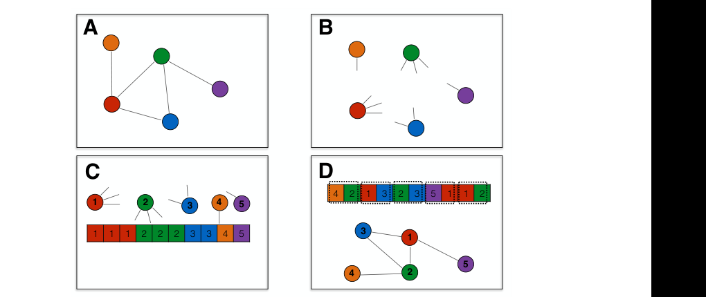
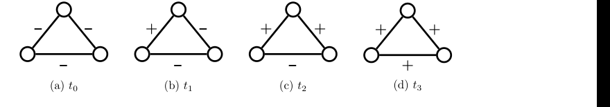
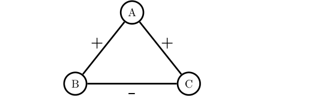

# CS224W：网络分析（2017 秋季）作业 2

> [!info] 授权中文译本
> 本页是 [Stanford CS224W 2017 Problem Set 2](https://snap.stanford.edu/class/cs224w-2017/homeworks/hw2/hw2.pdf) 的完整中文翻译，保留原章节、题号、分值、算法、图意和提交要求。翻译依据用户声明的 Stanford/作者授权制作，并非 Stanford 官方中文版。若公式或图示排版有差异，以原 PDF 为准。本页不含答案。知识准备与失败回流见[[../作业映射/CS224W-2017-HW2-知识点映射]]。

## 基本信息

- **课程**：CS224W：网络分析
- **学期**：2017 年秋季
- **作业**：Problem Set 2
- **截止时间**：2017 年 10 月 26 日，太平洋夏令时 23:59
- **迟交额度**：本作业最多使用 1 个迟交时段，定义见文末信息表。

## 通用说明

这些问题需要认真思考，但不要求很长的答案。请尽可能简洁。

### 提交方式

1. 通过 GradeScope 提交答案，通过 SNAP 提交网站提交代码。
2. 将全部书面答案整理为一个 PDF。每个子问题单独占一页，页首注明题号。课程建议使用提交模板的 LaTeX 文件。
3. 填写并签署文末或模板末尾的信息表，以确认遵守 Honor Code；排版提交时可键入姓名。信息表必须是最后一页，缺失将扣 2 分。
4. 第 2、3 题的[起始代码](http://web.stanford.edu/class/cs224w/homeworks/hw2/starter_code/)提供一种可能的解题起点，但并非唯一方法。可以自由修改并用于构建自己的解法。
5. 在 [SNAP 提交网站](http://snap.stanford.edu/submit) 上传代码，每道大题的全部代码放在一个文件中。

## 1. 配置模型（25 分，Praty、Ziyi）

分析真实网络性质的一种常用方法，是把它与生成式理论模型，即“空模型”比较。课堂第 3 讲讨论过 Erdos-Renyi 模型和配置模型等空模型。Erdos-Renyi 模型具有许多良好的理论性质，而配置模型的用途在于：它能生成具有指定度序列的随机网络。换言之，给定一张真实网络，配置模型允许我们从与真实网络具有完全相同度序列的网络空间中抽样。

本题详细分析配置模型。更多背景可参考 [Aaron Clauset 的配置模型讲义](http://tuvalu.santafe.edu/~aaronc/courses/5352/fall2013/csci5352_2013_L11.pdf)。

我们用配置模型考察 1998 年美国西部电网。在这张网络中，节点代表变压器、变电站和发电机，无向边代表输电线路。

下载数据：[USpowergrid_n4941.txt](http://web.stanford.edu/class/cs224w/homeworks/hw2/data_sets/USpowergrid_n4941.txt)。文件前两列是无向边的两个端点，忽略第三列。

### 1.1 使用 stub matching 模拟配置模型（15 分）

首先使用“随机匹配半边”（stub matching）生成配置模型。其直觉是：把网络拆成许多 stub，也就是带有悬空半边的节点；再随机配对这些 stub，生成随机网络。

算法如下：

1. 计算真实网络的度序列，构造向量

   $$
   \vec{k}=\{k_1,k_2,\ldots,k_n\},
   $$

   其中 $k_i$ 是节点 $i$ 的度，$n$ 是节点数。
2. 创建数组 $v$。对度序列中的每个元素 $k_i$，在 $v$ 中把索引 $i$ 写入恰好 $k_i$ 次。每个 $i$ 代表节点 $i$ 的一个 stub。
3. 对 $v$ 的元素做随机排列。
4. 将 $v$ 中相邻元素两两连接，生成随机网络。形式化地，$v$ 的长度为 $2m$，图中的 $m$ 条无向边为

   $$
   (v_1,v_2),(v_3,v_4),\ldots,(v_{2m-1},v_{2m}).
   $$

该算法有时会生成不合法的非简单网络，例如自环或同一对节点之间的多重边。如果发生这种情况，必须拒绝整张抽样网络并重新抽样。也就是说，构造完成后必须确认网络是简单图；若不是，则抽取一个全新的样本。

**图 1：stub matching 算法的一次示例运行。**

- **A**：一张玩具网络，不同节点用不同颜色标记。
- **B**：把网络拆为 stub；度为 $k$ 的节点带有 $k$ 条半边。
- **C**：给节点编号，构造向量 $v$，节点标签在其中重复 $k$ 次，$k$ 是该节点的度。
- **D**：随机排列 $v$，再把相邻元素配成一对，构造随机网络。

#### 1.1(a)（10 分）

使用电网的度序列，通过 stub matching 抽取 100 张随机简单网络。计算每张样本图的平均聚类系数，并报告 100 张样本的均值。

#### 1.1(b)（2 分）

考虑度分别为 $k_i$ 和 $k_j$ 的节点 $i,j$。在半边随机匹配下，节点 $i,j$ 相连的概率是多少？这个结果说明什么？为简化本子题，允许 stub matching 产生自环和多重边。

#### 1.1(c)（3 分）

构图时我们人为拒绝自环，但在大图中，自环不会造成很大问题。考虑边数 $m$ 非常大的图。用 stub matching 构图时，自环的期望数量是多少？该结果对图中自环所占比例意味着什么？

提示：把自环期望写成 $\langle k^2\rangle$ 与 $\langle k\rangle$ 的函数，其中

$$
\langle k^r\rangle=\frac{1}{n}\sum_i k_i^r,
$$

$n$ 是节点数。

### 1.2 使用重连模拟配置模型（10 分）

从配置模型抽样的第二种、也更常用的方法是“边重连”。该算法从一张实证网络开始，随机重连其中的边，直到网络在本质上随机化。

为美国电网实现边重连。反复执行以下过程：

1. 从图中随机选择两条不同的边

   $$
   e_1=(a,b),\qquad e_2=(c,d).
   $$

2. 从 $e_1$ 的两个端点中随机选一个记为 $u$，另一个记为 $v$。此时要么 $u=a,v=b$，要么 $u=b,v=a$。对 $e_2$ 做同样操作，把随机选中的端点记为 $w$，另一个记为 $x$。
3. 尝试用无向边 $(u,w)$ 和 $(v,x)$ 替换 $e_1,e_2$。只有当替换后的网络仍是简单图，即没有自环或多重边时才接受重连。否则拒绝这次重连并回到步骤 1；若合法，则保留新边并回到步骤 1。

在电网图上运行 10000 次边重连迭代。每 100 次迭代计算一次重连网络的平均聚类系数。绘制平均聚类系数关于迭代次数的曲线。

简要评论曲线：解释其形状，并说明它与 stub matching 算法生成网络的聚类系数有何关系。提示：二者应当非常相近。

### 第 1 题提交内容

**第 1 页**：

- stub matching 生成网络的平均聚类系数，即 100 张样本的均值。
- 度为 $k_i,k_j$ 的节点 $i,j$ 相连的概率表达式，并用 2-3 句话解释表达式及其含义。
- 自环数量的期望，并用 2-3 句话解释该结果对自环比例意味着什么。

**第 2 页**：

- 边重连算法中平均聚类系数关于迭代次数的曲线。
- 用 1-2 句话评论曲线。

**对应知识卡**：[[../../../02-Knowledge/🧠 学习系统/01-社交网络挖掘/02-网络结构与生成模型/随机网络模型-ER-WS-BA-配置模型]]、[[../../../02-Knowledge/🧠 学习系统/01-社交网络挖掘/02-网络结构与生成模型/HW2-重连-结构平衡与投票级联实验]]

## 2. 符号三元组分析（45 分，Poorvi、Anunay）

本题研究符号网络中的平衡概念。第一部分考察实证网络中符号三元组的分布，其余部分研究可能产生这种分布的不同生成模型。

### 2.1 Epinions 中的符号三元组（15 分）

下载：

- [Epinions 数据集](http://web.stanford.edu/class/cs224w/homeworks/hw2/data_sets/epinions-signed.txt)
- [起始代码](http://web.stanford.edu/class/cs224w/homeworks/hw2/starter_code/q2_starter.py)

Epinions 是消费者评论网站，成员可以决定是否信任其他成员，由此形成一张信任网络。

由于成员可以信任或不信任其他成员，这是一张每条边都带符号的符号网络。正边表示两个用户之间的信任，负边表示不信任。本题把图当作无向图，并研究以下四类三元组：

| 类型 | 正边数 | 负边数 |
| :---: | :---: | :---: |
| $t_0$ | 0 | 3 |
| $t_1$ | 1 | 2 |
| $t_2$ | 2 | 1 |
| $t_3$ | 3 | 0 |

**图 2：四种不同类型的符号三元组。**

#### 2.1(a)（5 分）

计算 Epinions 网络中每类三元组的数量和比例。每个三元组只计一次，不计自环。

#### 2.1(b)（5 分）

计算图中正边与负边的比例。令正边比例为 $p$。假设一个三元组中的每条边相互独立，以概率 $p$ 取正号、以概率 $1-p$ 取负号，计算每类三元组出现的概率。

#### 2.1(c)（5 分）

将 2.1(b) 的概率与 2.1(a) 的实证比例比较。相较随机基线，数据中哪些三元组出现得更多？哪些出现得更少？解释该现象。

### 2.2 随机符号网络中的平衡（8 分）

我们已经看到真实网络中符号三元组的分布。现在分析一个简单的符号网络生成模型，以判断实证分布到底有多“出人意料”，尤其是平衡三元组在随机模型中出现的可能性。

定义 $G^+$ 模型：从 $n$ 个节点的完全图开始。每条无向边 $e$ 以概率 $p$ 标为正，以概率 $1-p$ 标为负。

令 $G_B$ 表示图 $G$ 平衡这一事件。对 $p=1/2$ 的 $G^+$ 模型，证明

$$
P(G_B)\to0\qquad(n\to\infty).
$$

#### 2.2(a)（2 分）

令 $T$ 是 $G$ 中最大的边不相交三角形集合。所谓边不相交三角形集合，是指每条边恰好只属于其中一个三角形。给出 $|T|$ 的一个简单下界，即图中互不共享边的三角形数量下界。该下界应是 $n$ 的递增函数。

#### 2.2(b)（2 分）

对 $G$ 中任意一个三角形，它平衡的概率是多少？

#### 2.2(c)（2 分）

利用上一问的简单下界，给出 $T$ 中全部三角形都平衡的概率上界，并证明该概率在 $n\to\infty$ 时趋于 0。

#### 2.2(d)（2 分）

解释为什么上一问意味着 $P(G_B)\to0$。

### 2.3 平衡的动态过程模型（5 分）

如果平衡符号网络不像上一问所示那样由偶然随机产生，那么它们如何出现？一种被提出并研究的机制是动态过程：符号网络随时间演化，变得更加平衡。考虑以下简单过程：

1. 随机选择一个三元组。
2. 如果它已经平衡，不做任何事。
3. 否则，均匀随机选择其中一条边并翻转其符号，使该三元组变为平衡。

判断下述命题是否正确：在此过程中，平衡三元组的数量永远不会减少。如果正确，给出证明；如果错误，给出反例。

### 2.4 仿真（8 分）

在小网络上模拟上述动态过程：

1. 创建一张包含 10 个节点的完全网络。
2. 对每条边，以 $p=1/2$ 随机选择符号 $+$ 或 $-$。
3. 运行 2.3 中的动态过程 1000000 次迭代。

重复整个过程 100 次，即对从 $G^+$ 模型生成的 100 张不同图分别运行动态过程。最终有多大比例的网络变为平衡？

提示：图平衡当且仅当可以把节点划分为两个“阵营”，使同一阵营内每对节点之间都是正边，不同阵营之间每对节点都是负边。为了加速，一旦网络平衡即可停止，因为平衡后网络不再变化。

### 2.5 新节点的作用 I（4 分）

符号网络的另一种演化方式是新节点加入，并与已有节点建立新的符号边。考虑图 3 所示网络。是否可以加入节点 $D$，使它与所有现有节点 $A,B,C$ 都形成符号边，同时 $D$ 本身不属于任何不平衡三元组？说明理由。

**图 3：含一个三角形的不平衡网络。**

### 2.6 新节点的作用 II（5 分）

利用上一子题的答案，考虑一般问题：

取任意节点数、任意一张不平衡的完全符号网络。什么时候，如果存在这种情况，新节点 $X$ 能够加入网络并连接所有现有节点，同时不参与任何不平衡三元组？

如果可能，给出例子；如果不可能，给出论证。

### 第 2 题提交内容

**第 3 页**：

- 2.1(a)：每类三元组的数量和比例。
- 2.1(b)：正边、负边比例以及每类三元组的随机基线概率。
- 2.1(c)：哪些三元组比基线出现得更多或更少，并用 2-3 句话解释。

**第 4 页**：

- 2.2(a)：$|T|$ 的简单下界。
- 2.2(b)：$G$ 中任意三角形平衡的概率。
- 2.2(c)：$T$ 中全部三角形平衡的概率上界，并证明其在 $n\to\infty$ 时趋于 0。
- 2.2(d)：用 1-2 句话解释为什么 $P(G_B)\to0$。

**第 5 页**：

- 平衡三元组数量是否永不减少。
- 若命题正确，给出证明；否则给出反例。

**第 6 页**：最终变为平衡的网络比例。

**第 7 页**：是否可以加入节点 $D$，以及理由。

**第 8 页**：

- 新节点 $X$ 是否可能加入。
- 如果可能给出例子；如果不可能给出论证。

**对应知识卡**：[[../../../02-Knowledge/🧠 学习系统/01-社交网络挖掘/02-网络结构与生成模型/HW2-重连-结构平衡与投票级联实验]]

## 3. 基于决策的级联：一场地方选举（30 分，Anthony、Yokila）

现在正值选举季。候选人 A 与候选人 B 正在阳光明媚的 New Suburb Town 激烈争夺市议会席位。你是候选人 A 的战略顾问，负责选举预测和争取选民。

经过仔细建模，你构造了两个可能的选民社交图版本。每张图有 10000 个节点，节点 ID 是 0 到 9999 的整数。下载边表：

- [Graph 1](http://web.stanford.edu/class/cs224w/homeworks/hw2/data_sets/graph1.txt)
- [Graph 2](http://web.stanford.edu/class/cs224w/homeworks/hw2/data_sets/graph2.txt)

两张图都是无向图。

由于当地政治高度两极化，大多数选民已经决定立场：40% 投 A，40% 投 B，剩余 20% 未决定。每名选民的初始立场由节点 ID 最后一位决定：

- 末位为 `0-3`：支持 A；
- 末位为 `4-7`：支持 B；
- 末位为 `8-9`：未决定。

未决定选民经历为期 10 天的决策期，根据朋友中的多数选择候选人。过程如下：

1. 用每名选民的初始状态 A、B 或未决定初始化图。
2. 每轮中，所有原本未决定的选民都根据朋友状态决定候选人，按节点 ID 从小到大处理。若支持 A 的朋友数严格多于支持 B 的朋友数，该选民支持 A；反之支持 B。忽略仍未决定的朋友。
3. 如果支持 A 和 B 的朋友数相同，就在 A、B 之间交替分配，从 A 开始。也就是说，按节点 ID 顺序处理时，第一次平票判给 A，第二次判给 B，第三次判给 A，依此类推。交替状态对整个网络全局共享，并跨越所有轮次。使用一个全局变量记录当前应判给 A 还是 B，第一轮初始化为 A；每次用它处理平票后立即翻转。
4. 更新时使用当前轮已经产生的新值。例如更新节点 10 时，节点 0-9 使用本轮更新后的值，节点 11 及之后仍使用上一轮的值。
5. 共执行 10 轮。
6. 第 11 天为投票日，统计票数。

只有初始时未决定的选民参与上述决策过程。已经明确立场的选民不会因决策过程改变忠诚对象。

### 3.1 基础设置与预测（8 分）

读入两张图，为网络分配初始投票状态，然后执行 10 轮投票过程。

- Graph 1 中哪位候选人获胜？领先多少票？
- Graph 2 中哪位候选人获胜？领先多少票？

### 3.2 电视广告（8 分）

你筹集了 9000 美元竞选资金，决定在地方新闻中投放广告。不幸的是，只有节点 ID 为 `3000-3089` 的 New Suburb Town 居民观看地方新闻。广告说服力极强：看过广告的人会立即改投候选人 A，无论此前立场如何。

广告每次花费 1000 美元：

- 第一个 1000 美元覆盖选民 `3000-3009`；
- 第二个 1000 美元覆盖选民 `3010-3019`；
- 依此类推。

总共花费 $k$ 美元时，覆盖的节点 ID 范围为

$$
3000\ \text{到}\ 3000+\frac{k}{100}-1.
$$

广告在决策期前发生。被广告说服的选民以后不再改变主意。

模拟不同广告支出对两张候选社交图的影响。每次都重新读入图并设置原始状态，在决策过程开始前购买 $k$ 美元广告，然后执行决策过程并计票。

对两张图，在同一幅图中绘制：

- 横轴：支出 $k=1000,2000,\ldots,9000$；
- 纵轴：A 的获胜票差，即 A 票数减 B 票数。

两张图中分别至少需要花费多少才能赢得选举？

注意：电视广告会影响所有看到广告的选民，不仅是未决定选民。

> [!note] 译者校注
> 原 PDF 写“只有 100 人观看”，但同时给出的 ID 区间 `3000-3089` 和最高预算 9000 美元都只覆盖 90 人。译文保留原数字；实现时应以明确给出的 ID 区间和公式为准，并在报告中注明口径。

### 3.3 宴请高影响力选民（8 分）

电视广告不是使用竞选资金的唯一方式。另一个方案是举办每席 1000 美元的高级宴会，邀请 New Suburb Town 中的“高影响力人士”，即社交图中度数最高的人。

按认识人数从多到少邀请。参加宴会的人无论原立场如何，都会立即改投候选人 A。宴会在决策期前举行。如果多名选民度数相同，优先选择节点 ID 最小者。

模拟宴会对两张图的影响。每次重新读入图并设置初始状态，在决策过程前花费 $k$ 美元举办宴会，然后执行决策过程并计票。

对两张图，在同一幅图中绘制：

- 横轴：支出 $k=1000,2000,\ldots,9000$；
- 纵轴：A 的获胜票差，即 A 票数减 B 票数。

两张图中分别至少需要花费多少才能赢得选举？

注意：宴会会说服所有受邀选民投 A，不仅是未决定选民。

### 3.4 分析（6 分）

在同一幅双对数图中绘制两张图的度分布，方式与 Problem Set 1 的 1.1 相同。

虽然两张图的边数大致相同，但其中一张由 Erdos-Renyi 随机图模型生成，另一张由优先连接模型生成。判断哪张图对应哪个模型。

用 1-2 句话简要说明：这个生成模型信息如何解释 3.3 的结果？

### 第 3 题提交内容

**第 9 页**：两张图中获胜的候选人及其领先票数。

**第 10 页**：

- 两张图的获胜票差关于 $k$ 的曲线，绘制在同一幅图中。
- 在每张图中赢得选举所需的最低广告支出。

**第 11 页**：

- 两张图的获胜票差关于 $k$ 的曲线，绘制在同一幅图中。
- 在每张图中赢得选举所需的最低宴会支出。

**第 12 页**：

- 两张图的双对数度分布，绘制在同一幅图中。
- 每张图对应哪个随机图模型。
- 用 1-2 句话解释随机图模型为什么能说明 3.3 的结果。

**对应知识卡**：[[../../../02-Knowledge/🧠 学习系统/01-社交网络挖掘/02-网络结构与生成模型/HW2-重连-结构平衡与投票级联实验]]、[[../../../02-Knowledge/🧠 学习系统/01-社交网络挖掘/05-传播与影响力/阈值模型与网络级联]]

## 作业提交信息表

### 作业提交

填写此信息表，并将其附在每次作业提交中。本页必须是提交文件的最后一页。作业截止时间均为星期四 23:59。所有学生，无论是否为 SCPD 学生，都必须通过 [GradeScope](http://www.gradescope.com) 提交作业。

学生可以排版作业，也可以扫描手写作业。每个题目或子题的答案必须分别占一页，无论答案长短。学生还需要在 [SNAP 提交网站](http://snap.stanford.edu/submit) 上传代码。每道大题的全部代码放在一个文件中。GradeScope 提交文件中不要包含代码。

### 迟交政策

每名学生总共有两个免费迟交时段。作业在星期四太平洋夏令时 23:59 截止；下一个星期一 23:59 时，一个迟交时段到期。每份作业最多只能使用一个迟交时段。星期一 23:59 之后收到的作业不得分。免费迟交时段用完后，迟交作业不得分。

### Honor Code

课程强烈鼓励学生组成学习小组。学生可以分组讨论和处理作业问题，但每名学生必须独立写出自己的解答，也就是必须真正理解解法并能独立重建。学生应明确列出参与讨论的其他同学姓名。

使用从网络上获得的代码或解答，包括 GitHub、Google 或往年答案，将被视为违反 Honor Code。课程会对所有提交进行抄袭检查，并严肃对待 Honor Code。

- **姓名**：
- **邮箱**：
- **SUID**：
- **讨论小组成员**：
- **声明**：本人确认并接受 Honor Code。
- **签名**：
