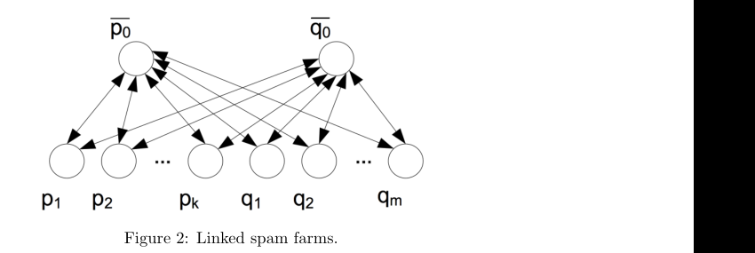
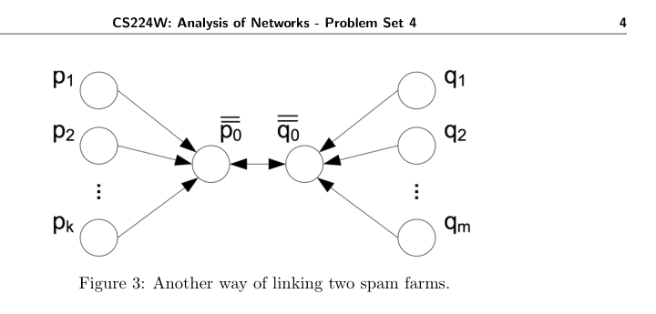

# CS224W：网络分析（2017 秋季）作业 4

> [!info] 授权中文译本
> 本页是 [Stanford CS224W 2017 Problem Set 4](https://snap.stanford.edu/class/cs224w-2017/homeworks/hw4/hw4.pdf) 的完整中文翻译，保留原章节、题号、分值、公式、算法、图意和提交要求。翻译依据用户声明的 Stanford/作者授权制作，并非 Stanford 官方中文版。若公式或图示排版有差异，以原 PDF 为准。本页不含答案。知识准备与失败回流见[[../作业映射/CS224W-2017-HW4-知识点映射]]。

## 基本信息

- **课程**：CS224W：网络分析
- **学期**：2017 年秋季
- **作业**：Problem Set 4
- **截止时间**：2017 年 11 月 30 日，太平洋夏令时 23:59
- **迟交额度**：本作业最多使用 1 个迟交时段，定义见文末信息表。

## 通用说明

这些问题需要认真思考，但不要求很长的答案。请尽可能简洁。

### 提交方式

1. 通过 GradeScope 提交答案，通过 SNAP 提交网站提交代码。
2. 将全部书面答案整理为一个 PDF，页首注明题号。课程建议使用提交模板的 LaTeX 文件。
3. 填写并签署文末或模板末尾的信息表，以确认遵守 Honor Code；排版提交时可键入姓名。信息表必须是最后一页，缺失将扣 2 分。
4. 在 [SNAP 提交网站](http://snap.stanford.edu/submit) 上传代码，每道大题的全部代码放在一个文件中。
5. 提交作业后填写 Homework 4 Feedback Form；填写者可获得额外学分。

## 1. PageRank 主题变体（25 分，Silviana、Poorvi）

### 1.1 个性化 PageRank I（7 分）

个性化 PageRank 是一个非常重要的现实问题：不同用户认为不同网页与自己相关，因此搜索引擎可以调整网页相关性估计，为用户提供更适合其兴趣的结果。

回顾课堂内容：通过巧妙修改 teleport 向量，可以把 PageRank 专门化为个性化 PageRank。本题研究这种方法。

假设人的兴趣可以用一组代表性页面表示。例如，Zuzanna 对体育和食物感兴趣，可以用页面集合

$$
\{\texttt{www.espn.com},\texttt{www.epicurious.com}\}
$$

表示。为方便记号，本题使用整数作为网页名称。

假设已经计算出以下用户的个性化 PageRank 向量：

- Agatha 的兴趣由 teleport 集合 $\{1,2,3\}$ 表示；
- Bertha 的兴趣由 teleport 集合 $\{3,4,5\}$ 表示；
- Clementine 的兴趣由 teleport 集合 $\{1,4,5\}$ 表示；
- DeShawn 的兴趣由 teleport 集合 $\{1\}$ 表示。

假设 teleport 集合中每个节点的权重相同。在不查看图结构的情况下，对以下用户判断能否计算其个性化 PageRank 向量；若能，说明方法；若不能，说明原因。teleport 参数 $\beta$ 固定。

#### 1.1(i)（2 分）

Eloise 的兴趣由 teleport 集合 $\{2\}$ 表示。

#### 1.1(ii)（2 分）

Felicity 的兴趣由 teleport 集合 $\{5\}$ 表示。

#### 1.1(iii)（3 分）

Glynnis 的兴趣由 teleport 集合 $\{1,2,3,4,5\}$ 表示，对应权重依次为

$$
0.1,\ 0.2,\ 0.3,\ 0.2,\ 0.2.
$$

### 1.2 个性化 PageRank II（3 分）

假设已经计算出一组用户的个性化 PageRank 向量，记这个已计算向量集合为 $V$。在不访问 Web 图的情况下，能够从 $V$ 计算出的全部个性化 PageRank 向量构成什么集合？

### 1.3 Spam Farm I（5 分）

每天使用搜索引擎查找信息的人数极其庞大，因此较高的 PageRank 分数很有价值。这会激励人们操纵系统，人为提高网站 PageRank。由于 PageRank 依赖链接结构，许多 PageRank 垃圾攻击利用特殊网络配置，提高目标页面的 PageRank。本题研究这些配置，即 spam farm。

考虑图 1 所示 spam farm。攻击者控制一组 boosting 页面 $1,\ldots,k$，页面 $i$ 的 PageRank 分数为 $p_i$，并试图提高目标页面 0 的 PageRank。目标页从图中其他部分获得数量为 $\lambda$ 的 PageRank（图中的虚线箭头）。

其中

$$
\lambda=\sum_{i\in S}\frac{r_i}{d_i},
$$

$S$ 是图中其他部分、链接到目标页面 0 的节点集合，$r_i$ 是节点 $i\in S$ 的 PageRank 分数，$d_i$ 是节点 $i$ 的出度。

令 $N$ 为整个 Web 的页面数量，包括 boosting 页面和目标页面。求该配置下目标页面的 PageRank $p_0$，要求它是 $\lambda,k,\beta,N$ 的函数，表达式中不得出现 $p_i$ 等其他参数。

提示：可以先写出关于 $p_1,\ldots,p_k,\beta,k,N$ 的 $p_0$ 表达式，再把 boosting 页的 PageRank 写成关于 $p_0,\beta,k,N$ 的表达式。记住 $\lambda$ 是从 spam farm 外部链接到目标节点的 PageRank；$p_0$ 必须包含 teleportation 项。

**图 1：一个 spam farm。**

### 1.4 Spam Farm II（5 分）

事实证明，图 1 的结构在可用资源给定时是最优的，即它最大化目标页的 PageRank $p_0$。但与其他攻击者合作仍可能做得更好。

此外，从图其余部分获得的 $\lambda$ 在数学上等价于增加某些 boosting 页面，因此本题后续忽略 $\lambda$。

考虑两个攻击者把各自的 spam farm 连接起来：除了链接到自己的目标页，每个攻击者还链接到对方的目标页，如图 2 所示。若两个攻击者单独运行上一问的 spam 配置（此时没有 $\lambda$），令目标页 PageRank 分别为 $p'_0,q'_0$。

在新配置下，求目标页面 $\bar p_0,\bar q_0$ 的 PageRank，要求结果是 $k,m,\beta,N$ 的函数，其中 $N$ 仍为 Web 图页面总数。计算

$$
p'_0+q'_0,\qquad \bar p_0-p'_0,\qquad \bar q_0-q'_0,\qquad \bar p_0+\bar q_0.
$$

攻击者合作是否比独立运行更有利？也就是说，是否有

$$
\bar p_0+\bar q_0>p'_0+q'_0?
$$

**图 2：连接起来的两个 spam farm。**

### 1.5 Spam Farm III（5 分）

攻击者还可以用其他方式结盟。考虑图 3：两个攻击者只把自己的目标页面互相连接。再次令 $p'_0,q'_0$ 表示两个攻击者各自运行原配置时获得的目标页 PageRank。

在图 3 的配置下，求目标页面 $\bar p_0,\bar q_0$ 的 PageRank，要求是 $k,m,\beta,N$ 的函数。计算

$$
p'_0+q'_0,\qquad \bar p_0-p'_0,\qquad \bar q_0-q'_0,\qquad \bar p_0+\bar q_0.
$$

攻击者合作是否比独立运行更有利？也就是说，是否有

$$
\bar p_0+\bar q_0>p'_0+q'_0?
$$

**图 3：连接两个 spam farm 的另一种方式。**

### 第 1 题提交内容

**第 1 页**：对 1.1(i)、(ii)、(iii) 分别回答“是”或“否”，并简要解释原因。

**第 2 页**：用 $V$ 表达可计算集合，并简要解释。

**第 3 页**：给出关于 $k,\beta,N$ 的 $p_0$ 表达式，并展示推导过程。

**第 4 页**：给出关于 $k,m,\beta,N$ 的 $p'_0+q'_0$、$\bar p_0-p'_0$、$\bar q_0-q'_0$ 和 $\bar p_0+\bar q_0$ 表达式，并展示推导；回答攻击者是否更有利以及原因。

**第 5 页**：对图 3 的配置给出同样四个表达式、推导和是否更有利的判断。

**对应知识卡**：[[../../../02-Knowledge/🧠 学习系统/01-社交网络挖掘/04-排序与链接预测/PageRank-HITS-PPR与Spam-Farm]]、[[../../../02-Knowledge/🧠 学习系统/01-社交网络挖掘/04-排序与链接预测/PageRank-HITS-PPR与Spam-Farm]]

## 2. 近似边介数中心性（25 分，Anunay、Praty）

边介数中心性是网络分析中的重要概念。例如，课堂介绍过用于社区发现的 Girvan-Newman 算法，其中就把介数中心性作为子程序。

给定无向图 $G=(V,E)$，边 $\{v,w\}\in E$ 的介数中心性定义为

$$
B(\{v,w\})=
\sum_{(s,t)\in V^2}
\frac{\sigma_{st}(\{v,w\})}{\sigma_{st}},
$$

其中 $\sigma_{st}$ 是 $s,t$ 之间最短路径的数量，$\sigma_{st}(\{v,w\})$ 是包含边 $\{v,w\}$ 的 $s,t$ 最短路径数量。

本题假设 $G$ 连通，即任意两个节点之间始终存在路径。

### 算法 1：精确边介数中心性

对每个顶点 $s\in V$，从 $s$ 执行 BFS，得到 BFS 树 $T_s$。对每个 $v\in V$，定义 $v$ 的父节点集合 $P_s(v)$：集合中的节点 $u\in V$ 会在 $G$ 中某条从 $s$ 到 $v$ 的最短路径上紧邻 $v$ 之前出现。

BFS 期间，对每个 $v\in V$ 计算 $s,v$ 之间最短路径的数量 $\sigma_{sv}$：

$$
\sigma_{sv}=
\begin{cases}
1, & v=s,\\[4pt]
\displaystyle\sum_{u\in P_s(v)}\sigma_{su}, & \text{其他情况}。
\end{cases}
$$

BFS 完成后，用以下递推计算源点 $s$ 对每条边 $\{v,w\}\in E$ 的依赖：

$$
\delta_s(\{v,w\})=
\begin{cases}
\dfrac{\sigma_{sv}}{\sigma_{sw}}, & w\text{ 是 }T_s\text{ 的叶节点},\\[8pt]
\dfrac{\sigma_{sv}}{\sigma_{sw}}
\left(1+\displaystyle\sum_{x:w\in P_s(x)}\delta_s(\{w,x\})\right), & \text{其他情况}。
\end{cases}
$$

不失一般性，假设从 $s$ 到 $v$ 的最短路径短于到 $w$ 的最短路径。由此有：

- $\delta$ 只对连接两个节点 $u,v$ 且其中一个比另一个离 $s$ 更远的边真正定义。若边的两端到 $s$ 等距，则约定 $\delta=0$。
- 计算依赖时不必遍历所有边；只需查看从 $s$ 出发的某棵 BFS 树中的边，因为其他边不在任何最短路径上，依赖为 0。遍历所有边也不算错误，只要节点等距时将依赖设为 0。
- 必须确保每条边的依赖只计算一次，并且分子/分母使用正确的 $\sigma$ 值。离源点 $s$ 较近的节点的 $\sigma$ 应始终位于分子。

由于边无向，

$$
\delta_s(\{v,w\})=\delta_s(\{w,v\}).
$$

最后，边 $\{v,w\}$ 的边介数为

$$
B(\{v,w\})=\sum_{s\in V}\delta_s(\{v,w\}).
$$

算法 1 的时间复杂度是 $O(nm)$，其中 $n,m$ 分别是节点数和边数。对无向、无权图，目前没有更快的精确计算边介数算法。注意，使用算法 1 时，即使只关心部分边，也必须计算所有边的介数。

### 算法 2：近似边介数中心性

算法 2 与算法 1 几乎相同，区别在于：它不从每个节点开始 BFS，而是有放回地随机抽取起点；同时，它可以近似计算任意指定边 $e\in E$ 的介数，而无需同时计算其他所有边。

反复执行：

1. 从 $V$ 中随机抽取节点 $v_i$；
2. 从 $v_i$ 执行算法 1 中的 BFS；
3. 对每条感兴趣的边 $e$，维护依赖分数 $\delta_{v_i}(e)$ 的运行总和 $\Delta_e$，每条边各维护一个 $\Delta_e$；
4. 继续抽样，直到对某个常数 $c\ge2$，满足

   $$
   \Delta_e>cn;
   $$

5. 令总抽样数为 $k$，边 $e$ 的介数估计为

   $$
   \frac{n}{k}\Delta_e.
   $$

### 定理 1：近似保证

若 $0<\epsilon<1/2$，且边 $e$ 的中心性为

$$
\frac{n^2}{t},
$$

其中 $t\ge1$ 为常数，则使用 $\epsilon t$ 个源节点样本时，以至少 $1-2\epsilon$ 的概率，可以在因子 $1/\epsilon$ 范围内估计其中心性。

算法 2 在实践中运行快得多。本题要求实现并比较两个算法。

### 仿真

按以下步骤进行：

1. 使用 Barabasi-Albert 优先连接模型生成随机图：节点数 $n=1000$，每加入一个节点，就把它连接到 4 个已有节点。可使用 SNAP 函数 `snap.GenPrefAttach(1000, 4)`。
2. 实现算法 1，计算所有边 $e\in E$ 的精确边介数。
3. 实现算法 2，计算所有边 $e\in E$ 的近似边介数。取 $c=5$，随机起点最多抽取 $n/10$ 个。
4. 两个算法都会根据边介数给出边排序。提交一张叠加图：算法 1 一条曲线，算法 2 一条曲线。若按照相应算法，边介数排名第 $x$ 的边的介数为 $y$，则绘制坐标 $(x,y)$ 的点。纵轴使用对数刻度。简要评论两条曲线。
5. 比较两个算法的运行时间并简要评论。

### 第 2 题提交内容

**第 6 页**：曲线图及简短评论；两个算法运行时间差异的简短评论。

**对应知识卡**：[[../../../02-Knowledge/🧠 学习系统/01-社交网络挖掘/03-社会结构与社区/边介数与Brandes近似]]、[[../../../02-Knowledge/🧠 学习系统/01-社交网络挖掘/03-社会结构与社区/HW4-边介数-Polblogs与谱方法实验]]

## 3. 随机 Kronecker 图（20 分，Yokila）

本题研究随机 Kronecker 图的一些数学性质。

### 3.1 位向量表示（2 分）

推导随机 Kronecker 图节点的一种有用位向量表示。后续子题将使用这种表示，推导边概率和其他图性质的闭式表达式。

给定对称的 $2\times2$ 概率矩阵 $\Theta_1$，令

$$
\Theta_1[1,1]=\alpha,
\qquad
\Theta_1[1,0]=\Theta_1[0,1]=\beta,
\qquad
\Theta_1[0,0]=\gamma,
$$

并满足

$$
0\le\gamma\le\beta\le\alpha\le1.
$$

基于第 $k$ 次 Kronecker 幂 $\Theta_k$ 的随机 Kronecker 图有 $2^k$ 个节点。

证明如何用长度为 $k$ 的唯一位向量标记每个节点，使节点

$$
u=(u_1u_2\ldots u_k),\qquad
v=(v_1v_2\ldots v_k)
$$

之间存在边的概率为

$$
\prod_{b=1}^{k}\Theta_1[u_b,v_b].
$$

### 3.2 边概率（5 分）

定义顶点权重为其位向量标签中 1 的数量。考虑权重为 $\ell$ 的节点 $u$。对任意节点 $v$，令：

- $i$ 是满足 $u_b=v_b=1$ 的位数；
- $j$ 是满足 $u_b=0,v_b=1$ 的位数。

这里 $u_b,v_b$ 是 $u,v$ 位表示中的第 $b$ 位，且每个节点的表示有 $k$ 位。

使用 3.1 的结果，推导 $P[u,v]$ 关于 $i,j,\ell$ 的表达式，其中 $P[u,v]$ 表示出现边的概率。

提示：表达式应包含 3.1 中的 $\alpha,\beta,\gamma$。

### 3.3 度（5 分）

求用 $k$ 位表示、权重为 $\ell$ 的节点 $u$ 的期望度。

提示：可能需要使用二项式公式

$$
(x+y)^n=\sum_{k=0}^{n}\binom{n}{k}x^ky^{n-k}.
$$

### 3.4 边数（4 分）

根据上一问的结果，可以方便地计算图的其他性质。假设图是无向图，求图中边数的期望。

本小题不需要把自环作为特殊情况处理。

### 3.5 自环（4 分）

仍假设图是无向图。求自环数量的期望。

### 第 3 题提交内容

**第 7 页**：简短推导。

**第 8 页**：关于给定变量写出 $P[u,v]$，并展示/解释过程。

**第 9 页**：节点 $u$ 的期望度，展示并解释过程。

**第 10 页**：图中期望边数，展示并解释过程。

**第 11 页**：图中期望自环数，展示并解释过程。

**对应知识卡**：[[../../../02-Knowledge/🧠 学习系统/01-社交网络挖掘/06-表示学习与项目/Kronecker图与网络演化]]

## 4. 谱聚类（35 分，Anthony、Ziyi）

本题推导若干谱聚类算法，并用它们分析真实数据集。这些算法使用与图相关矩阵的特征向量。解题时可以参考课程的图聚类讲义。

### 符号与定义

令 $G=(V,E)$ 是简单、无向、连通图，即没有自环或多重边；$n=|V|$，$m=|E|$。

- 邻接矩阵 $A$：若 $(i,j)\in E$，则 $A_{ij}=1$，否则 $A_{ij}=0$。
- 度矩阵 $D$：对角元素

  $$
  D_{ii}=\sum_j A_{ij}.
  $$

- 图拉普拉斯矩阵

  $$
  L=D-A.
  $$

对节点集合 $S\subset V$，用 cut 和 volume 衡量它作为社区的质量。

集合 $S$ 的 cut 是一端在 $S$、另一端在补集 $\bar S=V\setminus S$ 的边数量：

$$
\operatorname{cut}(S)=\sum_{i\in S,j\in\bar S}A_{ij}.
$$

注意 cut 对称，即

$$
\operatorname{cut}(S)=\operatorname{cut}(\bar S).
$$

集合 $S$ 的 volume 是其中节点度数之和：

$$
\operatorname{vol}(S)=\sum_{i\in S}d_i,
$$

其中 $d_i$ 是节点 $i$ 的度。

### 4.1 最小化 normalized cut 的谱算法（10 分）

我们希望找到 normalized cut 较小的集合 $S$：

$$
\operatorname{NCUT}(S)=
\frac{\operatorname{cut}(S)}{\operatorname{vol}(S)}
+
\frac{\operatorname{cut}(\bar S)}{\operatorname{vol}(\bar S)}.
\tag{1}
$$

直观上，NCUT 较小的集合既应当只有少量边连接到图的其他部分（分子小），也应当在规模上相对平衡（分母大）。

对节点集合 $S$ 定义赋值向量 $x$：

$$
x_i=
\begin{cases}
\sqrt{\dfrac{\operatorname{vol}(\bar S)}{\operatorname{vol}(S)}}, & i\in S,\\[10pt]
-\sqrt{\dfrac{\operatorname{vol}(S)}{\operatorname{vol}(\bar S)}}, & i\in\bar S.
\end{cases}
\tag{2}
$$

证明以下性质：

1. $x^TLx=c\cdot\operatorname{NCUT}(S)$，其中 $c$ 是由题目参数决定的常数。
2. $x^TDe=0$，其中 $e$ 是全 1 向量。
3. $x^TDx=2m$。

因为 $x^TDx$ 是常数 $2m$，可以把 normalized cut 最小化写为

$$
\begin{aligned}
\min_{S\subset V,\ x\in\mathbb R^n}\quad&
\frac{x^TLx}{x^TDx}\\
\text{s.t.}\quad&x^TDe=0,\\
&x^TDx=2m,\\
&x\text{ 具有式 (2) 的形式}.
\end{aligned}
\tag{3}
$$

要求 $x$ 具有式 (2) 的形式使该优化问题 NP-hard。现在使用“松弛并舍入”：去掉该约束，使优化问题可处理，再把松弛解舍入回原问题的可行点。

松弛问题为

$$
\begin{aligned}
\min_{x\in\mathbb R^n}\quad&
\frac{x^TLx}{x^TDx}\\
\text{s.t.}\quad&x^TDe=0,\\
&x^TDx=2m.
\end{aligned}
\tag{4}
$$

证明式 (4) 的最小化向量为

$$
D^{-1/2}v,
$$

其中 $v$ 是归一化图拉普拉斯

$$
\widetilde L=D^{-1/2}LD^{-1/2}
$$

的第二小特征值对应的特征向量。

最后，为把解舍入回原问题的可行点，可以把特征向量中所有正元素的下标作为集合 $S$，所有负元素的下标作为 $\bar S$。

提示：

1. 作代换 $z=D^{1/2}x$。
2. 注意 $e$ 是 $L$ 最小特征值对应的特征向量。
3. 归一化图拉普拉斯 $\widetilde L$ 是对称矩阵，因此任意向量都可以写成其正交归一特征向量的线性组合。

### 4.2 最大化模块度的谱算法（8 分）

令 $y\in\{1,-1\}^n$ 为集合 $S$ 的赋值向量：

$$
y_i=
\begin{cases}
1,&i\in S,\\
-1,&i\in\bar S.
\end{cases}
\tag{5}
$$

赋值 $y$ 的模块度为

$$
Q(y)=\frac{1}{2m}
\sum_{1\le i,j\le n}
\left[A_{ij}-\frac{d_id_j}{2m}\right]
\mathbb I_{y_i=y_j}.
\tag{6}
$$

其中 $d_id_j/(2m)$ 近似表示：在具有相同度序列的随机多重图中，节点 $i,j$ 之间的期望边数。可以把它理解为 Problem Set 2 中的配置模型，但允许一对节点之间有多重边。因此 $A_{ij}-d_id_j/(2m)$ 衡量图中的连接有多“出人意料”。

证明

$$
Q(y)=cy^TBy,
$$

其中

$$
B=A-\frac{1}{2m}dd^T.
$$

提示：先证明 $Be=0$，然后使用

$$
y_iy_j+1=2\mathbb I_{y_i=y_j}.
$$

对任意赋值向量 $y$，都有 $y^Ty=n$。因此模块度最大化问题可以写成

$$
\begin{aligned}
\max_{S\subset V,\ y\in\mathbb R^n}\quad&y^TBy\\
\text{s.t.}\quad&y^Ty=n,\\
&y\text{ 具有式 (5) 的形式}.
\end{aligned}
\tag{7}
$$

再次使用松弛并舍入。去掉 $y$ 必须具有式 (5) 的约束，得到

$$
\begin{aligned}
\max_{y\in\mathbb R^n}\quad&y^TBy\\
\text{s.t.}\quad&y^Ty=n.
\end{aligned}
\tag{8}
$$

证明式 (8) 的最优向量是 $B$ 的最大，即最大的代数特征值对应的特征向量。

最后，为舍入解，可以把特征向量中所有正元素的下标作为集合 $S$，所有负元素的下标作为 $\bar S$。

提示：模块度矩阵 $B$ 也是对称矩阵，因此证明应与 4.1 类似。

### 4.3 模块度与 cut、volume 的关系（7 分）

上一问把模块度定义为相对于空模型的“出人意料程度”。然而，模块度也与 cut 和 volume 有关。令 $y$ 为式 (5) 中的赋值向量。证明

$$
Q(y)=\frac{1}{2m}
\left(
-2\cdot\operatorname{cut}(S)
+\frac{1}{m}\operatorname{vol}(S)\operatorname{vol}(\bar S)
\right).
\tag{9}
$$

因此，最大化模块度实际上等价于最小化 cut 与分区 volume 负乘积之和。

### 4.4 政治博客网络分析（10 分）

使用上述谱算法对网络进行聚类。下载 [polblogs 网络](http://cs224w.stanford.edu/homeworks/hw4/data_sets/polblogs.txt)。该网络的节点是政治博客；如果博客 $i$ 链接博客 $j$，或博客 $j$ 链接博客 $i$，则二者之间存在无向边。

博客标签为：

- 自由派（label 0）；
- 保守派（label 1）。

从[标签文件](http://cs224w.stanford.edu/homeworks/hw4/data_sets/polblogs-labels.txt)下载标签。

实现 normalized cut 最小化谱算法和模块度最大化谱算法。使用它们把 polblogs 网络划分为两个节点集合 $S$ 与 $\bar S$。

分别计算并报告两种算法得到的 $S$ 与 $\bar S$ 的规模，以及相对于真实标签的聚类纯度（purity）。

### 第 4 题提交内容

**第 12 页**：三个性质的证明，以及最小化向量的证明。

**第 13 页**：模块度二次型的证明，以及最大化向量的证明。

**第 14 页**：模块度与 cut、volume 关系的证明。

**第 15 页**：

- normalized cut 最小化谱算法和模块度最大化谱算法分别发现的两个簇中 $S$ 与 $\bar S$ 的节点数。
- 两种算法相对于真实标签的聚类纯度。

**对应知识卡**：[[../../../02-Knowledge/🧠 学习系统/01-社交网络挖掘/03-社会结构与社区/社区发现-模块度与谱松弛]]、[[../../../02-Knowledge/🧠 学习系统/01-社交网络挖掘/03-社会结构与社区/HW4-边介数-Polblogs与谱方法实验]]

## 作业提交信息表

### 作业提交

填写此信息表，并将其附在每次作业提交中。本页必须是提交文件的最后一页。作业截止时间均为星期四 23:59。所有学生，无论是否为 SCPD 学生，都必须通过 [GradeScope](http://www.gradescope.com) 提交作业。

学生可以排版作业，也可以扫描手写作业。每个题目或子题的答案必须分别占一页，无论答案长短。学生还需要在 [SNAP 提交网站](http://snap.stanford.edu/submit) 上传代码。每道大题的全部代码放在一个文件中。GradeScope 提交文件中不要包含代码。

### 迟交政策

每名学生总共有两个免费迟交时段。作业在星期四太平洋夏令时 23:59 截止；下一个星期一 23:59 时，一个迟交时段到期。每份作业最多只能使用一个迟交时段。星期一 23:59 之后收到的作业不得分。免费迟交时段用完后，迟交作业不得分。

### Honor Code

课程强烈鼓励学生组成学习小组。学生可以分组讨论和处理作业问题，但每名学生必须独立写出自己的解答，也就是必须真正理解解法并能独立重建。学生应明确列出参与讨论的其他同学姓名。

使用从网络上获得的代码或解答，包括 GitHub、Google 或往年答案，将被视为违反 Honor Code。课程会对所有提交进行抄袭检查，并严肃对待 Honor Code。

- **姓名**：
- **邮箱**：
- **SUID**：
- **讨论小组成员**：
- **声明**：本人确认并接受 Honor Code。
- **签名**：
