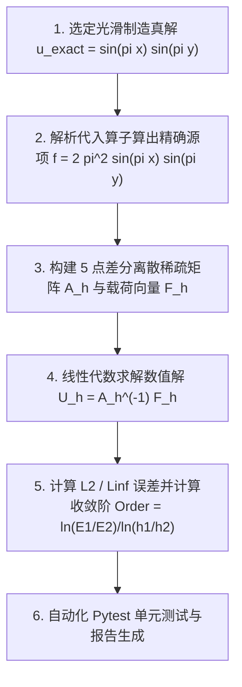

# 偏微分方程-大作业-制造解方法驱动的PDE有限差分求解与收敛阶验证

> 所属阶段：[[02-Knowledge/🧠 学习系统/34-偏微分方程/04-现代变分弱解与数值计算/🧭 阶段4-现代变分弱解与数值计算|阶段 4：现代变分弱解与数值计算]]  
> 考查目标：完成偏微分方程从数理推导到工程代码的最终闭环，实现二维 Poisson 方程 5 点差分求解器，利用制造解方法 (MMS) 进行多重网格细化 ($N \in \{10, 20, 40, 80\}$)，精确测定 $L_2$ 与 $L_\infty$ 误差范数，并绘制与验证理论 $O(h^2)$ 收敛阶。

---

## 学习目标
- 掌握科学计算中偏微分方程求解器的工业级验证技术——制造解方法 (Method of Manufactured Solutions, MMS)。
- 熟练利用 Python、NumPy 与 SciPy 稀疏矩阵工具构建 2D 离散拉普拉斯算子与 Kronecker 积。
- 掌握多重网格细化下的离散误差范数测定与对数收敛阶线性回归拟合方法。
- 编写自动化单元测试套件，通过持续集成验证二阶代数相容性与数值稳定性。

---

## 任务背景与边界
在真实工程与物理仿真中，由于大多数复杂边界几何或非线性 PDE 缺乏初等解析解，无法通过已知真解直接衡量数值误差。制造解方法 (MMS) 是计算流体力学 (CFD) 与计算力学中的黄金标准：通过主动选取高阶光滑解析函数，反代入微分算子导出精确外力源项，从而构筑一个精度严格已知、支持任意网格细化的闭环验证基准。

---

## 详细题目与实验任务



### 任务 1：MMS 解析推导与定解边界构建（15分）
选定定义在二维单位正方形 $\Omega = (0, 1)^2$ 上的制造真解：
$$u_{exact}(x, y) = \sin(\pi x) \sin(\pi y)$$
1. **源项计算**：精确计算其拉普拉斯算子作用，导出对应的负源项函数：
   $$f(x, y) = -\Delta u_{exact} = -\left( \frac{\partial^2 u}{\partial x^2} + \frac{\partial^2 u}{\partial y^2} \right) = 2\pi^2 \sin(\pi x) \sin(\pi y)$$
2. **边界条件检验**：验证 $u_{exact}$ 在正方形四条边界 $x=0, x=1, y=0, y=1$ 上均严格恒等于 0，满足齐次 Dirichlet 边界条件。

### 任务 2：Python 5 点差分稀疏矩阵求解器编写（25分）
在 `03-Projects/34-偏微分方程/scripts/mms_poisson_solver.py` 中编写高效数值求解器：
1. 取网格划分数 $N$，网格步长 $h = 1/N$，内部自由度节点数为 $(N-1) \times (N-1)$。
2. 构建一维三对角离散差分矩阵 $T = \text{tridiag}(-1, 2, -1) \in \mathbb{R}^{(N-1)\times(N-1)}$。
3. 利用 Kronecker 积张量积合成二维 5 点差分稀疏矩阵：
   $$A_h = \frac{1}{h^2} \left( T \otimes I + I \otimes T \right)$$
4. 计算内部载荷向量 $F_h$，调用 `scipy.sparse.linalg.spsolve` 求解线性代数系统 $A_h U_h = F_h$。

### 任务 3：多网格细化误差测定与收敛阶计算（20分）
程序自动在多重细化网格 $N \in [10, 20, 40, 80]$（步长 $h \in [0.1, 0.05, 0.025, 0.0125]$）上运行，并计算：
1. **离散加权 $L_2$ 误差范数**：
   $$E_{L_2}(h) = \sqrt{h^2 \sum_{i=1}^{N-1}\sum_{j=1}^{N-1} |U_{i,j} - u_{exact}(x_i, y_j)|^2}$$
2. **离散最大模 $L_\infty$ 误差范数**：
   $$E_{L_\infty}(h) = \max_{1 \le i, j \le N-1} |U_{i,j} - u_{exact}(x_i, y_j)|$$
3. **计算相邻网格实测收敛阶**：
   $$\text{Order} = \frac{\ln(E(h_{k-1}) / E(h_k))}{\ln(h_{k-1} / h_k)}$$
   打印格式化对齐收敛阶表格。

### 任务 4：自动化单元测试套件开发（20分）
在 `03-Projects/34-偏微分方程/tests/test_mms_solver.py` 中编写自动化测试：
1. 编写单网格残差与基础数值范围断言测试。
2. 编写多网格细化收敛阶自动化断言测试，断言实测收敛阶满足 $1.95 \le \text{Order} \le 2.05$。

### 任务 5：实验结果分析与数值报告（20分）
分析为什么 5 点中心差分格式能够达到严谨的 $O(h^2)$ 二阶收敛；讨论若制造解选择带有拐角奇异性的非光滑函数（如 $r^{2/3}\sin(2\theta/3)$）时，收敛阶为何会退化至 $O(h^{2/3})$。

---

## 提交要求
- 提交完整可运行的 Python 求解器代码：`scripts/mms_poisson_solver.py`。
- 提交自动化回归测试脚本：`tests/test_mms_solver.py`。
- 提交终端运行输出的收敛阶四级细化表格与二阶收敛证实。

---

## 验收标准与 Rubric (100分)

| 验收维度 | 核心要求 | 满分标准 |
| :--- | :--- | :---: |
| **1. MMS 解析推导** | 准确推导选定真解 $u_{exact}(x, y) = \sin(\pi x)\sin(\pi y)$ 的拉普拉斯负源项 $f(x, y) = 2\pi^2 \sin(\pi x)\sin(\pi y)$ | 15分 |
| **2. 差分格式构建** | 准确生成单位正方形 $\Omega = (0, 1)^2$ 上的 5 点差分稀疏矩阵 $A_h$，边界 Dirichlet 准确嵌入 | 25分 |
| **3. 多网格细化** | 程序自动在 $N = 10, 20, 40, 80$ (步长 $h = 0.1, 0.05, 0.025, 0.0125$) 依次求解 | 20分 |
| **4. 误差与收敛阶** | 自动输出 $L_2$ 范数误差、最大模 $L_\infty$ 误差以及相邻网格实测收敛阶表格 | 20分 |
| **5. 自动化测试** | `pytest` 自动化测试套件通过，断言实测收敛阶 $p \in [1.95, 2.05]$ | 20分 |

---

## 引导与自检清单
- [ ] 检查一维 Kronecker 积是否正确保留了自然网格行优先排序。
- [ ] 检查 $L_2$ 范数计算时是否乘上了面积权重 $h^2$（即 $\sqrt{h^2 \sum e^2}$），否则算出的只是未加权的欧氏向量模长。
- [ ] 检查多重网格实测收敛阶是否稳定在 $2.00 \pm 0.02$。

---

## 🚀 快速执行验证命令

```powershell
python f:\-\03-Projects\34-偏微分方程\scripts\mms_poisson_solver.py
pytest f:\-\03-Projects\34-偏微分方程\tests\
```
