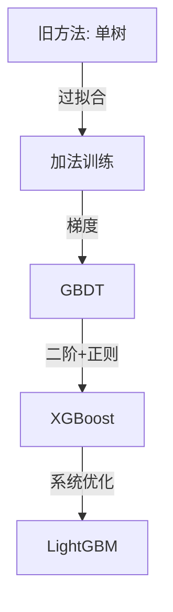

# 03 · Obsidian 嵌入与反向链接

> 把"独立卡片"串成"知识图谱"。

## 🧷 4 类链接语法

| 语法 | 作用 | 例 |
|:---|:---|:---|
| `[[X]]` | 双向链接（最常用） | 见 `[[假设空间]]` 的人会自动反向 |
| `[[X#段落]]` | 链接到指定段 | `[[假设空间#直觉模型]]` |
| `[[X#^block-id]]` | 链接到指定 block | `[[XGBoost#^eq-regularization]]` |
| `![[X]]` | 嵌入整张卡 | 在 MOC 视图里直接显示内容 |
| `![[X#段落]]` | 嵌入指定段 | 关键推导嵌入到 MOC 主页 |

### 块 ID 用法（精细化嵌入）

```markdown
```python
def gradient_boosting_objective(): #^gb-objective
    return L + Omega
```

## 反向链接密度

| 笔记类型 | 至少需要 | 强制段 |
|:---|:---|:---|
| 概念卡 | 3 条 | `## 关联` |
| 推导卡 | 2 条 | `## 关联` |
| 题型卡 | 2 条 | `## 关联` |
| 错题卡 | 1 条 | `## 关联` |
| 作业卡 | 3 条 | `## 关联` |

**反例**：把链接全塞在正文段落里，看不到结构。
**正例**：集中在 `## 关联` 段，分类列：
- **前置**：[[依赖概念 1]]、[[依赖概念 2]]
- **相关**：[[同模块其他概念]]
- **跨路径**：[[其他路径的相关概念]]
- **错题入口**：`[[04-Review/04-🔁 Review|Review]]`

## 📊 Dataview 实战

### 基础查询：列出某路径所有概念卡

```dataview
TABLE topic AS "主题", status AS "状态", difficulty AS "难度"
FROM "02-Knowledge/🧠 学习系统/17-机器学习"
WHERE type = "study" AND kind = "concept"
SORT file.mtime DESC
```

### JavaScript 进阶：进度统计

```dataviewjs
const path = "02-Knowledge/🧠 学习系统/17-机器学习/01-基础概念";
const cards = dv.pages(`"${path}"`).where(p => p.type === "study");
const total = cards.length;
const done = cards.where(p => p.status === "completed").length;

dv.table(
  ["指标", "数值"],
  [
    ["总卡数", total],
    ["已完成", done],
    ["完成率", total ? `${Math.round(done*100/total)}%` : "—"],
    ["弱项", cards.where(p => p.weak === true).length]
  ]
);
```

### 推荐嵌入到主页的查询

| 查询 | 放在哪 |
|:---|:---|
| 今日日计划链接 | `🏠 主页.md` 顶部 |
| Sprint 任务源守卫 | `🏠 主页.md` 中部 |
| 概念自动索引 | `02-Knowledge/🧠 学习系统/🔍 概念自动索引` |
| 教师式课程卡完成率 | `🏠 主页.md` 新增 |
| 阶梯作业完成率 | `🏠 主页.md` 新增 |

## 🎨 嵌入与画图

### Excalidraw 嵌入

```markdown
![[excalidraw/XGBoost-Flow#canvas]]
```

放在 `## 3. 直觉模型` 段，强制要求每张教师式课程卡都有 1 张图。

### Mermaid 图（轻量替代）



放在不想用 Excalidraw 的笔记里（数学推导、流程图谱）。

### Canvas 用法

复杂概念组用 Canvas 串成思维导图：
- 一个 Canvas = 一组相关的卡片
- 节点 = 卡片，箭头 = 关系
- 例：`*机器学习基础概念图谱.canvas` 串 17-机器学习/01-基础概念 所有卡

## 🏷️ 标签 vs 字段

**优先用 frontmatter 字段，不用标签**：
- 标签会被 `tags` 数组统计 → 适合枚举型状态（`#学习`、`#论文`）
- 字段是结构化数据 → 适合过滤、查询、聚合（`status / flow / kind / difficulty / concept`）

**例外**：
- `#学习` `#论文` `#主页` 三个状态标签保留
- 跨路径搜索时标签更方便（如 `#机器学习` 在 17 和 23 路径都出现）

## 🔁 反向链接健康度

**指标**：每张卡的入链数（"X 引用了本卡"）。

| 入链数 | 状态 | 动作 |
|:---:|:---|:---|
| 0 | 孤岛 | 立刻找 ≥1 条关联或删除 |
| 1-2 | 弱关联 | 补充前置和相关 |
| 3-5 | 健康 | 维持 |
| ≥6 | 枢纽卡 | 注意防止"什么都在这里" |

**查询所有孤岛**：

```dataviewjs
const all = dv.pages().where(p => !p.template && !p.weak);
const orphans = all.array().filter(p => p.file.inlinks.length === 0);
dv.list(orphans.map(p => p.file.link));
```

## ⚡ 性能与同步

1. **大库分片**：02-Knowledge 下用路径前缀过滤，避免全局扫描
2. **嵌入式查询**：复杂 dataviewjs 用 `LIMIT` 限制结果
3. **标签索引**：跨路径搜索用标签（`#机器学习` 比 `WHERE contains(related, ...)` 快 10x）
4. **Templater 缓存**：模板变量解析过一次后会缓存，不要频繁改日期变量

## 🧰 推荐插件

| 插件 | 角色 | 必装 |
|:---|:---|:---:|
| **Dataview** | 自动索引 | ✅ |
| **Templater** | 模板插值 | ✅ |
| **QuickAdd** | 快速创建 | ✅ |
| **Excalidraw** | 画图 | ✅ |
| **Spaced Repetition** | 复习 | ❌（Anki 主调度） |
| **Mind Map** | 思维导图 | 选装 |
| **Outliner** | 大纲编辑 | 选装 |
| **Projects** | 项目面板 | 选装 |

## 🆘 常见错误

1. **链接打错文件名** → 打开 `99-System/tools/verify_links_and_paths.py` 扫描
2. **嵌入过深** → `![[A#B#C]]` 不会显示，**只支持 `![[A#B]]` 一层**
3. **块 ID 含中文** → block ID 只能用英文/数字/下划线
4. **Dataview 全局扫描卡** → 加 `FROM "02-Knowledge"` 等路径限定

---

*创建于：2026-08-02 · 配套文档：[[01-教师式课程卡填法]] [[02-阶梯作业填法]] [[04-复盘与 Spaced Repetition]]*
