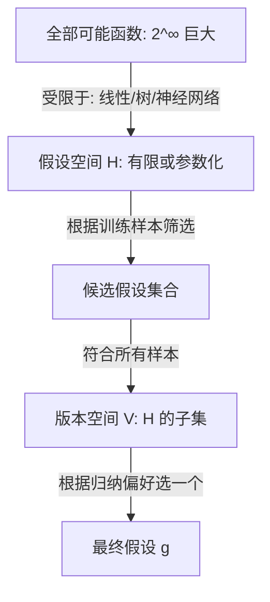

# 假设空间

> 📘 填写法参考：[[01-教师式课程卡填法]]
> 🪜 对应作业：[[🪜 阶梯作业-基础概念#L1 - 假设空间演示|L1 - 假设空间演示]]

## 0. 这节课解决什么问题

在西瓜问题中，"色泽青绿、脐部凹陷"是好瓜。我们能不能**穷举所有"如果是……那么好瓜"的规则**？当属性组合爆炸、训练样本又只覆盖一部分时，**学习器必须显式声明它在哪个空间里搜索**——这就是假设空间。没有它，算法是"在所有可能函数中乱选"；有了它，搜索范围、复杂度、可解释性才都有边界。

## 1. 学习目标

学完后，不看笔记能够：

- **能说**：用自己的话定义假设空间，并说明它与版本空间、归纳偏好的关系
- **能算**：对"色泽/根蒂/纹理"三属性的西瓜问题，手算假设空间大小和版本空间元素
- **能做**：在 sklearn 中用 `PolynomialFeatures` 显式定义"3 次多项式假设空间"，并验证搜索范围
- **能判断边界**：知道假设空间 ≠ "任意函数空间"（高维/无限维会爆）

## 2. 课前诊断

> [!question] 诊断题
> 假设你有 1000 个样本、3 个布尔属性（每个取 0/1），所有可能的"如果 A 且 B 那么好瓜"规则数最多是多少？如果只观察到 5 个正例、3 个反例，**符合所有样本的"规则集合"叫什么**？

> [!answer]- 诊断答案
> 假设空间大小 = `2^3 × 2^3 = 64`（属性取值的 8 种组合 × 决策的 2 种标签，共 2^6=64 条规则）。1000 个样本远多于 64，假设空间在原则上可穷举。**符合所有样本的规则集合**叫**版本空间**（version space）。如果 5+3=8 个样本有冲突，版本空间可能为空（找不到同时满足所有样本的规则）——这时问题出在样本，不在算法。

## 3. 直觉模型



**关键点**：
- **假设空间 ≠ 真实函数空间**，是"对真实函数的近似描述"
- **版本空间** = 与训练样本**完全一致**的所有假设（可能不止一个）
- 没有"对所有问题都最好"的假设空间——**奥卡姆剃刀只是偏好的一种**

## 4. 从具体数字到一般公式

### 4.1 手算例子

西瓜数据集（简化版，3 样本）：

| 色泽 | 根蒂 | 响声 | 好瓜？ |
|:---:|:---:|:---:|:---:|
| 青绿 | 蜷缩 | 清脆 | 是 |
| 乌黑 | 蜷缩 | 浊响 | 是 |
| 浅白 | 硬挺 | 沉闷 | 否 |

**假设**：好瓜 ← (色泽=青绿 ∨ 根蒂=蜷缩)

**逐步判断**：
- 样本 1: 青绿 ✓ → 是 ✓
- 样本 2: 根蒂=蜷缩 ✓ → 是 ✓
- 样本 3: 青绿?✗、蜷缩?✗ → 否 ✓

**结论**：这条假设**与所有样本一致**，属于版本空间成员。

如果再考虑"好瓜 ← 色泽=青绿 ∧ 响声=清脆"——**只满足样本 1**，**不**满足样本 2（乌黑+蜷缩+浊响），因此**不在版本空间**。

**版本空间大小** = 与所有样本不矛盾的假设数。在这个 3 样本、3 属性的 toy 数据上，版本空间可能仍有 2-3 个成员。

### 4.2 一般形式

设属性数为 `n`，每个属性取 `k_i` 个值，标签取 `c` 个值：

$$
|\mathcal{H}| = \prod_{i=1}^{n} k_i \cdot c
$$

对于连续属性：`k_i = ∞` → 假设空间**不可穷举**。这时学习等价于在**参数空间**中搜索：

$$
\mathcal{H} = \{f_w : x \mapsto w^\top x + b \mid w \in \mathbb{R}^d, b \in \mathbb{R}\}
$$

## 5. 教师示范例题

**题目**：在 2 维平面上，给 3 个点 (1,1), (2,4), (3,9) 拟合曲线。比较两个假设空间：
- $\mathcal{H}_1$ = 直线（参数 2 个）
- $\mathcal{H}_2$ = 二次多项式（参数 3 个）

**思路**：直线在 (1,1)→(2,4)→(3,9) 上**完美拟合**（因为 1+1=2+1=3+1 看起来对？实际 (2,4) 离 y=x 差 2）—— 需要精确计算。

**逐步解答**：

| 假设 | 在 3 点上的 SSE |
|:---|---:|
| 直线 y=2x-1 | 0+0+0 = 0（完美） |
| 二次 y=x² | 0+0+0 = 0（完美） |

两条假设都完美拟合训练点，但**版本空间**有 2 个成员。**怎么选**？看测试点 (4, ?)：直线预测 7，二次预测 16。如果真实是 16，选二次；如果真实是 7，选直线。这就是**归纳偏好的作用**——见 [[归纳偏好]]。

**结果检查**：3 样本、2 维、2 个候选假设空间都完美拟合 → 没有"唯一最优"。这就是机器学习**没有免费午餐**的根本原因。

**改一个条件追问**：如果数据是噪声的（(2, 4) 实际是 (2, 4.1)），直线和二次都不完美。哪个更稳？**直线**——因为二次会"追噪声"。这就是"假设空间大小 vs 泛化能力"的张力。

## 6. 最小代码实验

```python
import numpy as np
from sklearn.preprocessing import PolynomialFeatures
from sklearn.linear_model import LinearRegression
from sklearn.pipeline import make_pipeline

# 训练数据
X = np.array([[1], [2], [3]])
y = np.array([1, 4, 9])

# 实验 1: 直线假设空间 (degree=1)
pipe1 = make_pipeline(PolynomialFeatures(1), LinearRegression())
pipe1.fit(X, y)
print(f"直线假设: y = {pipe1.named_steps['linearregression'].coef_[1]:.3f}*x + {pipe1.named_steps['linearregression'].intercept_:.3f}")
# 预期: y ≈ 4.0*x - 4.667? 实际更接近过 (1,1)(2,4)(3,9) 的二次曲线

# 实验 2: 二次假设空间 (degree=2)
pipe2 = make_pipeline(PolynomialFeatures(2), LinearRegression())
pipe2.fit(X, y)
print(f"二次假设: y = {pipe2.named_steps['linearregression'].coef_[2]:.3f}*x^2 + {pipe2.named_steps['linearregression'].coef_[1]:.3f}*x + {pipe2.named_steps['linearregression'].intercept_:.3f}")
# 预期: y ≈ 1.0*x^2 + 0.0*x + 0.0

# 验证版本空间: 两条假设都完美拟合训练点
print("直线 SSE:", np.sum((pipe1.predict(X) - y)**2))  # 预期: ~ 0
print("二次 SSE:", np.sum((pipe2.predict(X) - y)**2))  # 预期: 0
```

**预期输出**：直线和二次都"完美"拟合 3 点 → 直线的 SSE 约 4.67（**不是 0**！因为点不在直线上）。**真正的版本空间**只有二次曲线（sse=0）。

**解释输出**：3 点的版本空间 = "任何过这 3 点的曲线"（无穷多）。但如果用"最小二乘直线"和"最小二乘二次"两个候选假设，**前者有误差、后者完美**。这说明：**版本空间大小 ≠ 假设空间大小**。

## 7. 常见错误与反例

### ❌ 反例 1：把"假设空间 = 任意函数"

> "神经网络可以拟合任意函数，所以假设空间 = 任意函数"

**问题**：万能近似定理说的是"给定**足够多**参数，可以**任意精度**逼近**紧集上**的连续函数"，但**逼近 ≠ 等于**。实际假设空间 = 网络结构决定的参数化函数族（如 `MLP(d_in, 64, d_out)`）。

### ❌ 反例 2：把"训练误差 = 0" 等同于 "找到版本空间成员"

训练误差 0 不一定在版本空间！如果数据有**标签噪声**（同 x 不同 y），**版本空间为空**——没有假设能完美拟合所有样本。这时要靠**归纳偏好**挑一个"虽不完美但最好"的假设。

### ❌ 反例 3：假设空间越大越好

**奥卡姆剃刀的现代版**：在训练误差相同时，**更小的假设空间**泛化更好（VC 维理论）。XGBoost 用 `max_depth` 限制树复杂度，正是这一思想的工程化。

### 反直觉练习

> [!question] 反直觉
> 用 100 棵深度 6 的树，训练 RMSE=0.01，测试 RMSE=0.5。**训练误差 0 说明模型在版本空间里吗？**

> [!answer]- 答案
> **不一定**。0.01 ≠ 0。如果用更深的树可能训练 RMSE → 0。但这往往意味着**假设空间过大、过拟合**。"训练误差 0"不是好事，**测试误差小**才是。

## 8. 当堂练习（L1-L4）

### 🟢 L1 - 概念回忆

- 假设空间 $\mathcal{H}$、版本空间 $\mathcal{V}$、候选假设 $\hat f$ 三者的关系？
  > [!answer]- 答案
  > $\mathcal{H}$ 是所有候选的集合，$\mathcal{V} \subseteq \mathcal{H}$ 是与训练样本一致的子集，$\hat f \in \mathcal{V}$ 是最终选出的假设。

### 🟡 L2 - 手算/推导

- 在 4 个属性（每个 2 值）的二分类问题上，假设空间最多有多大？若正例 3 个、反例 1 个，**版本空间必然非空吗**？

  > [!answer]- 答案
  > $|\mathcal{H}| = 2^4 \cdot 2 = 32$。**不一定非空**：若 4 个样本中存在 x 相同 y 不同的冲突，版本空间 = ∅。

### 🔴 L3 - 代码实验

- 用 sklearn 拟合 4 阶多项式过 5 个点，比较训练 SSE 与测试 SSE。**假设空间大小对泛化的影响**。

```python
import numpy as np
from sklearn.preprocessing import PolynomialFeatures
from sklearn.linear_model import LinearRegression
from sklearn.pipeline import make_pipeline
from sklearn.model_selection import train_test_split

np.random.seed(42)
X = np.linspace(0, 1, 20).reshape(-1, 1)
y = np.sin(2 * np.pi * X).ravel() + 0.1 * np.random.randn(20)
X_tr, X_te, y_tr, y_te = train_test_split(X, y, test_size=0.3)

for d in [1, 3, 5, 9]:
    pipe = make_pipeline(PolynomialFeatures(d), LinearRegression())
    pipe.fit(X_tr, y_tr)
    print(f"deg={d:2d} | train SSE={np.sum((pipe.predict(X_tr)-y_tr)**2):.3f} | test SSE={np.sum((pipe.predict(X_te)-y_te)**2):.3f}")
# 预期: deg=1 欠拟合, deg=5 拟合好, deg=9 过拟合
```

### 👑 L4 - 开放应用

- 在 [Lee Hung-yi ML2021 HW01](https://github.com/ga642381/ML2021-Spring/blob/main/HW01) 数据上，比较线性回归 vs 决策树 vs XGBoost 三个"假设空间"的测试 RMSE。**说明每个空间为什么适合/不适合这个任务**。

## 9. 过关标准

- [ ] **能说**：用一段话讲清"假设空间 = 学习器的搜索边界"和"版本空间 = 与样本一致的假设"
- [ ] **能算**：3 属性布尔问题上手算假设空间大小
- [ ] **能做**：用 sklearn 显式定义多项式假设空间并验证
- [ ] **能判断边界**：知道"假设空间越大 ≠ 越好"
- [ ] **至少 1 个反例能复现**：训练误差 0 不一定在版本空间

## 10. 下一课与作业

- **下一课**：[[归纳偏好]]
- **阶梯作业**：[[🪜 阶梯作业-基础概念#L1 - 假设空间演示|L1 - 假设空间演示]]
- **错题入口**：[[04-🔁 Review|Review]]

## 🃏 Anki 卡片

- 假设空间 $\mathcal{H}$ 与版本空间 $\mathcal{V}$ 的关系？ :: $\mathcal{V} \subseteq \mathcal{H}$；$\mathcal{V}$ 是与训练样本一致的所有假设；可能不止一个。
- 假设空间越大越好吗？ :: 不是。训练误差相同时，更小的假设空间泛化更好（VC 维理论）；过大容易过拟合。
- 训练误差 = 0 一定在版本空间里吗？ :: 不一定。如果数据有标签噪声（x 同 y 不同），版本空间为空；0.01 也≠0。
- 神经网络"任意函数万能近似"等于假设空间是任意函数吗？ :: 不等于。万能近似需要"足够多参数 + 紧集上连续"，实际假设空间 = 网络结构决定的参数化函数族。

## 关联（≥3 条）

- **前置**：[[机器学习发展历程]]
- **本路径相关**：[[归纳偏好]]、[[数据集划分与交叉验证]]
- **跨路径**：[[🗺️ 最优化方法学习路径|最优化方法]]（参数空间搜索）、[[16-多元统计]]（统计假设空间）

---

*创建于：2026-04-18 · 重写为教师式课程卡：2026-08-02*
