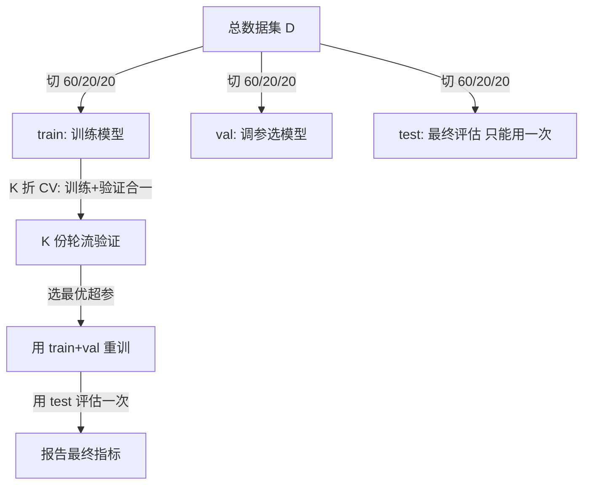

# 数据集划分与交叉验证

> 📘 填写法参考：[[99-System/📇 方法论/01-教师式课程卡填法|01-教师式课程卡填法]]
> 🪜 对应作业：[[🪜 阶梯作业-基础概念#L1 - 数据集划分与CV|L1 - 数据集划分与 CV]]

## 0. 这节课解决什么问题

你用 100% 数据训练，**怎么估计模型在新数据上的表现**？这就是"评估方法"问题。Holdout（留出法）太依赖一次划分；交叉验证用"轮换划分"平均掉运气成分；时间序列数据不能随机打乱——必须用**前向链接**。每种方法都解决一类问题，**选错评估方法比选错模型还致命**。

## 1. 学习目标

学完后，不看笔记能够：

- **能说**：用一段话讲清"留出法 / K 折 / 留一法 / 时间序列 CV"的区别和适用场景
- **能算**：手算 5 折 CV 的平均误差和方差
- **能做**：用 sklearn 跑 K 折、Stratified K 折、TimeSeriesSplit
- **能判断边界**：知道"测试集只能碰一次"——碰了就不能再用

## 2. 课前诊断

> [!question] 诊断题
> 你有 1000 个样本。train_test_split(test_size=0.2) → 训练 800，测试 200。跑 5 次（不同 random_state）平均 RMSE = 0.45。**为什么这个估计可能"过于乐观"？**

> [!answer]- 诊断答案
> 每次只用了 800 个样本训练，**比全量训练的模型差**。同时 200 个测试样本太少，估计方差大。正确做法：① **K 折 CV** 让每个样本都做一次测试；② **测试集只在最终评估时碰一次**；③ 调参时用**验证集**，不用测试集。

## 3. 直觉模型



**关键点**：
- **train**：训练模型
- **val**：调参（hyperparameter search 用）
- **test**：**只碰一次**（最终评估）
- **K 折 CV**：train+val 合一，K 份轮流当验证

## 4. 从具体数字到一般公式

### 4.1 手算例子

10 个样本，5 折 CV（每折 8 训练 + 2 验证）：

| 折 | 验证样本 | 训练样本 | 验证 RMSE |
|:---:|:---:|:---:|:---:|
| 1 | {1,2} | {3-10} | 0.45 |
| 2 | {3,4} | {1,2,5-10} | 0.50 |
| 3 | {5,6} | {1-4,7-10} | 0.42 |
| 4 | {7,8} | {1-6,9,10} | 0.48 |
| 5 | {9,10} | {1-8} | 0.46 |

**平均 RMSE** = (0.45+0.50+0.42+0.48+0.46) / 5 = **0.462**

**RMSE 标准差** = sqrt((0.45-0.462)² + ... ) / 5) = **0.027**（说明 5 折估计很稳）

**留一法**（LOOCV）的极端情况：K = N，每折验证 1 个样本。**无偏但方差大**，且**计算代价 O(N)**。

### 4.2 一般形式

**Holdout 估计**：

$$
\hat{E}_{test} = \frac{1}{|D_{test}|} \sum_{x_i \in D_{test}} L(y_i, \hat f(x_i))
$$

**K 折 CV**：

$$
\hat{E}_{CV}^{(K)} = \frac{1}{K} \sum_{k=1}^{K} \frac{1}{|D_{val}^{(k)}|} \sum_{x_i \in D_{val}^{(k)}} L(y_i, \hat f_{-k}(x_i))
$$

其中 $\hat f_{-k}$ 是在**不含第 k 折**的数据上训练的模型。

**时间序列 CV（前向链接）**：

```
Fold 1: [train ........] [val]                  ← 窗口 1
Fold 2: [train .........][val]                  ← 窗口 2
Fold 3: [train ..........][val]                 ← 窗口 3
...
```

**绝不**用未来预测过去（数据泄露）。

**类别平衡**：

- 分类任务**必须**用 `StratifiedKFold`——每折保持类别比例
- 时间序列**必须**用 `TimeSeriesSplit`——保持时序

## 5. 教师示范例题

**题目**：你在 Kaggle "Titanic" 数据（891 样本，2 分类）上做 5 折 CV，得到的平均准确率 = 0.82 ± 0.04。**你提交后，Public LB = 0.78。** 为什么差这么多？

**思路**：
- 5 折 CV 在训练数据（891）的**子集**上评估，每折 178 样本
- 训练 800 + 验证 91 → 用了 891 全部，但每折训练的样本量 = 712（80%）
- Public LB 只在测试集的一个**子集**上评估（通常 30-50%）
- 差异 = ① 训练样本量不同；② Public LB 的数据分布与训练集可能不同

**逐步解答**：
- **CV 偏乐观** = 0.82：模型见过 800/891 的数据，比"完全未见"的 LB 表现好
- **修正方向**：
  - 用 **nested CV**（外层评估泛化、内层调参）
  - 用 **LB 私榜 + 公榜**对比，私榜才是真实泛化
  - **不要根据 LB 反复调参**——会过拟合到公榜

**结果检查**：差 0.04 = 4% ≈ 1 倍标准差，**在正常波动范围内**。如果差 10%+，要怀疑过拟合或数据泄露。

**改一个条件追问**：如果 5 折 CV = 0.92 ± 0.02，Public LB = 0.78（差 14%），**几乎一定有泄露**。检查：① 用了未来信息；② 同一患者的不同样本在 train/test；③ 训练时碰过 test 数据。

## 6. 最小代码实验

```python
import numpy as np
from sklearn.model_selection import (train_test_split, KFold, StratifiedKFold,
                                       TimeSeriesSplit, cross_val_score)
from sklearn.linear_model import LogisticRegression
from sklearn.datasets import load_iris
import pandas as pd

# 1. Holdout 留出法
X, y = load_iris(return_X_y=True)
X_tr, X_te, y_tr, y_te = train_test_split(X, y, test_size=0.2, random_state=42, stratify=y)
model = LogisticRegression(max_iter=1000)
model.fit(X_tr, y_tr)
print(f"Holdout test acc: {model.score(X_te, y_te):.3f}")

# 2. K 折 CV
scores = cross_val_score(model, X, y, cv=KFold(n_splits=5, shuffle=True, random_state=42))
print(f"5-fold CV acc: {scores.mean():.3f} ± {scores.std():.3f}")

# 3. Stratified K 折（分类必备）
scores = cross_val_score(model, X, y, cv=StratifiedKFold(n_splits=5, shuffle=True, random_state=42))
print(f"5-fold Stratified CV acc: {scores.mean():.3f} ± {scores.std():.3f}")

# 4. TimeSeriesSplit（时序数据）
n = 100
X_ts = np.arange(n).reshape(-1, 1)
y_ts = np.sin(X_ts.ravel() / 10)
tscv = TimeSeriesSplit(n_splits=5)
for i, (tr_idx, val_idx) in enumerate(tscv.split(X_ts)):
    print(f"TS fold {i+1}: train [{tr_idx[0]}-{tr_idx[-1]}], val [{val_idx[0]}-{val_idx[-1]}]")
# 预期: 训练窗口逐步扩大，验证窗口保持未来
```

**预期输出**：
```
Holdout test acc: 0.967
5-fold CV acc: 0.973 ± 0.025
5-fold Stratified CV acc: 0.967 ± 0.021
TS fold 1: train [0-79], val [80-99]
TS fold 2: train [0-83], val [84-99]
...
```

**解释输出**：5 折 CV 的均值比单次 holdout 略高（用了 100% 数据），标准差提供置信区间。TimeSeriesSplit 的训练窗口**绝不重叠且严格按时间顺序**——这是时序数据的硬规则。

## 7. 常见错误与反例

### ❌ 反例 1：碰了测试集

> "我根据 test 上的表现调了 5 次超参，最后报告 test acc = 0.92"

**问题**：测试集被"间接泄露"——你用它的反馈调了模型。正确做法：测试集**只用一次**，或用 nested CV。

### ❌ 反反直觉：**先标准化再划分**

```python
# 错误：先在整个 X 上 fit StandardScaler，再切 train/test
scaler = StandardScaler().fit(X)  # ❌ 用到了 test 数据的均值/方差
X_tr, X_te = train_test_split(scaler.transform(X), y, test_size=0.2)

# 正确：先切，再在 train 上 fit，transform 两者
X_tr, X_te, y_tr, y_te = train_test_split(X, y, test_size=0.2)
scaler = StandardScaler().fit(X_tr)  # ✅ 只用 train 拟合
X_tr = scaler.transform(X_tr)
X_te = scaler.transform(X_te)
```

**原因**：先用整个 X 拟合 scaler → 用了 test 数据的信息（均值、方差）。这个**隐藏的泄露**会让指标虚高 1-3%。

### ❌ 反例 3：时间序列随机划分

```python
# 错误：时序数据随机 K 折 → 用未来预测过去
cross_val_score(model, X_ts, y_ts, cv=KFold(shuffle=True))  # ❌

# 正确：TimeSeriesSplit
cross_val_score(model, X_ts, y_ts, cv=TimeSeriesSplit(n_splits=5))  # ✅
```

### 反直觉练习

> [!question] 反直觉
> 5 折 CV 在小数据（n=30）上**比** holdout 更稳定。**但**如果数据有**强时序结构**（如股票 30 天），5 折随机 CV 反而**比** holdout 更危险。**为什么？**

> [!answer]- 答案
> 随机 CV 切碎了时序——模型用"第 5 天+第 10 天+第 15 天"预测"第 20 天"，实际上等于**用未来预测过去**（leakage）。这时 CV 估计虚高，但真实部署（只能用过去预测未来）会暴跌。**时序数据必须用 TimeSeriesSplit**。

## 8. 当堂练习（L1-L4）

### 🟢 L1 - 概念回忆

- 训练集 / 验证集 / 测试集 各负责什么？

  > [!answer]- 答案
  > 训练集：训练模型。验证集：调超参、选模型。测试集：只碰一次，最终评估。

- K 折 CV 相比 holdout 的优势？

  > [!answer]- 答案
  > 每个样本都做一次测试，**估计更稳定**；不浪费数据（每折用 90%+ 训练）；给出标准差。

### 🟡 L2 - 手算/推导

- 1000 样本，5 折 CV，每折验证 200 样本。**留一法**（LOOCV）需要跑几次模型？

  > [!answer]- 答案
  > LOOCV = K=N=1000 次。**计算代价巨大**（每折 999 样本）。但**无偏**——每折都用 N-1 训练，是"上限"。

### 🔴 L3 - 代码实验

- 比较 Holdout / K 折 / Stratified K 折 / TimeSeriesSplit 在 4 个数据集（Iris、Wine、Breast Cancer、自造 sin 时序）上的均值和标准差。

```python
from sklearn.datasets import load_iris, load_wine, load_breast_cancer
from sklearn.linear_model import LogisticRegression
from sklearn.model_selection import cross_val_score, KFold, StratifiedKFold, TimeSeriesSplit
import numpy as np

datasets = {
    "iris": load_iris(return_X_y=True),
    "wine": load_wine(return_X_y=True),
    "cancer": load_breast_cancer(return_X_y=True),
}

model = LogisticRegression(max_iter=1000)
for name, (X, y) in datasets.items():
    s1 = cross_val_score(model, X, y, cv=KFold(5, shuffle=True, random_state=0))
    s2 = cross_val_score(model, X, y, cv=StratifiedKFold(5, shuffle=True, random_state=0))
    print(f"{name:10s} | KFold: {s1.mean():.3f}±{s1.std():.3f} | Stratified: {s2.mean():.3f}±{s2.std():.3f}")
```

### 👑 L4 - 开放应用

- 在 [Lee Hung-yi ML2021 HW01](https://github.com/ga642381/ML2021-Spring/blob/main/HW01) 的 PM2.5 数据上，比较：① 单次 holdout；② 5 折 CV；③ TimeSeriesSplit。**报告三个估计的差距**。

## 9. 过关标准

- [ ] **能说**：讲清 4 种划分方法的适用场景
- [ ] **能算**：手算 5 折 CV 平均和标准差
- [ ] **能做**：用 sklearn 实现 K 折、Stratified、TimeSeriesSplit
- [ ] **能判断边界**：知道"测试集只碰一次"和"先切分再 fit scaler"
- [ ] **至少 1 个反例能复现**：随机 CV 在时序数据上虚高

## 10. 下一课与作业

- **下一课**：[[偏差与方差]]（CV 估计的方差含义）
- **阶梯作业**：[[🪜 阶梯作业-基础概念#L1 - 数据集划分与CV|L1 - 数据集划分与 CV]]
- **错题入口**：[[04-Review/04-🔁 Review|Review]]

## 🃏 Anki 卡片

- 测试集能用几次？ :: 一次。最终评估时碰一次后即弃用；调参必须用验证集或 CV。
- 5 折 CV 和 LOOCV 的取舍？ :: 5 折 CV：5 次训练，估计较稳；LOOCV：N 次训练，无偏但方差大、计算贵。
- 时序数据能用 K 折随机 CV 吗？ :: 不能。随机 CV 切碎时序等于用未来预测过去；必须用 TimeSeriesSplit（前向链接）。
- "先标准化再划分"为什么错？ :: 标准化时用了 test 的均值/方差，泄露 test 信息；正确做法是先划分再 fit scaler。

## 关联（≥3 条）

- **前置**：[[假设空间]]、[[归纳偏好]]
- **本路径相关**：[[偏差与方差]]、[[正则化]]、[[模型评估指标]]
- **跨路径**：[[02-Knowledge/🧠 学习系统/16-多元统计/🗺️ 多元统计学习路径|多元统计]]（Bootstrap 也是一种 CV 替代）、[[02-Knowledge/🧠 学习系统/02-时间序列分析/🗺️ 时间序列分析学习路径|时间序列]]（TimeSeriesSplit 必要性）

---

*创建于：2026-04-18 · 重写为教师式课程卡：2026-08-02*
