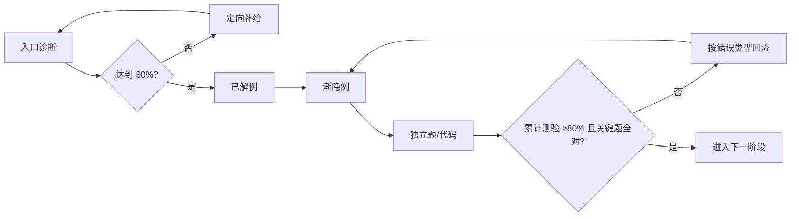

# 🚦 零基础启动与学习契约

> **目标**：先证明“环境能跑、前置够用、知道失败去哪补”，再进入阶段 1。不要从 PageRank、谱聚类或 GNN 随机跳读。

## 1. 第一次学习的 90 分钟路线

| 时间 | 任务 | 可观察产物 | 失败出口 |
| :--- | :--- | :--- | :--- |
| 0–15 分钟 | [[NetworkX-SNAP环境与数据工作流#7. 例子：基础 → 中等 → 实际应用]] | 输出 Python/NetworkX 版本与 4 节点图统计 | 回到环境安装区 |
| 15–40 分钟 | [[数学与Python前置诊断#7. 例子：基础 → 中等 → 实际应用]] | 三组诊断分数 | 按诊断结果补 Python/概率/线代 |
| 40–65 分钟 | [[图与网络基础#7. 例子：基础 → 中等 → 实际应用]] | 手算度数与代码输出一致 | 回看邻接表、度、握手定理 |
| 65–90 分钟 | [[有向网络统计与数据清洗#7. 例子：基础 → 中等 → 实际应用]] | 写出数据口径清单 | 回看有向/无向、自环/重边 |

## 2. 三条学习路线

### 路线 A：零基础
1. 本目录两张启动卡全部通过。
2. 按阶段 1→6 顺序；每阶段先做入口诊断，再学主卡，最后做累计测验。
3. 每张卡采用“先预测—再手算—后运行—最后解释”的顺序。

### 路线 B：有 Python/数学基础
1. 先做[[数学与Python前置诊断]]，只能跳过得分不低于 80% 的补给。
2. 仍需完成每阶段累计测验；会公式不等于会建模口径。

### 路线 C：直接准备 CS224W 2017 作业
1. 从对应[[🧭 CS224W-2017-作业总映射|作业总映射]]进入。
2. 先通过“最小知识点集”，再打开官方 PDF。
3. 官方题目与答案不复制进笔记；这里只保留自己的推导、代码、失败记录和结果解释。

## 3. 学习循环



## 4. 掌握标准

- **入口通过**：诊断题不低于 80%；标记为“关键”的题必须全对。
- **单卡通过**：不看笔记完成定义、公式、手算、代码解释、误区辨析五项。
- **阶段通过**：累计测验不低于 80%，且间隔 24 小时后复测仍不低于 70%。
- **作业就绪**：对应映射中的每个官方子题均有知识卡、先备项与自我检查证据。
- **失败不是重读全文**：先判定属于定义、口径、推导、代码、统计解释或迁移，再按卡内“失败后的回流”定向补救。

## 5. 学习证据模板

每次阶段测验后在阶段 MOC 下记录：

```markdown
- 日期：
- 首测：__/10；24h 复测：__/10
- 信心（答题前）：__/5；实际正确率：__%
- 错误类型：定义 / 口径 / 推导 / 代码 / 解释 / 迁移
- 回流链接：填写真实的 Obsidian 双链（文件名加具体小节）
- 下一次复测：
```

## 6. 导航

- [[数学与Python前置诊断]]
- [[NetworkX-SNAP环境与数据工作流]]
- [[🗺️ 社交网络挖掘-课程框架]]
- [[🧭 CS224W-2017-作业总映射|CS224W 2017 作业总映射]]
