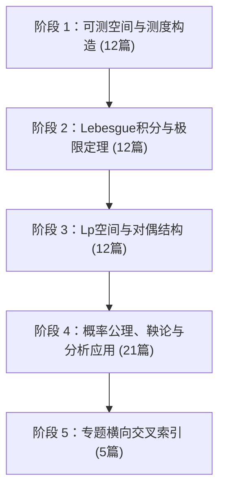

# 测度论 🗺️ 学习路径

> [!note] 已归档
> 本页是旧版详细清单，正式入口已统一为 [[🗺️ 测度论学习路径|测度论学习路径]]。保留本页仅用于追溯历史内容。

---

> [!important] 导师指南
> 本学习路径基于认知科学与一对一私教导师模板构建，涵盖 57 篇单点深度学习笔记与 5 大专题横向索引（总计 62 篇标准文件），达到名校研究生级《实变函数与测度论》全覆盖标准。
> 测度论不仅是现代概率论（Kolmogorov 公理体系）的灵魂底座，更是 $L^p$ 空间、泛函分析、调和分析、概率鞅论与偏微分方程 (PDE) 弱解的通用语言。

---

## 🗺️ 阶段路线总览

---

## 阶段 1：可测空间与测度构造 (12 篇)

本阶段建立可测空间 $(\Omega, \mathcal{F})$、$\sigma$-代数生成、Lebesgue 测度构造与 $\pi$-$\lambda$ 系统。

| 序号 | 笔记主题 | 核心概念与双链 |
| :--- | :--- | :--- |
| 01 | $\sigma$-代数生成 | [[可测空间基础-代数生成-σ代数生成|σ代数生成]] · 可列交并封闭性与代数扩张 |
| 02 | Borel 结构 | [[可测空间基础-代数生成-Borel结构|Borel结构]] · 拓扑开集生成的 Borel $\sigma$-代数 |
| 03 | 可测映射 | [[可测空间基础-代数生成-可测映射|可测映射]] · 原像拉回 $\mathcal{F}$-可测性 |
| 04 | 外测度 | [[可测空间基础-测度构造-外测度|外测度]] · Carathéodory 外测度与次可加性 |
| 05 | Lebesgue 测度 | [[可测空间基础-测度构造-Lebesgue测度|Lebesgue测度]] · 区间长度平移不变扩张 |
| 06 | 可测判别 | [[可测空间基础-测度构造-可测判别|可测判别]] · Carathéodory 可测切割条件 $E^*$ |
| 07 | 指示函数 | [[可测空间基础-可测函数-指示函数|指示函数]] · $\mathbb{I}_A$ 原性原子构件 |
| 08 | 简单函数 | [[可测空间基础-可测函数-简单函数|简单函数]] · 阶梯组合 $\sum c_i \mathbb{I}_{A_i}$ |
| 09 | 可测性判别 | [[可测空间基础-可测函数-可测性判别|可测性判别]] · 上截断水平集 $\{x \mid f(x) > a\}$ |
| 10 | 生成集思维 | [[可测空间基础-方法论-生成集思维|生成集思维]] · 柱集与产生元判定 |
| 11 | $\pi$-$\lambda$ 方法 | [[可测空间基础-方法论-π-λ方法|π-λ方法]] · Dynkin $\pi$-$\lambda$ 定理与测度唯一性 |
| 12 | 乘积结构 | [[可测空间基础-方法论-乘积结构|乘积结构]] · 乘积 $\sigma$-代数 $\mathcal{F} \otimes \mathcal{G}$ |

---

## 阶段 2：Lebesgue 积分与极限定理 (12 篇)

本阶段建立非负/绝对可积 Lebesgue 积分、三大极限交换定理 (MCT/Fatou/DCT)、Fubini 乘积积分与 Radon-Nikodym 绝对连续。

| 序号 | 笔记主题 | 核心概念与双链 |
| :--- | :--- | :--- |
| 13 | 简单函数逼近 | [[积分与收敛-积分构造-简单函数逼近|简单函数逼近]] · 非负可测函数阶梯递增 $s_n \uparrow f$ |
| 14 | 非负积分 | [[积分与收敛-积分构造-非负积分|非负积分]] · 上确界定义 $\int f d\mu = \sup \int s d\mu$ |
| 15 | 绝对可积 | [[积分与收敛-积分构造-绝对可积|绝对可积]] · $f^+ - f^-$ 拆分与 $L^1$ 空间 |
| 16 | 极限与积分交换 | [[积分与收敛-极限定理-交换极限与积分|交换极限与积分]] · 极限与积分交换的三大防线 |
| 17 | 主导条件 | [[积分与收敛-极限定理-主导条件|主导条件]] · Lebesgue 控制收敛定理 (DCT) |
| 18 | 反例意识 | [[积分与收敛-极限定理-反例意识|反例意识]] · 移动高塔与高频震荡控制崩溃 |
| 19 | 乘积测度 | [[积分与收敛-二重积分-乘积测度|乘积测度]] · $\mu \times \nu$ 矩形面积扩张 |
| 20 | 二重积分 | [[积分与收敛-二重积分-二重积分|二重积分]] · Tonelli 绝对非负二重积分 |
| 21 | 交换积分次序 | [[积分与收敛-二重积分-交换积分次序|交换积分次序]] · Fubini 交换积分次序条件 |
| 22 | 符号测度 | [[积分与收敛-符号测度入口-符号测度|符号测度]] · Hahn 与 Jordan 测度正负分解 |
| 23 | 绝对连续 | [[积分与收敛-符号测度入口-绝对连续|绝对连续]] · $\nu \ll \mu$ 与 Radon-Nikodym 定理 |
| 24 | 密度函数直觉 | [[积分与收敛-符号测度入口-密度函数直觉|密度函数直觉]] · RN 导数 $g = \frac{d\nu}{d\mu}$ |

---

## 阶段 3：$L^p$ 空间与对偶结构 (12 篇)

本阶段建立 $L^p$ 空间范数完备性 (Riesz-Fischer)、Hölder/Minkowski 不等式、磨光逼近、三大收敛类型、Riesz 表示定理与弱拓扑。

| 序号 | 笔记主题 | 核心概念与双链 |
| :--- | :--- | :--- |
| 25 | 范数 | [[Lp空间与结构-Lp 范数与不等式-范数|范数]] · $L^p$ 空间模长与 $p \ge 1$ 凸性 |
| 26 | 三角不等式 | [[Lp空间与结构-Lp 范数与不等式-三角不等式|三角不等式]] · Hölder 不等式与 Minkowski 不等式 |
| 27 | 插值直觉 | [[Lp空间与结构-Lp 范数与不等式-插值直觉|插值直觉]] · Riesz-Thorin $L^p$ 空间插值放缩 |
| 28 | 完备性与稠密 | [[Lp空间与结构-完备性与稠密-完备性与稠密|完备性与稠密]] · Riesz-Fischer 完备性定理 |
| 29 | 逼近过程 | [[Lp空间与结构-完备性与稠密-逼近过程|逼近过程]] · 简单函数、$C_c$ 与 $C_c^\infty$ 磨光卷积逼近 |
| 30 | Banach 空间直觉 | [[Lp空间与结构-完备性与稠密-Banach 空间直觉|Banach 空间直觉]] · 凸性、自反性与 $L^2$ 正交投影 |
| 31 | 收敛比较 | [[Lp空间与结构-收敛类型-收敛比较|收敛比较]] · a.e.、依测度、$L^p$ 强收敛与弱收敛比较 |
| 32 | 反例 | [[Lp空间与结构-收敛类型-反例|反例]] · 打字机序列、移动高塔与高频震荡反例 |
| 33 | 紧性直觉 | [[Lp空间与结构-收敛类型-紧性直觉|紧性直觉]] · Fréchet-Kolmogorov 紧性定理三条件 |
| 34 | 线性泛函 | [[Lp空间与结构-对偶与结构-线性泛函|线性泛函]] · Riesz 表示定理 $(L^p)^* \cong L^q$ |
| 35 | 对偶配对 | [[Lp空间与结构-对偶与结构-对偶配对|对偶配对]] · $\langle f, g \rangle = \int f g d\mu$ 与对偶算子 $T^*$ |
| 36 | 弱拓扑 | [[Lp空间与结构-对偶与结构-弱拓扑|弱拓扑]] · 弱收敛 $f_n \rightharpoonup f$ 与 Banach-Alaoglu 弱*紧性 |

---

## 阶段 4：概率公理、鞅论与分析应用 (21 篇)

本阶段将测度论全面应用于 Kolmogorov 概率公理体系（随机变量、期望、条件期望、独立性、SLLN/CLT、弱收敛、Prokhorov 紧性、Kolmogorov 扩张定理、Doob 鞅收敛定理）及实分析/调和分析进阶应用（Lebesgue FTC、BV 变差、卷积、Fourier 变换、弱导数、Lusin 定理、Hardy-Littlewood 最大函数、Haar 测度与 Marcinkiewicz 插值）。

| 序号 | 笔记主题 | 核心概念与双链 |
| :--- | :--- | :--- |
| 37 | 概率空间 | [[概率与分析应用-概率测度-概率空间|概率空间]] · Kolmogorov 三元组 $(\Omega, \mathcal{F}, P)$ 与归一化 |
| 38 | 随机变量 | [[概率与分析应用-概率测度-随机变量|随机变量]] · 可测映射、诱导测度 $P_X$ 与逆变换采样 |
| 39 | 期望 | [[概率与分析应用-概率测度-期望|期望]] · 抽象 Lebesgue 积分 $\mathbb{E}[X]$、LOTUS 与 Jensen 不等式 |
| 40 | 独立性 | [[概率与分析应用-独立性与极限定理-独立性|独立性]] · 子 $\sigma$-代数独立、乘积解偶与卷积 |
| 41 | 大数定律 | [[概率与分析应用-独立性与极限定理-大数定律|大数定律]] · WLLN、Kolmogorov SLLN 充要条件与截断法 |
| 42 | 中心极限定理 | [[概率与分析应用-独立性与极限定理-中心极限定理|中心极限定理]] · CLT、特征函数与 Lévy 连续性定理 |
| 43 | 密度函数 | [[概率与分析应用-密度与条件期望-密度函数|密度函数]] · Radon-Nikodym 导数 $f = \frac{dP_X}{d\lambda}$ 与 Lebesgue 分解 |
| 44 | 条件期望 | [[概率与分析应用-密度与条件期望-条件期望|条件期望]] · $\mathbb{E}[X \mid \mathcal{G}]$ 的 RN 构造、塔层法则与 $L^2$ 正交投影 |
| 45 | 弱收敛 | [[概率与分析应用-弱收敛与紧性-弱收敛|弱收敛]] · 概率测度弱收敛 $P_n \Rightarrow P$ 与 Portmanteau 定理 |
| 46 | 紧性 | [[概率与分析应用-弱收敛与紧性-紧性|紧性]] · 概率测度等度紧 (Tightness) 与 Prokhorov 紧性定理 |
| 47 | 微积分基本定理 | [[概率与分析应用-分析应用-微积分基本定理|微积分基本定理]] · Lebesgue FTC、绝对连续函数 (AC) 与 Lebesgue 点 |
| 48 | 变差 | [[概率与分析应用-分析应用-变差|变差]] · 有界变差函数 (BV)、Jordan 分解与 Lebesgue-Stieltjes 测度 |
| 49 | 卷积 | [[概率与分析应用-分析应用-卷积|卷积]] · 卷积算子 $(f * g)$、Young 卷积不等式与磨光平滑 |
| 50 | Fourier 变换 | [[概率与分析应用-分析应用-Fourier变换|Fourier变换]] · Fourier 对偶、Plancherel $L^2$ 等距与特征函数 |
| 51 | 微分算子 | [[概率与分析应用-分析应用-微分算子|微分算子]] · 测试函数 $C_c^\infty$ 对偶、弱导数与 Sobolev 空间 $W^{k,p}$ |
| 57 | Lusin 定理与覆盖 | [[概率与分析应用-分析应用-Lusin定理与覆盖|Lusin定理与覆盖]] · Lusin 近乎连续定理、Littlewood 第二原则与 Vitali 5倍覆盖引理 |
| 58 | HL 最大函数 | [[概率与分析应用-分析应用-HardyLittlewood最大函数|HardyLittlewood最大函数]] · $M f$ 算子、弱 $(1, 1)$ 型不等式与 Lebesgue 微分证明 |
| 59 | Kolmogorov 扩张 | [[概率与分析应用-概率测度-Kolmogorov扩张定理|Kolmogorov扩张定理]] · 相容有限维分布族、柱集代数与无穷维路径空间测度构造 |
| 60 | Haar 测度 | [[概率与分析应用-分析应用-Haar测度|Haar测度]] · 局部紧拓扑群平移不变 Radon 测度、模函数与单模群 |
| 61 | 鞅收敛定理 | [[概率与分析应用-概率测度-鞅收敛定理|鞅收敛定理]] · 鞅 (Martingale)、Doob 上穿不等式与几乎处处收敛 |
| 62 | Marcinkiewicz 插值 | [[概率与分析应用-分析应用-Marcinkiewicz插值|Marcinkiewicz插值]] · 弱型 $(p, q)$ 算子插值、层析积分与强型 $(p_\theta, q_\theta)$ 导出 |

---

## 阶段 5：专题与横向交叉索引 (5 篇)

横向打通单点笔记，构建全景比较矩阵与对偶图谱。

1. [[测度论-核心概念交叉索引]]：跨阶段概念关联与 57 篇单点笔记全景检索。
2. [[测度论-三大收敛与极限交换定理解析矩阵]]：a.e.、依测度、$L^p$、弱收敛及 MCT/Fatou/DCT 横向对比。
3. [[测度论-测度分解与RadonNikodym专题]]：Hahn、Jordan、Lebesgue 测度分解与 Radon-Nikodym 导数全景。
4. [[测度论-Lp空间与概率弱收敛对偶图谱]]：Banach 空间对偶、Prokhorov 紧性与 Fourier 调和分析矩阵。
