# ✅ 量化金融学习系统优化验收报告

## 结论

当前项目已经**适合按主线学习**：入口唯一、近期目标收敛、知识点与作业一一对应、每步有闭卷与产物闸门、复习不再双重调度。材料质量已经达到“可学习、可核验、可继续迭代”的标准。

但必须区分三件事：

1. **材料通过质量审计**，不等于学习者已经掌握；
2. **作业包测试通过**，不等于 A01 已由学习者完成；
3. **回测框架可复现**，不等于策略能实盘盈利。

当前真实进度仍以 [[🚀 Qlib项目执行入口]] 的 K01 / A01 指针为准。

## 质量变化

| 指标 | 优化前已指出的问题 | 本轮严格复审 |
|:---|---:|---:|
| 活跃量化金融知识卡 | 低质卡与重复卡混杂 | **99** 张唯一主卡 |
| 平均分 | 最高学科均分约 **55.6** | **87.8 / 100** |
| 中位数 | 未达合格线 | **88** |
| 最低分 | 大量低于 60 | **80** |
| 80–89 | — | **61** 张 |
| 90–100 | — | **38** 张 |
| 无可定位来源 | 大量存在 | **0** |
| 断链 | 大量存在 | **0** |
| K01–K28 | 均分 78.5、部分低于 80 | 均分 **82.2**，最低 **80**，低于 80 为 **0** |

评分来自同一套极严审计口径，报告保存在 `99-System/🗄️ 归档/知识库审计/`。分数只评价材料的主题聚焦、完整性、严谨性、来源、验证、连接和维护性。

## 认知科学对应关系

| 原则 | 项目中的实现 | 防止的问题 |
|:---|:---|:---|
| 降低外在认知负荷 | 全库唯一 Active Sprint、唯一行动入口、唯一 Sprint 任务源 | 多入口、重复计划、每天重新选择学什么 |
| 掌握学习 | 日期只给节奏，K 闸门决定是否解锁下一项 | 看完即算会、为追进度跳过缺口 |
| 提取练习 | 每个 K 先闭卷诊断，结束后闭卷解释；59 张高价值 Anki 卡 | 熟悉感冒充掌握 |
| 生成效应 | 手算、最小代码、失败测试、审计表先于完整答案 | 只读笔记、被动抄写 |
| 及时反馈 | K 卡的可运行断言 + A 作业硬验收 + 测试包 | 错误长期不被发现 |
| 间隔复习 | FSRS 只由外部 Anki 调度，Obsidian 记录来源与薄弱点 | 手写复习表和插件重复调度 |
| 交错与迁移 | 同一概念依次进入数据、基线、因子、模型、稳健性与答辩 | 只会孤立公式，不能迁移到项目 |
| 合意困难 | 单日最多一个新 K；失败时停留原 K 并保留失败案例 | 任务过载与虚假顺滑 |

## 路线是否清晰

### 当前 14 天只做一件事

[[2026-Sprint1-量化金融冲刺计划|Sprint 1]] 只要求：

1. K01 收益率与对数收益率；
2. K02 OHLCV 清洗与复权；
3. K03 时间索引与交易日历；
4. K04 分组、索引与滞后；
5. K05 滚动窗口；
6. K06 样本泄漏；
7. [[A01-数据协议与无泄漏审计]]。

K07–K28 和 A02–A06 已明确放入六周路线，不再挤进当前 Sprint。

### 六周纵向路线

```mermaid
flowchart LR
  K01["K01–K06 数据与无泄漏协议"] --> A01["A01 数据协议审计"]
  A01 --> K07["K07–K10 基准、回撤与成本"]
  K07 --> A02["A02 E0 基线"]
  A02 --> K11["K11–K17 因子定义与评价"]
  K11 --> A03["A03 E1 简单因子"]
  A03 --> K18["K18–K23 特征、模型与 Qlib"]
  K18 --> A04["A04 E2 LightGBM"]
  A04 --> K24["K24–K28 偏差与稳健性"]
  K24 --> A05["A05 成本和稳健性"]
  A05 --> A06["A06 复现报告与答辩"]
```

完整映射见 [[🧩 Qlib 项目知识点—作业—验收路线图]]。

## 作业安排是否合理

| 作业 | 角色 | 关键产物 | 解锁条件 |
|:---|:---|:---|:---|
| A01 | 数据与时间协议 | 数据字典、复权说明、切分断言、泄漏失败案例 | K01–K06 |
| A02 | 不带 Alpha 的 E0 基线 | 等权/指数基准、gross/net、成本与回撤 | A01 通过 |
| A03 | 可解释 E1 因子 | 冻结因子定义、排序、分层、IC/Rank IC | A02 通过 |
| A04 | E2 Qlib + LightGBM | 训练期早停、预测、组合与实验记录 | A03 通过 |
| A05 | 稳健性审计 | 成本压力、偏差清单、PBO/尝试台账 | A04 通过 |
| A06 | 复现与答辩 | 从空目录复现、失败结果、限制与结论 | A05 通过 |

安排合理的原因：先建立数据协议，再建立无 Alpha 基准；先有简单可解释因子，再上复杂模型；最后才讨论稳健性和答辩。每一阶段只有一个主要新增难度，避免同时学习数据、模型、执行和统计检验。

## 结构治理结果

- 合并或归位 **18** 张活跃重复、错名或层级错误的卡片；旧路径保留稳定入口，原文均已归档。
- 对 **60 / 60** 张质量隔离卡指定唯一主卡，未留下“以后再说”的无主任务。
- 将 `for example0` 归入 Engle–Granger 协整算例，将 `公式理解7` 归为 Johansen 检验。
- 把“夯实基础常见题型”重新分类为 `problem-type`，不再冒充概念主卡。
- 72 张无来源卡补齐主题相关论文、官方文档或教材章节，并增加成立条件、反例压力和复现实验协议。
- 量化金融活跃知识卡最终做到 **0 无来源、0 断链、0 低于 80**。

隔离卡逐张处置清单：`99-System/🗄️ 归档/知识库审计/quant_finance_quarantine_triage_2026-08-01.md`。

## 自动验收

| 检查 | 结果 |
|:---|:---|
| K01–K28、A01–A06、关键入口与当前指针 | 通过 |
| 量化金融 Markdown frontmatter | **246 / 246** 可解析，YAML 错误 **0** |
| Anki 来源卡 | **59** 张验证通过 |
| Sprint 日/周派生视图 | 与唯一任务源同步 |
| 真实作业包测试 | **17 passed** |
| 严格知识卡审计 | **99** 张，均分 **87.8**，最低 **80** |

## 现在怎么学

不要从 99 张卡中任意挑选。每天只执行：

1. 打开 [[🚀 Qlib项目执行入口]]；
2. 对当前 K 做 10 分钟闭卷诊断；
3. 学当前主卡的必要部分；
4. 完成一个手算、代码、测试或审计产物；
5. 把证据写入当前 A 作业；
6. 闭卷验收通过后才移动指针；
7. 只复习 Anki 当天到期卡。

当前应继续 K01 / A01，不因材料已经优化完毕而跳到后续模型或策略。
